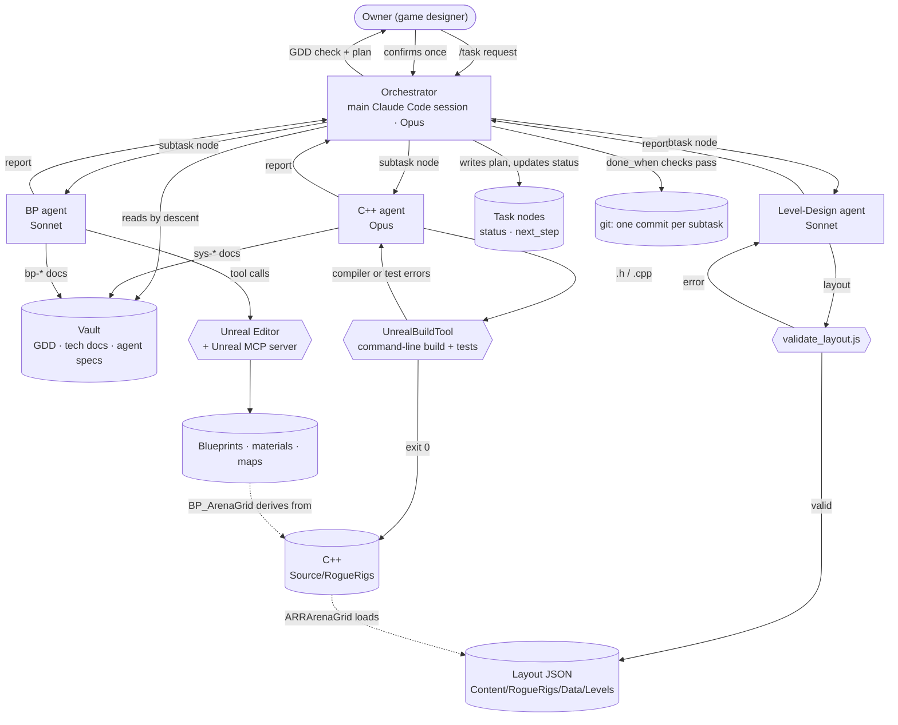

# Rogue Rigs — a four-agent dev crew for an Unreal Engine game

**Game:** *Rogue Rigs*, a top-down roguelite auto-shooter built in Unreal Engine 5.8 (C++ first). An independent miner steals ore from a corporate asteroid claim guarded by security robots; the destructible rock arena is the player's best weapon. Capstone project of the ELVTR course *Multi-Agent AI for Game Development* (instructor: Joshua Burdick).

**What the crew produces:** playable game content for Rogue Rigs, from a plain-language request. One request becomes a GDD-checked plan, then real project files: arena layouts (JSON), C++ gameplay systems, Blueprints and maps in the editor, automation tests, and up-to-date documentation in the project vault.

No AI runs inside the game. The agents are development tools only.

## Architecture

Agents never talk to each other. Every hand-off goes through files: the Orchestrator writes a subtask node, the agent reads it and writes its output plus a report, and the Orchestrator checks the result before moving on.

## The crew

| Agent | Model | Input | Output | Without it |
|---|---|---|---|---|
| **Orchestrator** | Opus | the owner's request; GDD and tech nodes | a global task and its subtasks in `vault/reference/tasks/`; status; commits | nobody checks requests against the GDD, splits work, sequences the editor, or records progress |
| **Level-Design** | Sonnet | a subtask with a layout brief; layout schema; terrain specs | `Content/RogueRigs/Data/Levels/<name>.json` that passes the validator | no arena: the grid has nothing to build |
| **C++** | Opus | a subtask; C++ standard; GDD and system docs; engine source | C++ under `Source/RogueRigs/<System>/`, built from the command line; automation tests; system docs | no gameplay code: no grid, player, GAS, weapons or tests |
| **BP** | Sonnet | a subtask; Unreal MCP doc; system docs | Blueprints derived from C++, material instances, maps, placed actors; one doc node per Blueprint | C++ classes never reach a playable map |

Agent definitions: `.claude/agents/*.md` (Claude Code subagents: model, tools, turn limit) point to their specs in `vault/reference/agents/`, the single source of truth any AI tool can read.

## How a request runs

The owner types `/task <request>` in a Claude Code session opened on this repo (`.claude/commands/task.md`). The Orchestrator follows `vault/reference/agents/orchestration-protocol.md`:

0. **Resume.** Report any global task still in progress and continue from its `next_step`. Status lives in files, so another session or account can pick up after a usage limit.
1. **Restate** the request as a goal with observable acceptance checks.
2. **GDD check.** Report conflicts with the design, values still marked `open`, and scope outside the milestone; stop for the owner's decision.
3. **Plan.** Atomic subtasks: one agent, one output, explicit `depends_on`, `done_when` and editor state (C++ builds with the editor closed, BP work with it open).
4. **Confirm.** The owner confirms the global task once.
5. **Execute** one subtask at a time: delegate, run the `done_when` checks, commit. A failed check goes back to the same agent once; a second failure marks the subtask `blocked`.
6. **Close.** Global acceptance checks, then report.

## Shared memory: the vault

`vault/` holds the game design (split into one-concept nodes), technical docs, agent specs and tasks. Agents read it by descending from `vault/root.md` through indexes, never by searching, so each one loads only what its subtask needs. `vault/scripts/lint.js` enforces structure (links, parents, statuses) and runs as a git pre-commit hook.

## Guardrails that do not rely on the prompt

| Check | Catches |
|---|---|
| `Tools/validate_layout.js` | malformed layouts, wrong cell types, blocked spawn, out-of-brief coverage, before they reach the engine |
| Command-line build (exit code) | C++ that does not compile |
| Unreal automation tests (`Source/RogueRigs/Tests/`) | gameplay regressions (digging, weapons) that MCP cannot drive in play mode |
| Vault lint (pre-commit) | broken links, orphan nodes, invalid statuses |

## Run log

Eight requests have gone through the crew so far (full records in `vault/reference/tasks/`):

| Task | Request | Result |
|---|---|---|
| 001 | Create the M1 arena | 60 × 60 asteroid-shaped grey-box arena built from JSON by a C++ grid actor; about 300k tokens |
| 002 | Clean up the template project | TopDown and Strategy content removed; startup map set; about 340k tokens |
| 003 | Paths walled by rock, 80 × 80 | organic path network, 7 hidden pockets, 59 % rock, 12 heal ore; project renamed; about 140k tokens |
| 004 | Rebuild the miner with GAS | `ARRMiner` with an ability system and CSV-initialised attributes; move speed driven by GAS; about 255k tokens |
| 005 | Drone orbiting the miner | separate drone actor with Orbit / Dig / Hack states; about 92k tokens |
| 006 | Digging | block destruction, drone laser, block shake, ore and heal pickups; 6 automation tests; about 490k tokens |
| 007 | Burst rifle and target dummy | auto-fire bursts, GAS damage with criticals, floating damage numbers, dummy that refills |
| 008 | Feel fixes from playtest | shot height, free movement while firing, burst pause, readable numbers; 14/14 tests pass; about 300k tokens |

## Lessons so far

- **Token ceilings were too low.** C++ subtasks used 69k–100k tokens against an 80k ceiling; ceilings will be reset at the M1 retrospective.
- **MCP cannot drive play-mode input**, so behaviour is verified by C++ automation tests written by the C++ agent, and the owner confirms the feel in play.
- **Editor sequencing matters.** C++ builds need the editor closed; MCP needs it open. The Orchestrator plans this per subtask.
- **Small subtasks pay off.** When a session hit a limit, the next one resumed from `next_step` without re-planning.

## Run it

Requirements: Unreal Engine 5.8, Visual Studio 2026 (MSVC 14.50), the Claude desktop app (Code tab), and the Unreal MCP + All Toolsets plugins (enabled in `RogueRigs.uproject`).

1. Open the editor and start the MCP server (Editor Preferences → Model Context Protocol → Auto Start Server).
2. In the Claude app, open a **Local** Code session whose folder is this repository.
3. Type `/task` followed by what you want, for example: `/task Add a stationary enemy that shoots at the miner`.

## Repository map

| Path | Content |
|---|---|
| `.claude/agents/`, `.claude/commands/task.md` | the crew: subagent definitions and the entry command |
| `vault/reference/agents/` | agent specs and the orchestration protocol |
| `vault/reference/gdd/` | the game design document, one node per concept |
| `vault/reference/tech/`, `vault/reference/tasks/` | technical docs; every task the crew has run |
| `Tools/` | layout validator and reference layout generator |
| `Source/RogueRigs/`, `Content/RogueRigs/` | the game code and assets the crew produced |
