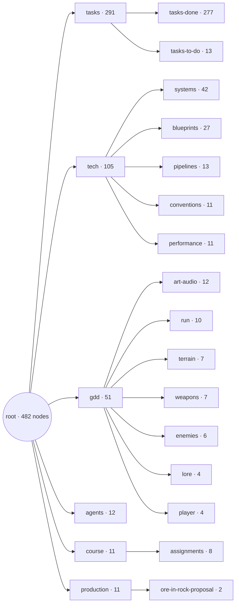
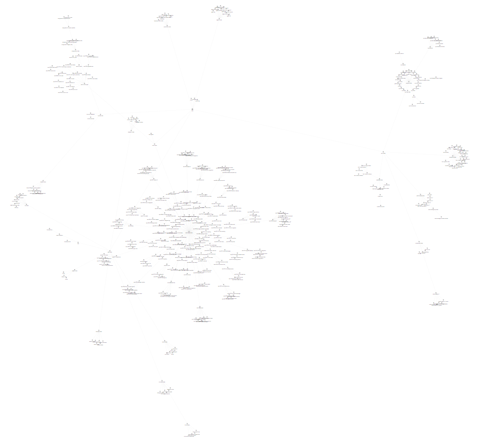
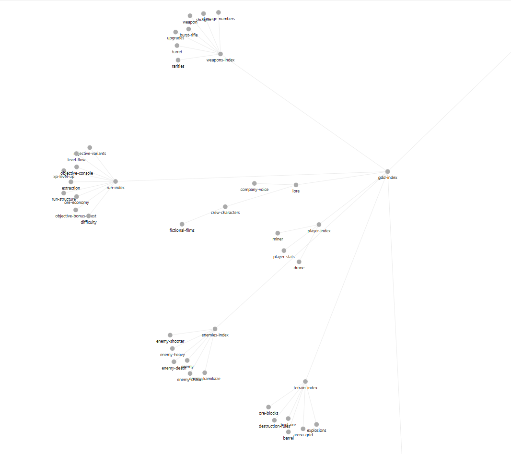
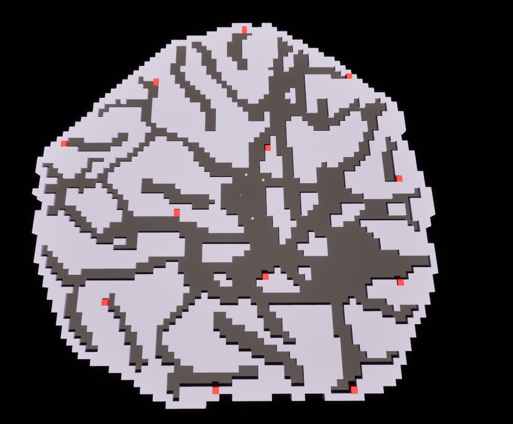
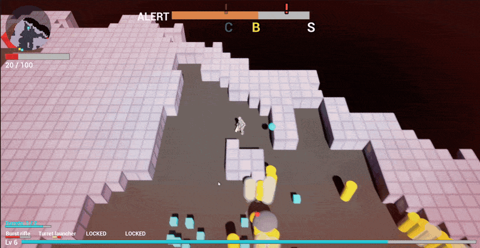
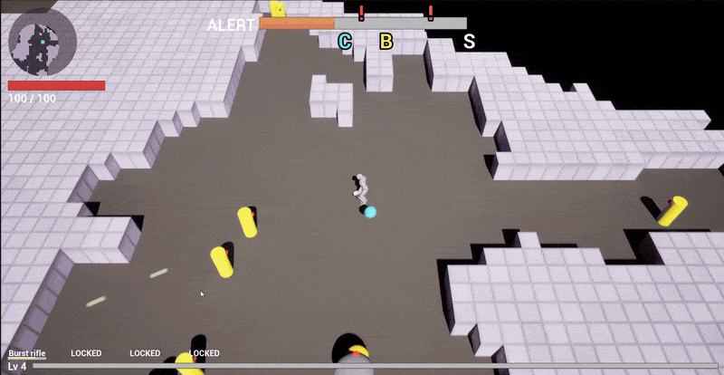
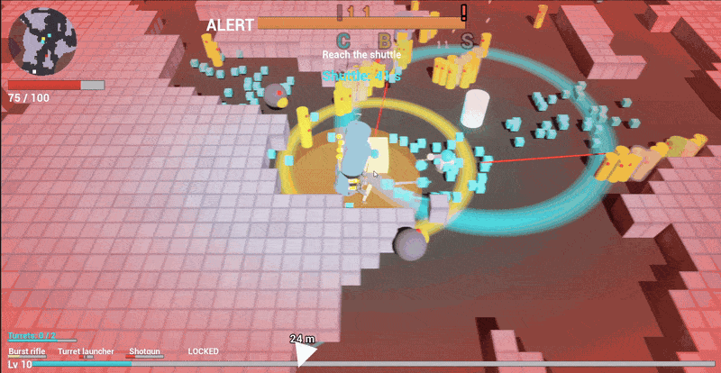
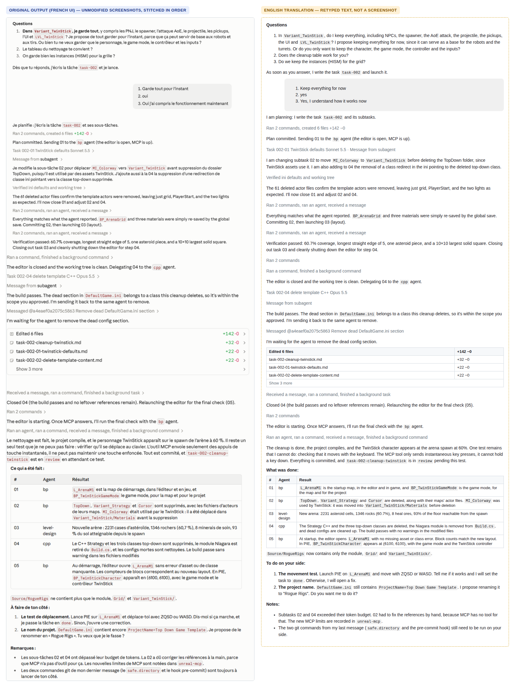
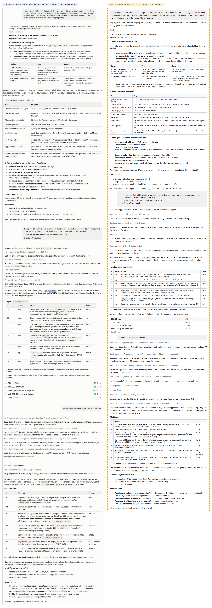

# Rogue Rigs — an AI agent dev crew for an Unreal Engine game

## Course assignments

| # | Assignment | Folder | Status |
|---|---|---|---|
| 1 | GDD First Draft | [A1-gdd-first-draft](assignments/A1-gdd-first-draft/) | Submitted |
| 2 | GDD Final Draft | [A2-gdd-final-draft](assignments/A2-gdd-final-draft/) | Submitted |
| 3 | Building an Agent Crew | [A3-agent-crew](assignments/A3-agent-crew/) | Submitted (commit `b119b86`, tag [`a3-submission`](https://github.com/soumois/RogueRigs/tree/a3-submission)) |
| 4 | Dynamic Content Pipeline | [A4-dynamic-content-pipeline](assignments/A4-dynamic-content-pipeline/) | Submitted (commit `0790c65`, tag [`a4-submission`](https://github.com/soumois/RogueRigs/tree/a4-submission)) |

All assignments: [assignments/](assignments/).

## Project vault

[`vault/`](vault/) is the single source of truth of the project: the game design, technical docs, agent specs and every task the crew has run (482 nodes). Start at [`vault/root.md`](vault/root.md).

<!-- vault-map:start -->

<!-- vault-map:end -->

The map above is generated from each node's `parent` field: `node vault/scripts/vault-map.js` (it also refreshes the counts below).

| Branch | Nodes | Holds |
|---|---|---|
| [`gdd`](vault/reference/gdd/) | 51 | what the game is: pillars, lore, characters, weapons, enemies, terrain, art, audio, dialogue tone |
| [`tech`](vault/reference/tech/) | 105 | how it is built: conventions, C++ systems, Blueprint docs, pipelines |
| [`agents`](vault/reference/agents/) | 12 | the dev crew: one spec per agent, the orchestration protocol |
| [`tasks`](vault/reference/tasks/) | 291 | open tasks in [`tasks-to-do-index`](vault/reference/tasks/tasks-to-do-index.md), finished ones archived in [`tasks-done-index`](vault/reference/tasks/tasks-done-index.md) |
| [`production`](vault/reference/production/) | 11 | milestones, scope, wishlist, cost log, handovers |
| [`course`](vault/reference/course/) | 11 | course frame, assignments with briefs, rubrics, deadlines and plans |

Reading and writing rules: [`_navigation.md`](vault/_navigation.md) (descend from the root, never search) and [`_authoring.md`](vault/_authoring.md) (frontmatter, one concept per node, lint). The visual references and their prompts are in [`vault/assets/`](vault/assets/) and [`art-prompts`](vault/reference/gdd/art-audio/art-prompts.md).

**Browse it in Obsidian:** open the `vault/` folder as a vault. The **Parent Graph** plugin ships with it (`vault/.obsidian/plugins/parent-graph`): enable community plugins, then click the fork icon in the ribbon to see the tree drawn from each node's `parent` field.

| The whole vault (Parent Graph view) | Zoom on the game design branch |
|---|---|
| [](docs/images/vault-overview.png) | [](docs/images/vault-gdd-zoom.png) |


**Game:** *Rogue Rigs*, a top-down roguelite auto-shooter built in Unreal Engine 5.8 (C++ first). An independent miner steals ore from a corporate asteroid claim guarded by security robots; the destructible rock arena is the player's best weapon. Capstone project of the ELVTR course *Multi-Agent AI for Game Development* (instructor: Joshua Burdick).

**What the crew produces:** playable game content for Rogue Rigs, from a plain-language request. One request becomes a GDD-checked plan, then real project files: arena layouts (JSON), C++ gameplay systems, Blueprints and maps in the editor, automation tests, and up-to-date documentation in the project vault.

No AI runs inside the game. The agents are development tools only.

## What the crew built

All of this was produced by crew requests (see the run log below) and is played in the Unreal editor (PIE).

**The game today (milestone M2, task 031).**
- **Arena:** 240 × 240 cells of 67 uu, converted from the 80 × 80 M1 layout with irregular rock edges and passages at least 3 cells wide. The grid renders in chunks, and the flow field updates incrementally when blocks are destroyed.
- **Mining:** touching a wall is enough. The drone cuts up to 4 blocks in a 120° arc, with one laser beam per block. Explosions carve round holes.
- **Weapons:** burst rifle with piercing, shotgun firing pellets, and a turret launcher placed with a button. New weapons come as level-up cards.
- **Robots:** chaser, shield chaser, kamikaze with a flare before exploding, shooter that never retreats, and a heavy with a 400 uu ground slam.
- **Wave director:** robots from the first second, packs from several sides, spawns biased toward where the player runs, two announced hordes, a shooter cap, at most 150 alive.
- **Run loop:** XP cubes that pop out and stream to the miner, level-up with 3 cards and a reroll, upgrades with rarities, command console hack and shuttle extraction, and a pacing bot that tunes the XP curve.
- **Feedback:** pooled Niagara damage numbers (gold crits, stacking), red damage vignette, horde banner, alert bar with event icons, and an optional light halo.
- **Tests:** 185 automation tests run headless. Stress tests hold 400 robots under 16.6 ms per frame on the dev PC.

The arena image dates from milestone M1 (80 × 80 arena, 200 uu cells). The three animations come from one full run recorded on 2026-10-10 in a standalone game window: 240 × 240 grid of 67 uu cells, level 1 to level 10, ending in an extraction. More captures of the features added since Assignment 3 are in the [Assignment 4 README](assignments/A4-dynamic-content-pipeline/README.md#game-features-added-since-assignment-3).

**The arena.** An 80 × 80 asteroid generated by the `level-design` agent as JSON, validated by `Tools/validate_layout.js`, then built by the C++ grid actor. Light cells are rock, dark cells are the paths the miner starts in, red cubes are heal ore (tasks 001, 003).



**Digging a tunnel, and the robots take it.** At 20 HP (red vignette) the miner cuts a corridor through the small 67 uu rock cells. The drone's laser fan cuts several blocks at once, up to 8 and about two rows deep. The horde follows through the new opening as soon as it exists: the flow field is rebuilt on a worker thread, so robots take a new path within 1–2 frames (tasks 029, 060, 065, 066).



**A pack, damage numbers, XP and a level-up.** Robots arrive from several sides. The burst rifle shows one damage number per hit, and the first hit taken flashes the red vignette (100 → 90 HP). Destroyed robots drop XP cubes that pop out and stream to the miner with a Niagara trail, up to LEVEL UP. On the HUD: the round minimap at the top left, the alert bar with its console (C), chest (B) and shuttle (S) icons, the weapon slots and the console locator arrow in metres at the bottom (tasks 040, 054, 055, 058, 059, 061, 062).



**Horde, escape, extraction.** The shuttle is called when a horde lands and the health bar drops from 75 to 10. The miner digs his way out, follows the locator arrow and the chevrons to the shuttle (it lands 37 to 50 cells away) and boards it: extraction successful (tasks 040, 049).



## Architecture


Agents never talk to each other. Every hand-off goes through files: the Orchestrator writes a subtask node, the agent reads it and writes its output plus a report, and the Orchestrator checks the result before moving on.

## The crew

| Agent | Model | Input | Output | Without it |
|---|---|---|---|---|
| **Orchestrator** | Opus | the owner's request; GDD and tech nodes | a global task and its subtasks in `vault/reference/tasks/`; status; commits | nobody checks requests against the GDD, splits work, sequences the editor, or records progress |
| **Level-Design** | Sonnet | a subtask with a layout brief; layout schema; terrain specs | `Content/RogueRigs/Data/Levels/<name>.json` that passes the validator | no arena: the grid has nothing to build |
| **C++** | Opus | a subtask; C++ standard; GDD and system docs; engine source | C++ under `Source/RogueRigs/<System>/`, built from the command line; automation tests; system docs | no gameplay code: no grid, player, GAS, weapons or tests |
| **BP** | Sonnet | a subtask; Unreal MCP doc; system docs | Blueprints derived from C++, material instances, maps, placed actors; one doc node per Blueprint | C++ classes never reach a playable map |
| **Text** | Sonnet | a subtask; lore, characters, fictional films, company voice, dialogue tone; the mechanic node it writes for | upgrade texts, barks and alert lines in `Content/RogueRigs/Data/Text/`; a retrieval log (query, excerpt, output) | player-facing text sounds generic or breaks the lore |
| **Style-guide** (critic) | Opus | the generated output only, never the generator's prompt; numbered rules L1–L4 and T1–T9 | a verdict per item: pass or fail, rule id, reason, corrected line | lore breaks and tone drift reach the game unnoticed |
| *Art (planned)* | Sonnet | an asset need; art style guide, art prompts, color code, the entity spec | image prompts and candidate images (GPT image model through Kie.ai), self-reviewed against the style guide | every new asset needs a hand-written prompt and a manual style check |
| *3D (planned)* | Sonnet | an owner-validated image; asset pipeline | a cleaned, split FBX through Meshy or Tripo and Blender MCP, ready for the BP agent to import | images never become game meshes without hours of manual work |

Art and 3D are specified but not built yet. Agent definitions: `.claude/agents/*.md` (Claude Code subagents: model, tools, turn limit) point to their specs in `vault/reference/agents/`, the single source of truth any AI tool can read.

## Content pipeline: player-facing text

Two agents of the crew produce the game's text, from the same vault lore that describes the game.

- **`text` agent** (Sonnet, [`.claude/agents/text.md`](.claude/agents/text.md)): reads the lore, crew, company-voice and dialogue-tone nodes and writes Rook's upgrade card lines, Rook and Vesna barks and Kessler-Voss alert lines to `Content/RogueRigs/Data/Text/`. For each line it logs the query, the nodes read and the verbatim excerpt used (`Tools/content/logs/`).
- **`style-guide` agent** (Opus, [`.claude/agents/style-guide.md`](.claude/agents/style-guide.md)): the critic. It sees the output only and returns pass or fail per line with a rule id (L1-L4, T1-T9), a reason and a corrected line. At most 2 correction loops, then the owner rules.
- **Validator** `Tools/content/validate_text.js`: schema, word counts, ids, verbatim excerpts and the correction loop, checked without a model.

```
node Tools/content/validate_text.js <content file> --log <log file> [--review <review file>]
node Tools/content/validate_text.js --selftest
```

A C++ loader (`Source/RogueRigs/Text/`) reads the files at runtime; no AI runs in the game. Retrieval tables, critic corrections and the full run commands: [assignments/A4-dynamic-content-pipeline/](assignments/A4-dynamic-content-pipeline/).

## How a request runs

The owner types `/task <request>` in a Claude Code session opened on this repo (`.claude/commands/task.md`). The Orchestrator follows `vault/reference/agents/orchestration-protocol.md`:

0. **Resume.** Report any global task still in progress and continue from its `next_step`. Status lives in files, so another session or account can pick up after a usage limit.
1. **Restate** the request as a goal with observable acceptance checks.
2. **GDD check.** Report conflicts with the design, values still marked `open`, and scope outside the milestone; stop for the owner's decision.
3. **Plan.** Atomic subtasks: one agent, one output, explicit `depends_on`, `done_when` and editor state (C++ builds with the editor closed, BP work with it open).
4. **Confirm.** The owner confirms the global task once.
5. **Execute** one subtask at a time: delegate, run the `done_when` checks, record the cost, commit. A failed check goes back to the same agent once; a second failure marks the subtask `blocked`.
6. **Close.** Global acceptance checks, then report.

In practice the owner often launches several global tasks at once and lets the Orchestrator set **provisional** values. Each one is written in the GDD as `provisional` and reported for confirmation at the end. Any stress test result is reported to the owner as soon as it is measured, before the rest of the report. Owner play tests then feed new global tasks (030 and 031 came from two play sessions).

The Orchestrator's tooling lives in `vault/scripts/`:

| Script | Use |
|---|---|
| `task-status.js` | set a task node's status, `next_step` or `result`; keeps `tasks-index` in sync |
| `agent-usage.js`, `record-cost.js` | read this machine's Claude Code transcripts and add the subtask's tokens to `cost-log` |
| `crew-board.js` | render `Saved/CrewBoard/crew-board.html`, a dashboard of agents, queue and costs, published as an artifact for the owner |
| `lint.js` | check the vault and regenerate `_paths.md` |
| `vault-map.js` | regenerate the vault map and node counts in this README |

How-to and pitfalls for whoever takes over the Orchestrator role are in `vault/reference/agents/orchestrator-runbook.md` and `orchestrator-lessons.md`.

## Shared memory: the vault

`vault/` holds the game design (split into one-concept nodes), technical docs, agent specs and tasks; branch overview in [Project vault](#project-vault) above. Agents read it by descending from `vault/root.md` through indexes, never by searching, so each one loads only what its subtask needs. `vault/scripts/lint.js` enforces structure (links, parents, statuses). It runs as a git pre-commit hook once `git config core.hooksPath vault/scripts/hooks` is set; otherwise every vault edit is followed by `node vault/scripts/lint.js --write`.

## Guardrails that do not rely on the prompt

| Check | Catches |
|---|---|
| `Tools/validate_layout.js` | malformed layouts, wrong cell types, blocked spawn, out-of-brief coverage, before they reach the engine |
| Command-line build (exit code) | C++ that does not compile |
| Unreal automation tests (`Source/RogueRigs/Tests/`, 185 tests) | gameplay regressions that MCP cannot drive in play mode; integration tests load the real map and Blueprints and tick the HUD widgets headless |
| Stress runs in `-game` (`rr.Stress.*`, `Run-StressTest.ps1`) | frame-time budget: 16.6 ms average and 25 ms p99, up to 400 robots, explosion chains, fast digging |
| Pacing bot (`rr.Pacing.Run`) | level-up times against the design targets, over several seeds |
| `-game` screenshots (`rr.Debug.Shots`) read back by the C++ agent | visual defects that no test sees (blown-out lights, unreadable numbers, overlapping HUD) |
| Vault lint | broken links, orphan nodes, invalid statuses |

## Run log

Sixty-six requests (tasks 001 to 066) have gone through the crew so far, and four more are queued (full records in `vault/reference/tasks/`). From task 013 on, every subtask's tokens are recorded in `vault/reference/production/cost-log.md`. Uncached input is close to zero; the totals below give cache write, cache read and output.

| Task | Request | Result |
|---|---|---|
| 001 | Create the M1 arena | 60 × 60 asteroid-shaped grey-box arena built from JSON by a C++ grid actor; about 300k tokens |
| 002 | Clean up the template project | TopDown and Strategy content removed; startup map set; about 340k tokens |
| 003 | Paths walled by rock, 80 × 80 | organic path network, 7 hidden pockets, 59 % rock, 12 heal ore; project renamed; about 140k tokens |
| 004 | Rebuild the miner with GAS | `ARRMiner` with an ability system and CSV-initialised attributes; move speed driven by GAS; about 255k tokens |
| 005 | Drone orbiting the miner | separate drone actor with Orbit / Dig / Hack states; about 92k tokens |
| 006 | Digging | block destruction, drone laser, block shake, ore and heal pickups; 6 automation tests; about 490k tokens |
| 007 | Burst rifle and target dummy | auto-fire bursts, GAS damage with criticals, floating damage numbers, dummy that refills |
| 008 | Feel fixes from playtest | shot height, free movement while firing, burst pause, readable numbers; 14/14 tests pass; about 300k tokens |
| 009 | Chaser robot | player damage, 0.25 s i-frames, single death and game over; grid flow field behind a swappable path provider; enemy base class, chaser state machine, spawner, HUD; 35/35 tests; 50 chasers at 2.5 ms per tick; about 720k tokens |
| 010 | Damage numbers for the assignment video | quick damage numbers above every enemy |
| 011 | Explosions | barrel and kamikaze explosions, chain reactions, feel tweaks, tests |
| 012 | XP and level | tougher kamikaze, slower chasers, render-only shake, XP and level-up |
| 013 | Stress test | `-game` baseline from 50 to 400 robots, then the final M1 runs; cache write 225k, read 6.6M, output 96k |
| 014 | Upgrades and level-up | spawn packs, stat upgrades with rarities, level-up heal, pause, 3 cards, reroll; write 801k, read 36.3M, output 310k |
| 015 | Shotgun | conical wave with knockback; write 317k, read 12.9M, output 103k |
| 016 | Console and extraction | alert bar, command console hack, shuttle extraction, end screens; write 742k, read 32.1M, output 277k |
| 017 | Kamikaze radius | explosion radius 250 → 312 uu |
| 018 | Robot count optimization | trace, crowd collision, light movement, hitch fix; write 528k, read 11.5M, output 144k |
| 019 | Packaging fix | asset manager config so BuildCookRun exits 0 |
| 020 | Code review | readability and generalization refactor, Blueprint check; write 572k, read 19.5M, output 156k |
| 021 | Shooter robot | distance keeping, line of sight, repositioning, laser, shots; write 444k, read 15.0M, output 151k |
| 022 | Heavy robot | telegraphed ground slam, knockback resistance; write 618k, read 15.6M, output 133k |
| 023 | Grid cell size | stress test of 100 uu and 67 uu cells before choosing the grid size |
| 024 | Weapons rework | rifle pierce, shotgun pellets, turret on a button, weapons as level-up cards; write 1.2M, read 54.4M, output 438k |
| 025 | Damage numbers | pooled Niagara numbers, merging, bigger crits; write 876k, read 35.0M, output 304k |
| 029 | Fine grid | 67 uu cells (240 × 240), chunked rendering, incremental time-sliced flow field, arc mining by contact, laser fan; final stress within budget; write 1.7M, read 48.4M, output 404k |
| 026 | Pressure | landing clearance, wave director with announced hordes, damage vignette, horde banner, alert icons, light halo cheat; write 904k, read 25.6M, output 305k |
| 027 | Juice | XP cubes pop and stream, kamikaze flare, sparkle, heal ring, console ring, chevrons, damage number stacking; write 560k, read 26.6M, output 214k |
| 028 | Balance | 400 uu heavy slam, shield chaser, doubled upgrades, XP curve tuned by a pacing bot; write 730k, read 21.7M, output 166k |
| 030 | First play test | enemies from 1 s, slower ramp, shooters blended and capped at 6, heavies half as often, robots 20 % slower, shorter shooter range, XP retune; write 672k, read 11.3M, output 104k |
| 031 | Second play test | target dummy removed, closer spawns biased toward the run heading, robots 30 % slower, shooters never retreat, faster early levels; write 1.3M, read 24.1M, output 199k |
| 032 | Third play test | robot recycling, console locator, overtime, faster heavy, English texts, upgrade draw weights, weapon cards every 5 levels, bigger turret; write 852k, read 26.6M, output 171k |
| 033 | Robot speed and tests | every robot at 180 uu/s; tests updated to the owner's data changes; write 77k, read 1.8M, output 22k |
| 034 | Fourth play test | projectile hitbox, whole-vein mining, heal pickup, small terrain capsules, softer early waves, crowd mix; write 397k, read 13.6M, output 111k |
| 035 | Heal amount | a heal vein restores 60 HP; write 40k, read 0.5M, output 6k |
| 036 | Robot relocation | robots left behind are moved back ahead instead of removed; write 147k, read 4.9M, output 49k |
| 037 | Ammo HUD | ammo under each weapon slot, reload and turret recharge bars, padlocks; write 155k, read 3.5M, output 45k |
| 038 | Shooter detour | a shooter without line of sight walks around rock until it can fire; write 109k, read 3.1M, output 30k |
| 039 | Heavy slam radius | 400 → 340 uu, ground ring follows; write 26k, read 0.3M, output 7k |
| 040 | Locator arrow | pulsing console arrow with the distance in metres; write 151k, read 5.6M, output 40k |
| 041 | Front-sector spawns | robots spawn beyond the rock the miner digs toward; write 34k, read 0.6M, output 8k |
| 042 | Hack time | console hack 20 → 16 s; write 22k, read 0.2M, output 5k |
| 043 | Vein shake | every block of a vein being mined shakes together; write 34k, read 0.5M, output 10k |
| 044 | Fewer kamikazes | at most one per pack in one pack out of two, 1–2 per horde; write 47k, read 1.0M, output 14k |
| 045 | Easier first level | about 15 % fewer robots, rarer heavies, heavy cap 3; write 203k, read 2.1M, output 23k |
| 046 | Level 1 pressure | 80 robots alive at most, waves at least 120° apart; write 229k, read 1.0M, output 28k |
| 047 | Heavy speed | 180 → 153 uu/s; write 40k, read 0.2M, output 4k |
| 048 | Last-level profile | current wave director values saved as a data profile; write 33k, read 0.2M, output 5k |
| 049 | Shuttle distance | the shuttle lands 37 to 50 cells from the miner; write 51k, read 0.8M, output 13k |
| 050 | Flaky test | damage-number stacking test made reliable by fixing its cause; write 54k, read 1.0M, output 14k |
| 051 | Turret spacing | turrets kept at least 100 uu apart; write 50k, read 0.6M, output 10k |
| 052 | Heavy slam radius | 340 → 289 uu; write 34k, read 0.4M, output 7k |
| 053 | Weapon slot info | name, ammo and reload centred under each slot; write 56k, read 1.2M, output 16k |
| 054 | Niagara trail and sparkle | XP cube trail and pickup sparkle rebuilt in Niagara; write 190k, read 3.2M, output 42k |
| 055 | First-hit vignette | red vignette on the very first hit, packaged build included; write 348k, read 4.6M, output 49k |
| 056 | Bonus chest | one per level at 60 % alert, 8 s hack, XP, ore and a lucky upgrade choice; write 214k, read 8.0M, output 70k |
| 057 | Flaky test | XP pickup test made reliable by fixing its cause; write 77k, read 0.6M, output 10k |
| 058 | XP trail visible | the Niagara XP trail shows in game; write 47k, read 0.7M, output 11k |
| 059 | Damage numbers | one number per hit, no merging, random start on a small disc; write 213k, read 2.8M, output 38k |
| 060 | Deep mining | drone arc reaches 2.5 cells and cuts up to 8 blocks at once; write 153k, read 1.2M, output 19k |
| 061 | Minimap | round minimap of seen cells, markers for miner, console, chest and shuttle; write 235k, read 5.0M, output 70k |
| 062 | Alert bar ×2 | alert bar twice as wide and tall, icons rescaled; write 81k, read 1.0M, output 16k |
| 063 | Performance session | `-game` stress at 67 uu cells and flow-field budget tests on a quiet PC; write 232k, read 1.5M, output 20k |
| 064 | Minimap reveal | reveal circle of 18 cells around the miner; write 76k, read 0.5M, output 9k |
| 065 | Diagonal dig | moving into a corner of two blocks still digs; write 82k, read 0.5M, output 14k |
| 066 | Async flow field | flow field rebuilt on a worker thread with a double buffer; robots follow a new path within 1–2 frames; write 371k, read 4.7M, output 63k |
| 067–070 | Queued | stress scenario close to a real game, Unreal Insights capture in a packaged build, minimum PC spec, ore nuggets inside rock |

## Evidence: two real runs

Both captures are unmodified output of the Orchestrator session (the Claude app was set to French). Left: the original screenshots, stitched in order. Right: an English translation, retyped, not a screenshot.

**Task 002, cleanup.** The Orchestrator asks its GDD-check questions, waits for answers, plans, delegates to `bp`, `level-design` and `cpp` in turn, sends a subtask back to the same agent when a check fails, and closes with a per-agent report.



**Task 009, chaser robot.** The owner asks for NavMesh movement; the GDD check finds a conflict with the grid flow field chosen earlier, lays out both options and proposes values for every `open` field. After one confirmation, seven subtasks run back to back (six `cpp`, one `bp`), each followed by a build and the full test suite. The Orchestrator also finds and removes a stale git lock by itself.



## Lessons so far

- **Token ceilings were too low.** C++ subtasks used 69k–100k tokens against an 80k ceiling; ceilings will be reset at the M1 retrospective.
- **MCP cannot drive play-mode input**, so behaviour is verified by C++ automation tests written by the C++ agent, and the owner confirms the feel in play.
- **Editor sequencing matters.** C++ builds need the editor closed; MCP needs it open. The Orchestrator plans this per subtask.
- **Small subtasks pay off.** When a session hit a limit, the next one resumed from `next_step` without re-planning. The same files let a second Claude account take over mid-task (`handover-2026-10-06`).
- **Turn limits are routine.** The BP agent (40 turns) and the C++ agent (60 turns) often stop mid-subtask. The Orchestrator resumes the same agent with "commit what works first", and a BP step that fails twice through MCP is listed as not done instead of retried.
- **Nobody sees the screen.** Visual checks come from `-game` screenshots that the C++ agent opens and describes. They caught a blown-out kamikaze light, unreadable damage numbers and an overlapping HUD line. Defects that need the editor are carried into the next BP subtask.
- **Measure in a quiet machine.** A game running in the background doubled frame times once. Pacing uses the game clock, so it stays valid when performance numbers do not.
- **Cache reads dominate cost.** A long C++ subtask re-reads its context every turn, so 5–11M cache-read tokens per subtask is normal. Splitting work and resuming cleanly matters more than prompt length.

## Run it

Requirements: Unreal Engine 5.8, Visual Studio 2026 (MSVC 14.50), the Claude desktop app (Code tab), and the Unreal MCP + All Toolsets plugins (enabled in `RogueRigs.uproject`).

1. Open the editor and start the MCP server (Editor Preferences → Model Context Protocol → Auto Start Server).
2. In the Claude app, open a **Local** Code session whose folder is this repository.
3. Type `/task` followed by what you want, for example: `/task Add a stationary enemy that shoots at the miner`.

## Repository map

| Path | Content |
|---|---|
| `.claude/agents/`, `.claude/commands/task.md` | the crew: subagent definitions and the entry command |
| `vault/reference/agents/` | agent specs and the orchestration protocol |
| `vault/reference/gdd/` | the game design document, one node per concept |
| `vault/reference/tech/`, `vault/reference/tasks/` | technical docs; every task the crew has run |
| `vault/reference/production/` | milestones, wishlist, cost log, handover notes |
| `vault/scripts/` | vault lint and the Orchestrator's task, cost and dashboard scripts |
| `Tools/` | layout validator and reference layout generator |
| `Source/RogueRigs/`, `Content/RogueRigs/` | the game code and assets the crew produced |
