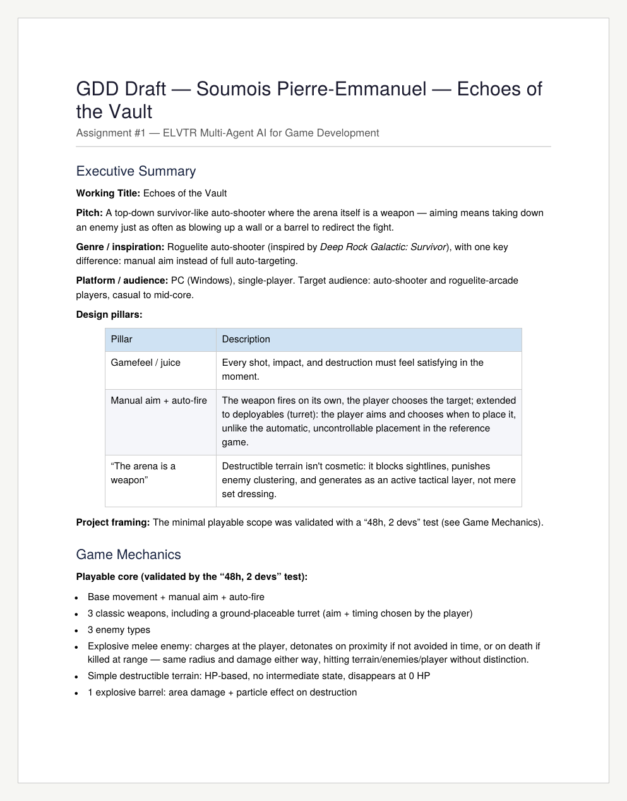

# Assignment 1 — GDD First Draft

**ELVTR · Multi-Agent AI for Game Development** · Soumois Pierre-Emmanuel

> Working title at the time: **Echoes of the Vault**. The game became **Rogue Rigs** in the final draft ([Assignment 2](../A2-gdd-final-draft/)).

📄 **[Read the first draft (PDF)](Echoes_of_the_Vault_GDD_Draft.pdf)**

## The idea in one line

A top-down survivor-like auto-shooter where **the arena itself is a weapon**: aiming means taking down an enemy just as often as blowing up a wall or a barrel to redirect the fight.

## What the draft set down

| Section | Content |
|---|---|
| Executive summary | Roguelite auto-shooter inspired by *Deep Rock Galactic: Survivor*, with one key difference: manual aim instead of full auto-targeting. PC, single-player, casual to mid-core. |
| Design pillars | **Gamefeel / juice** · **Manual aim + auto-fire** · **The arena is a weapon** |
| Playable core | Scope validated with a "48 h, 2 devs" test: movement, manual aim, auto-fire, 3 weapons including a placeable turret, 3 enemy types, HP-based destructible terrain, an explosive barrel, in-run upgrades only. |
| Level structure | A progress bar driven by time and kills, events (waves, chests), a hold-the-zone objective, then a risk/reward exit window. |
| AI architecture | AI is a **development-time tool only**. One Orchestrator delegates to specialized agents: C++, Blueprint, Level-Design, Balance and Text/content. |
| Technical strategy | Unreal Engine 5, logic in C++, Blueprints as a thin layer, per-run logs for the balance agent, token budget estimated task by task. |

## Instructor feedback

> "You may need additional agents as you get to the polish phases for animation and sound."

It was addressed in the final draft: animation, sound, art and style-guide agents were added, and every agent now states its output format.

## Next

➡️ [Assignment 2 — GDD Final Draft](../A2-gdd-final-draft/) · [All assignments](../)
