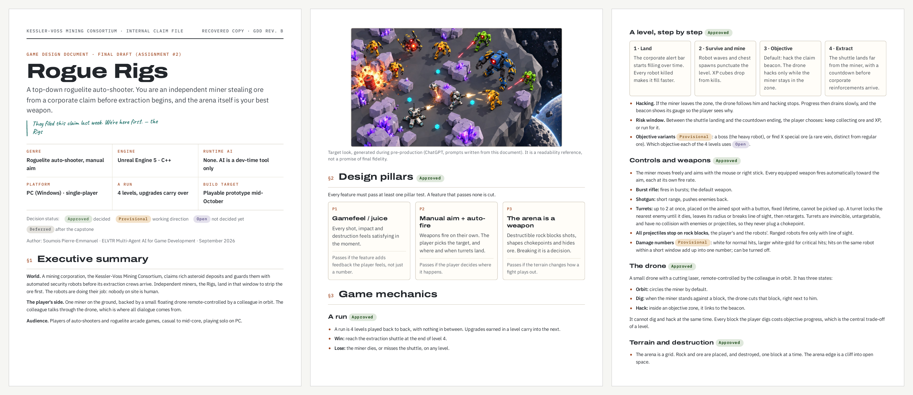
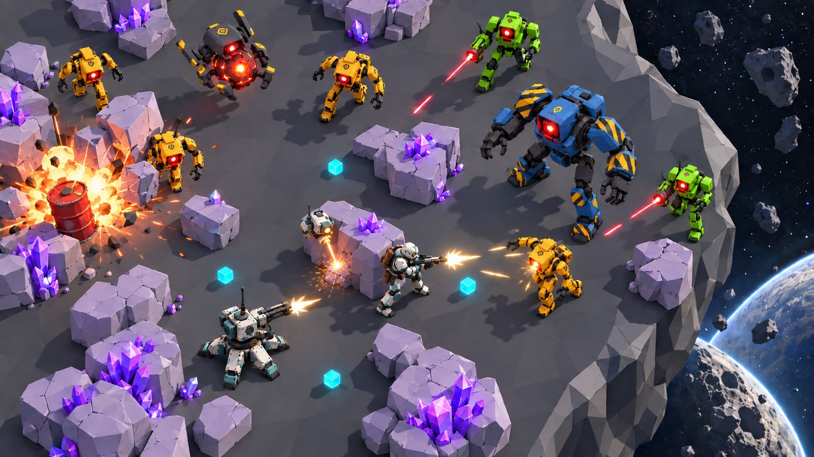
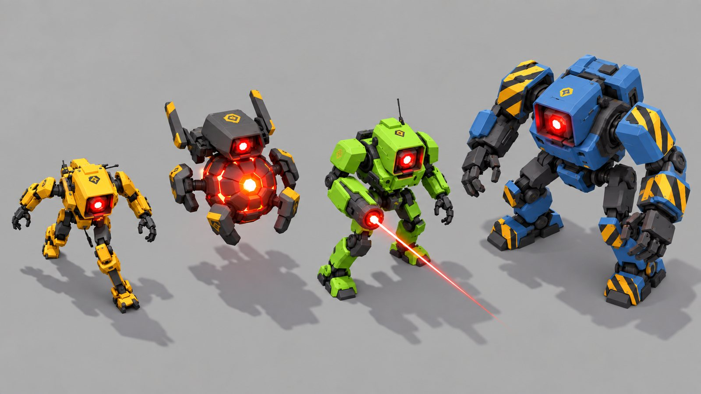
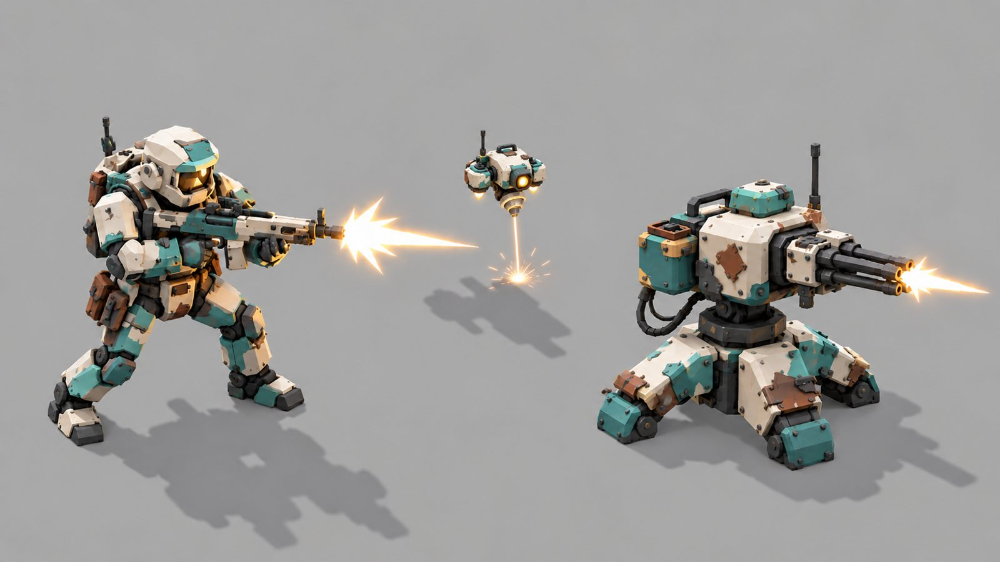

# Assignment 2 — GDD Final Draft: *Rogue Rigs*

**ELVTR · Multi-Agent AI for Game Development** · Soumois Pierre-Emmanuel

> *They filed this claim last week. We're here first.* — the Rigs

📄 **[Read the final GDD (PDF, 9 pages)](Rogue_Rigs_GDD.pdf)**

## At a glance

| | |
|---|---|
| **Genre** | Roguelite auto-shooter, manual aim |
| **Engine** | Unreal Engine 5 · C++ |
| **Runtime AI** | None. AI is a development-time tool only |
| **Platform** | PC (Windows) · single-player |
| **A run** | 4 levels, upgrades carry over |
| **Pitch** | An independent miner steals ore from a corporate asteroid claim before extraction begins, and the arena itself is the best weapon. |

## Design pillars

Every feature must pass at least one pillar test. A feature that passes none is cut.

| | Pillar | Passes if… |
|---|---|---|
| **P1** | Gamefeel / juice | the feature adds feedback the player feels, not just a number. |
| **P2** | Manual aim + auto-fire | the player decides where it happens. |
| **P3** | The arena is a weapon | the terrain changes how a fight plays out. |

## Target look

Generated during pre-production from prompts written from the GDD. It is a readability reference, not a promise of final fidelity.

| The corporate robots | The Rigs |
|---|---|
|  |  |

The prompts that produced these images are kept in the vault: `vault/reference/gdd/art-audio/art-prompts.md`.

## What changed since the first draft

| # | Change | Why |
|---|---|---|
| 1 | Placeholder title and no setting → *Rogue Rigs*, ore theft on a corporate asteroid claim | The lore now explains each mechanic: alert bar, hack, shuttle, robots |
| 2 | Win and loss defined for the whole 4-level run | The draft only defined them per level |
| 3 | Ore is secured only by extraction | The risk window now has a stake |
| 4 | Terrain on a grid; shots no longer break rock; three destruction sources | Destruction becomes a decision, which makes pillar 3 real |
| 5 | New: the drone (dig, hack, dialogue) | One tool for two jobs creates the central trade-off of a level |
| 6 | Grid autotiling and Niagara debris instead of Chaos Destruction | Performance with hordes, and a scope one person can build |
| 7 | Four-robot roster with a readability color code | The shooter must be spotted in under a second |
| 8 | Endless-wave objective replaced by "find special ore" | Ore hunting uses pillar 3 |
| 9 | Agents state their output format; animation, sound, art and style-guide agents added | Instructor feedback, and agent role clarity |
| 10 | Milestones M1 to M3 and a separate wishlist | Keeps the scope buildable in the weeks left |

## Where the GDD lives now

The PDF is the snapshot submitted for this assignment. The living version is the project vault, split into agent-sized nodes that the dev crew reads: [`vault/reference/gdd/`](../../vault/reference/gdd/). Decisions taken since then are recorded there, not in the PDF.

## Navigation

⬅️ [Assignment 1](../A1-gdd-first-draft/) · ➡️ [Assignment 3 — Agent Crew](../A3-agent-crew/) · [All assignments](../)
