# Assignment 4 — Dynamic Content Pipeline

**ELVTR · Multi-Agent AI for Game Development** · Soumois Pierre-Emmanuel

⬅️ [Assignment 3](../A3-agent-crew/) · [All assignments](../)

> **Final state of Assignment 4:** commit `0790c65` (tag [`a4-submission`](https://github.com/soumois/RogueRigs/tree/a4-submission)), after task 085. Later commits belong to the rest of the project.

## In short

- **Three content types *Rogue Rigs* was missing**, generated from the game's own lore and loaded in the game: 13 Rook flavor lines for the upgrade cards, 34 Rook and Vesna barks, 15 Kessler-Voss alert lines.
- **Retrieval is checked, not claimed:** every generated line logs the vault node and the exact sentence it used, and the validator fails if that sentence is not in the node word for word.
- **The critic caught 10 lore or tone breaks** across 90 line reviews (for example a Rook "film quote" built on the catchphrase "access granted"), each corrected and re-reviewed.
- **A human caught what the critic missed:** a company alert told the player to "Cease all extraction" during the shuttle countdown. That playtest finding became rule T9, which the critic then applied to every alert and used to catch two older lines.
- **Concrete tweak:** a baseline written without the lore, then a second version of the upgrade lines with a per-stat retrieval, compared side by side.

| Rubric criterion | Where it is answered |
|---|---|
| Game-anchored source | [Knowledge base](#knowledge-base) |
| Content fit | [Content fit](#content-fit) |
| RAG implementation | [RAG implementation](#rag-implementation) |
| Consistency checking | [Consistency checking](#consistency-checking) |
| Voice judgment | [Voice judgment](#voice-judgment) |

Scope: tasks 072 to 085 of the crew. Game work done in the same period is in [Game progress since Assignment 3](#game-progress-since-assignment-3), at the end of this file.

## Knowledge base

The knowledge base is the lore branch of the game's design document in the project vault (`vault/reference/gdd/`), the same nodes the dev crew reads for every task. `lore` (world, factions, rules L1–L4) is part of the GDD; the owner extended it with the two crew voices, the company voice, the text rules T1–T9 and a pool of fictional films. All of it describes mechanics that exist in the game (alert bar, console hack, shuttle countdown, upgrades).

| Node | Holds |
|---|---|
| [`lore`](../../vault/reference/gdd/lore.md) | World, factions, rules L1–L4 |
| [`crew-characters`](../../vault/reference/gdd/crew-characters.md) | Rook (the miner) and Vesna (the colleague in orbit) |
| [`fictional-films`](../../vault/reference/gdd/fictional-films.md) | The in-universe parody films Rook quotes |
| [`company-voice`](../../vault/reference/gdd/company-voice.md) | How Kessler-Voss speaks to the public and to threats |
| [`dialogue-tone`](../../vault/reference/gdd/art-audio/dialogue-tone.md) | Text rules T1–T9 |

The whole vault, which the text agent reaches by descent from `root` (generated by `node vault/scripts/vault-map.js`):

<!-- vault-map:start -->
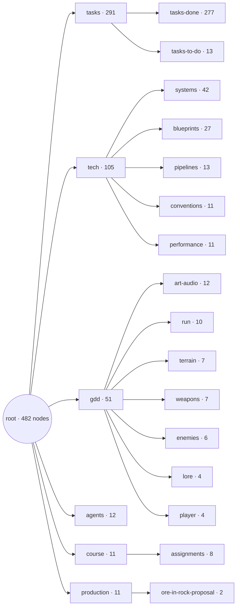
<!-- vault-map:end -->

| The whole vault (Parent Graph view in Obsidian) | The game design branch: `lore` and its children are the knowledge base |
|---|---|
| [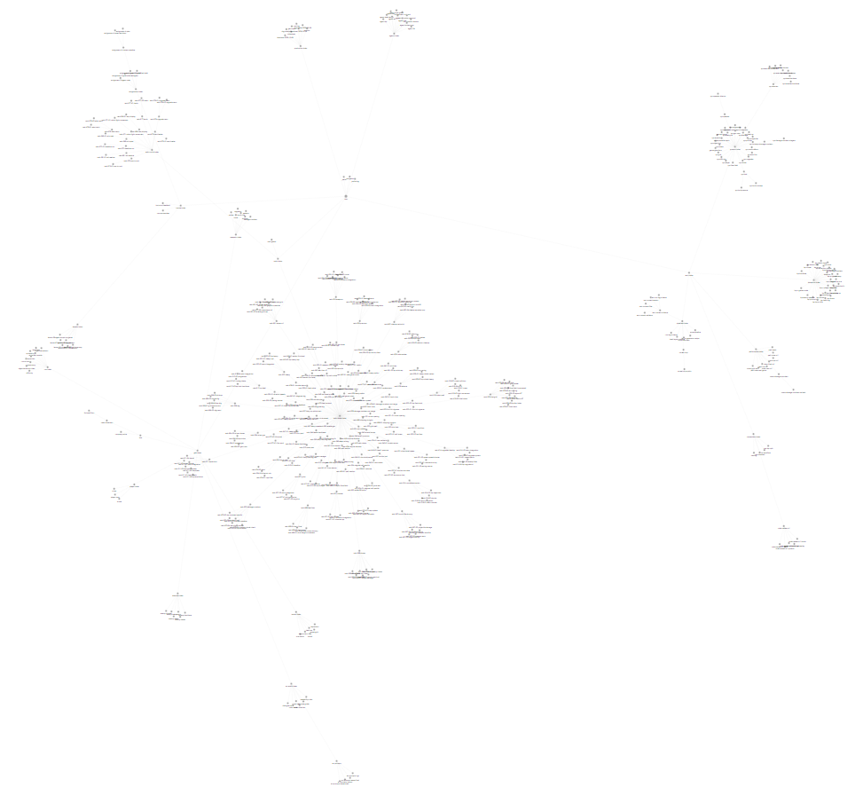](../../docs/images/vault-overview.png) | [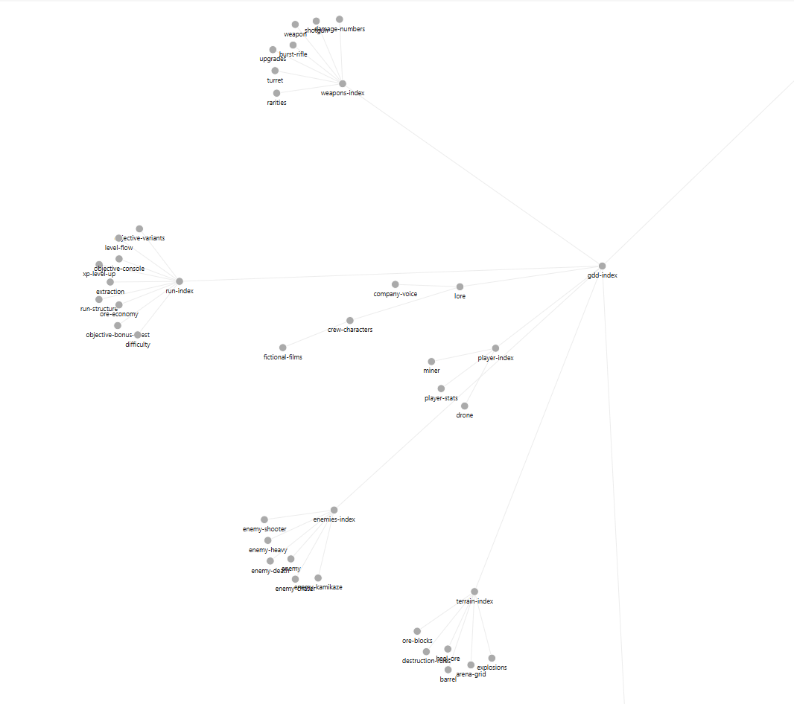](../../docs/images/vault-gdd-zoom.png) |

## Pipeline


- Text agent (Sonnet): [`.claude/agents/text.md`](../../.claude/agents/text.md) · spec [`agent-text`](../../vault/reference/agents/agent-text.md)
- Critic (Opus, a different model from the generator): [`.claude/agents/style-guide.md`](../../.claude/agents/style-guide.md) · spec [`agent-style-guide`](../../vault/reference/agents/agent-style-guide.md)
- Validator: [`validate_text.js`](../../Tools/content/validate_text.js) · contracts [`text-content-schema`](../../vault/reference/tech/pipelines/text-content-schema.md)

## Content fit

| Content type | Gap in the game | Output that fills it | File |
|---|---|---|---|
| **Upgrade card texts** | Level-up cards were purely functional ("Damage", "All weapons", "+12%"): nothing said who Rook is. | 13 Rook flavor lines, one per stat, shown under the stat name. | [`upgrade_texts.json`](../../Content/RogueRigs/Data/Text/upgrade_texts.json) |
| **Barks** | The game had no dialogue; Rook and Vesna existed only in the GDD. | 34 barks (Rook 20, Vesna 14) on the 14 existing game events, 3 to 8 words, tone from a fixed list of five. | [`barks.json`](../../Content/RogueRigs/Data/Text/barks.json) |
| **Kessler-Voss alerts** | The alert bar showed icons and no voice: the company hunting the player had no presence in text. | 15 lines, 3 for each of the 5 alert events: 10 cold bureaucratic toward threats, 5 glossy propaganda. | [`alerts.json`](../../Content/RogueRigs/Data/Text/alerts.json) |

| Type | Example from the files |
|---|---|
| Upgrade card, `Damage` | "Every hit lands harder, and the company's repair bill grows." |
| Rook, `level_up`, cocky | "Level up. Odds just got nervous." |
| Vesna, `player_damaged`, deadpan | "Another shortcut, Rook? Like the Pallas run." |
| Alert, `bonus_chest_dropped`, bureaucratic | "Cache contents remain company property. Tampering will be invoiced." |
| Alert, `extraction_ready`, propaganda | "Kessler-Voss proudly sends reinforcements to protect everyone's bright future." |

**In the game** (C++, no AI at runtime): the loader in [`Source/RogueRigs/Text/`](../../Source/RogueRigs/Text/) ([`sys-text-content`](../../vault/reference/tech/systems/ui/sys-text-content.md)) reads the three files at game start. The upgrade card shows Rook's line under the stat name, confirmed on screen by the owner (tasks 080, 084). The company alert line appears once, for 8 s, under the shuttle countdown (task 085). Barks are loaded but not displayed yet (owner decision). The loader has 6 automation tests (`RogueRigs.Text.*`); the full headless suite passed 201/201 when it was committed.

In the game (owner playtest, 2026-10-10):

| Level-up cards: Rook's line under each stat | Shuttle countdown: a Kessler-Voss alert under the timer |
|---|---|
| [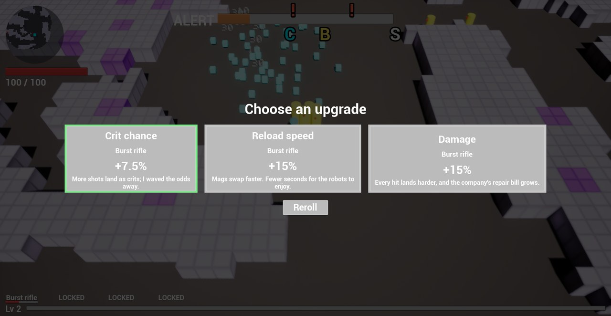](../../docs/images/a4/text-upgrade-cards.jpg) | [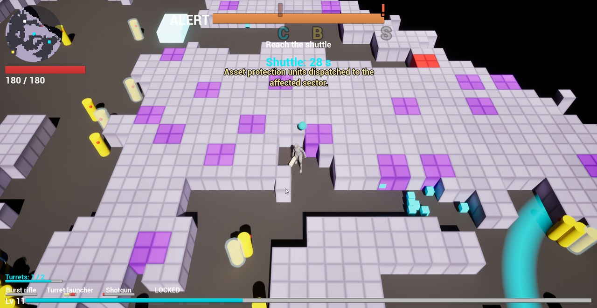](../../docs/images/a4/text-shuttle-alert.jpg) |
| `upg_crit_chance`, `upg_reload_speed`, `upg_damage` from [`upgrade_texts.json`](../../Content/RogueRigs/Data/Text/upgrade_texts.json) | `kv_horde_incoming_03` (bureaucratic) from [`alerts.json`](../../Content/RogueRigs/Data/Text/alerts.json): "Asset protection units dispatched to the affected sector." |

## RAG implementation

There is no vector database: at this scale the lore fits in context. The text agent *retrieves by descent*: it reads the lore nodes the vault index leads to, notes which node and which exact sentence drives a line, then writes it. Every item is logged with its query, the node ids read, the excerpt and the output. The validator then checks that **each logged excerpt appears word for word in the node it cites**, that the logged output equals the shipped text, and that any number in a line appears in a retrieved excerpt.

Logs: [upgrade texts](../../Tools/content/logs/20261010-112603-upgrade_texts.json), [barks](../../Tools/content/logs/20261010-103303-barks.json), [alerts](../../Tools/content/logs/20261010-112240-alerts.json). Six rows copied from them:

| Item | Query | Retrieved excerpt (node: verbatim) | Output |
|---|---|---|---|
| `upg_max_health` | Rook jargon word for max health: hull patch | `upgrades`: "max health +20 / +30 / +45 / +60 / +80"<br>`crew-characters`: "coolant, torque, drill bit, payload, burn window, hull patch, yield, redline." | More max health: another hull patch, no company warranty. |
| `upg_piercing` | Rook film quote for piercing, title must be in the catalogue | `upgrades`: "blue +1, purple +2, yellow +3 pierced robots"<br>`fictional-films`: "Last Inaction Hero (provisional)" | Like in Last Inaction Hero: each round punches through the robot queue. |
| `vesna_player_damaged_01` | vesna voice for player_damaged | `crew-characters`: "The Pallas run: Rook cut through a debris field" | Another shortcut, Rook? Like the Pallas run. |
| `vesna_run_won_01` | vesna voice for run_won | `crew-characters`: "The Ceres job: Rook's plan; they lost the ship." | Clean extraction. Better than the Ceres job. |
| `kv_bonus_chest_dropped_03` | bureaucratic register toward threats | `company-voice`: "Cold, impersonal, procedural: notice numbers, asset language, invoices; no emotion, no insult." | Cache contents remain company property. Tampering will be invoiced. |
| `kv_shuttle_countdown_01` | T9 rule and lore meaning of the extraction countdown | `dialogue-tone`: "Company text never orders the player to stop or do something that contradicts the objective; it states what the company does"<br>`lore`: "Company reinforcements arriving" | Reinforcements dispatched to the site. Arrival is imminent. |

Where the excerpt is a fact (a past job, the meaning of the countdown), it drives the content: Vesna can only name the Pallas run or the Ceres job because they are listed in `crew-characters`. Where it is a voice description (the company's register, Rook's traits), it drives the register, not the words. For the upgrade lines, 5 of the 13 `upgrades` excerpts carry that stat's own values; the others are a generic stat list or a nearby rule.

## Consistency checking

Two layers. The **validator** is deterministic: schema, ids, word counts, digits, reuse of vault example lines, verbatim excerpts, and the correction loop itself (a failed item must have a correction, a correction must follow a recorded fail). The **critic** sees only the content file and the numbered rules (L1–L4, T1–T9), and returns per item pass or fail, one rule id, a reason and a corrected line. At most 2 correction loops, then the owner rules.

Reviews: [upgrade texts v1](../../Tools/content/logs/20261010-103239-upgrade_texts.review.json) and [v2](../../Tools/content/logs/20261010-112603-upgrade_texts.review.json), [barks](../../Tools/content/logs/20261010-103303-barks.review.json), alerts [run 1](../../Tools/content/logs/20261010-103242-alerts.review.json) and [run 2](../../Tools/content/logs/20261010-112240-alerts.review.json), [film pool](../../Tools/content/logs/a4-film-pool-1.review.json).

**90 line reviews at round 0, 10 fails, all corrected; round 1: 75 line reviews, 0 fail.**

| # | Item | Before | Rule | Critic's reason (verbatim) | After |
|---|---|---|---|---|---|
| 1 | `upg_magazine_size` (v1) | Bigger mag, fewer reloads, more time making robots regret. | L3 | The joke gloats over making the robots suffer instead of aiming at the company. | Bigger mag, fewer reloads, more company hardware on the scrap pile. (v1, later replaced) |
| 2 | `rook_console_hacked_02` | Like in Universal Solder: access granted, feelings optional. | T3 | The quoted line is built on "access granted", a stock hacker-movie catchphrase, so the film quote is not an original line. | Like in Universal Solder: firewall folded first. |
| 3 | `rook_run_lost_01` (technical) | Missed the shuttle. Corporate wins, again. | T4 | The line is labelled technical but has no Rigs jargon or shop talk, so it does not deliver the technical Rook register its tone claims. | Missed the burn window. Corporate keeps the yield. |
| 4 | `kv_bonus_chest_dropped_01` | Unclaimed cache deployed. Retrieval by unauthorized personnel is prohibited. | T9 | Declaring retrieval by unauthorized personnel prohibited forbids the player from taking the chest, which contradicts the objective instead of stating what the company does. | Unregistered cache detected. Contents logged as company property. |
| 5 | `kv_horde_incoming_01` | Security response escalated. Unauthorized personnel are advised to disperse. | T9 | Advising unauthorized personnel to disperse is an order aimed at the player rather than a statement of what the company does. | Security response escalated. Additional units assigned to the claim. |
| 6 | `kv_extraction_ready_01` | Unregistered shuttle detected. Extraction route is now active. | T9 | Extraction route is now active does not state a company action and can read as the company opening the route for the player or announcing its own extraction. | Unregistered shuttle detected. Recovery units assigned to its landing zone. |
| 7 | `kv_extraction_ready_02` (propaganda) | Every extraction is noted. Kessler-Voss reinforcements are on the way. | T6 | Tagged propaganda but reads as a cold surveillance warning, with none of the upbeat public register of the company voice. | Kessler-Voss proudly sends reinforcements to protect everyone's bright future. |
| 8 | `upg_crit_damage` (v2) | Crits hit harder; I do love it when things blow up. | T3 | "I do love it when things blow up" paraphrases the well-known catchphrase "I love it when a plan comes together", and crits do not make things blow up. | Crits hit harder now; corporate gets to price the extra dents. |
| 9 | `upg_xp_gain` (v2) | XP gain up: levels come sooner, thinking comes later. | T2 | With no speaker marker, "thinking comes later" reads as a jab at the player's thinking rather than Rook's self-mockery. | XP gain up: I level up sooner, and still plan later. |
| 10 | `upg_piercing` (v2) | Like in Last Inaction Hero: one shot, several robots, zero invoices. | T3 | The title is in the pool, but "one shot, several robots" riffs on the well-known catchphrase "one shot, one kill" (the film Sniper), so the line is not original. | Like in Last Inaction Hero: each round punches through the robot queue. |

Corrections retrieve again: for catches 1 to 3, the text agent queried the vault for the cited rule (for example "Fix L3 fail: joke must target the company, not robot cruelty" retrieved the L3 sentence of `lore`) before rewriting.

### The T9 catch: a human found it first

In the first alerts run, `kv_shuttle_countdown_02` read **"Recovery units arrive shortly. Cease all extraction."** The critic passed it. In a playtest, the owner saw it under "Shuttle: 41 s" and did not understand it: a player reads HUD text as guidance, and it told them to stop while the objective is to reach the shuttle. That reading became rule **T9** in [`dialogue-tone`](../../vault/reference/gdd/art-audio/dialogue-tone.md): *company text never orders the player to stop or do something that contradicts the objective; it states what the company does.*

The text agent then rewrote the 6 shuttle and extraction lines, and the critic, now holding T9, reviewed all 15 alerts: 4 fails (catches 4 to 7), two of them older lines that had passed before ("prohibited", "advised to disperse"). After correction, 15 pass. The shipped countdown line is "Recovery units are inbound and closing on the site."

What the critic did **not** catch: before T9, all 15 alerts passed round 0, including the line above. The critic is another language model, not ground truth; it can only enforce the rules it is given.

**Film pool.** Before the runs, the film catalogue was grown from the owner's three examples to 50 parody titles and reviewed against T3: 48 pass, 2 fail ("Twisted Ankle": no recognisable film behind it → "Broken Arrears"; "Daylight Savings": the unchanged title of a real 2012 film → "Daylight Overtime").

## Voice judgment

This is the author's self-assessment; the only player reading on record is the playtest that produced T9.

**Baseline without lore.** The same text agent, same model, wrote 6 items per type with only the file schema and the mechanic node, no lore ([`Tools/content/logs/baseline/`](../../Tools/content/logs/baseline/), validated, never loaded in game):

| Item | Baseline (no lore) | Final (reads the vault) |
|---|---|---|
| `upg_fire_rate` | More bullets, fewer second thoughts. | Trigger's at redline: more shots every second, no warranty. |
| `upg_crit_chance` | Lucky shots find the weak spots. | More shots land as crits; I waved the odds away. |
| `vesna_player_damaged_01` | That looked painful. Keep moving. | Another shortcut, Rook? Like the Pallas run. |
| `rook_horde_incoming_01` | Bring them all. I brought ammo. | Like in Cliffhangover: everybody panic politely. |
| `vesna_extraction_ready_01` | Extraction approved. Form filed. Go. | Extraction is ready. Move your feet. |
| `kv_bonus_chest_dropped_01` | Wonderful news! A reward awaits your loyal service. | Unregistered cache detected. Contents logged as company property. |
| `kv_shuttle_countdown_01` | Shuttle departs on schedule. Late arrivals unaccounted. | Reinforcements dispatched to the site. Arrival is imminent. |

Does it sound like Rogue Rigs?

- **Upgrade lines:** the baseline has no speaker and fits any shooter; the final lines are Rook, with the Rigs jargon retrieved per stat (redline, payload, hull patch, torque). The clearest gain.
- **Alerts:** the baseline treats the player as a loyal employee ("your loyal service"); in this game the company hunts the player as "unauthorized personnel". The baseline countdown line also gets the mechanic wrong: the lore defines the countdown as company reinforcements arriving, not a shuttle departing. Here retrieval prevented a lore error, not just added flavor.
- **Barks:** only the final run can name the Pallas run, the Ceres job or a film from the pool, because only it read them.
- **Where the baseline is as good or better:** "Extraction approved. Form filed. Go." is a better joke than the final Vesna line, and the "Like in <film>:" pattern appears four times, which starts to read as a tic. The final lines are more consistent with the lore, not uniformly funnier.

**The concrete tweak: upgrade lines v1 → v2.** v1 retrieved the same two Rook voice excerpts for all 13 stats, and several lines were jokes that left the stat to the card title. v2 retrieves a pair per stat: the stat's own line in `upgrades` plus one Rook trait or jargon word that fits it, and logs `fictional-films` whenever a title is quoted.

| Stat | v1 (same two voice excerpts for all) | v2 (per-stat retrieval, shipped) |
|---|---|---|
| Crit damage | When a crit lands, it lands like a rockslide. | Crits hit harder now; corporate gets to price the extra dents. |
| Magazine size | Bigger mag, fewer reloads, more company hardware on the scrap pile. | Bigger mag, more shots before reloading. Payload, not paperwork. |
| Pickup radius | Ore jumps into my pockets from farther away. | Grabs pickups from farther away; every scrap counts toward my cut. |
| Luck | Luck bends the card odds my way, as usual. | Better luck means better cards. Shaky plan, total confidence. |
| Piercing | Shots punch through robots, like Die Hardly but cleaner. | Like in Last Inaction Hero: each round punches through the robot queue. |

All 13 lines of both versions: [v1](../../Tools/content/logs/v1/upgrade_texts.json), [v2](../../Content/RogueRigs/Data/Text/upgrade_texts.json). Critic round 0: v1 12 pass / 1 fail, v2 10 pass / 3 fail; both 13 pass after one correction.

v2 says what the stat does and was adopted for that. The cost is visible: more round-0 fails (two catchphrase paraphrases), fewer jabs at the company (3 lines against 5), and some lines read as a label followed by a joke ("XP gain up: ..."). The best v1 lines ("My trigger finger files no complaints") read more naturally. Passing the critic means breaking no rule, not being funnier.

## Numbers

| What | Count |
|---|---|
| Lines shipped | 62: 13 upgrade lines, 34 barks, 15 alerts |
| Barks by speaker / tone | Rook 20, Vesna 14 / cocky 13, deadpan 11, technical 10 |
| Alerts by register | 10 bureaucratic, 5 propaganda |
| Baseline lines (no lore, not shipped) | 18 |
| Film pool | 50 titles (48 pass, 2 corrected) |
| Critic, round 0 | 90 line reviews: 80 pass, 10 fail |
| Critic, round 1 | 75 line reviews: 75 pass |
| Correction loops used | 1 (maximum 2) |
| Validator | exit 0 on the 3 shipped and the 3 baseline files; selftest OK (3 cases) |
| Loader tests | 6 (`RogueRigs.Text.*`) |

## How to run it

From the repository root; Node is the only dependency of the content tools.

**Check the content (deterministic, no model call):**

```
node Tools/content/validate_text.js Content/RogueRigs/Data/Text/upgrade_texts.json --log Tools/content/logs/20261010-112603-upgrade_texts.json
node Tools/content/validate_text.js Content/RogueRigs/Data/Text/barks.json --log Tools/content/logs/20261010-103303-barks.json
node Tools/content/validate_text.js Content/RogueRigs/Data/Text/alerts.json --log Tools/content/logs/20261010-112240-alerts.json
node Tools/content/validate_text.js --selftest
```

Exit 0 means valid; exit 1 prints one JSON line per problem. Spec: [`text-content-validator`](../../vault/reference/tech/pipelines/text-content-validator.md).

**Generate and review (calls the models)**, in a Claude Code session on this repository:

1. `/task <request>`, for example "write the Rook flavor lines for the upgrade cards". The Orchestrator checks it against the GDD and plans one subtask per agent.
2. The `text` agent reads the lore nodes, writes the content file and its retrieval log, and runs the validator until it exits 0.
3. The `style-guide` agent reviews the content file and writes the review file.
4. Fails go back to the `text` agent, which corrects, logs the correction and re-validates; the critic reviews again (at most 2 loops).
5. The game loads the files at start.

---

## Game progress since Assignment 3

Assignment 3 was submitted at the tag [`a3-submission`](https://github.com/soumois/RogueRigs/tree/a3-submission), at the end of task 031 (2026-10-06). Since then the crew has run tasks 032 to 085, the last task of Assignment 4. The game work came from owner play tests; the text pipeline is described in the [Assignment 4 README](README.md).

The captures below come from one full run recorded on 2026-10-10 at 10:48 in a standalone game window (level 1 to level 10, ending in an extraction), cropped to the game view. The recording predates the on-screen display of the generated text (tasks 080 and 084), so the cards and alerts in it do not show a generated line yet.

### Visible in the run

**HUD** (video 00:11). Round minimap of the cells already seen, with markers for the miner, console, chest and shuttle (tasks 061, 064). Alert bar twice as wide and tall, with the console (C), bonus chest (B) and shuttle (S) icons (task 062). Weapon slots with name, ammo and reload centred under each slot, `LOCKED` on slots not owned yet (tasks 037, 053).

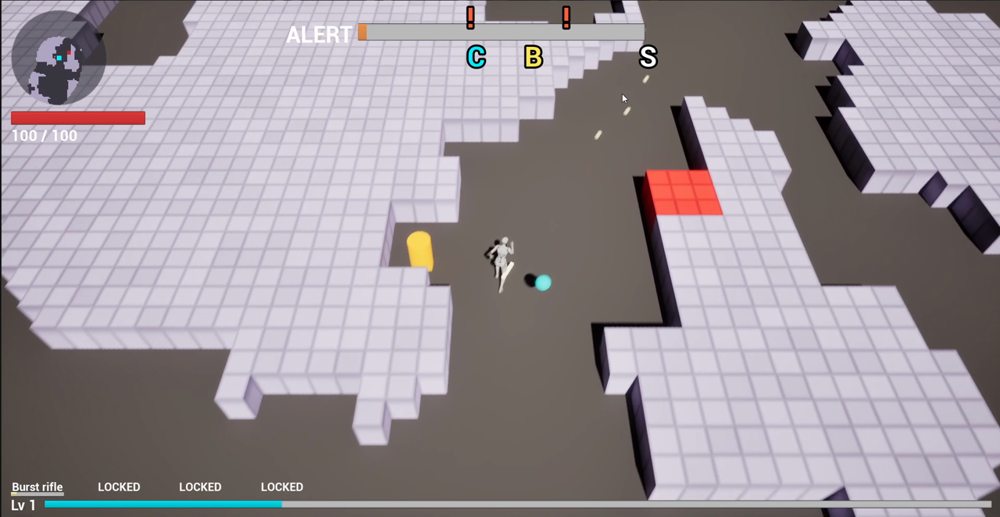

**Digging a tunnel through small rock cells** (video 02:21–02:33). The grid is 240 × 240 cells of 67 uu instead of 80 × 80 cells of 200 uu at M1. The drone's laser fan cuts several blocks at once, up to 8 and about two rows deep (task 060), and moving into the corner of two blocks still digs (task 065). The robots follow the new corridor as soon as it opens: the flow field is rebuilt on a worker thread with a double buffer (task 066).

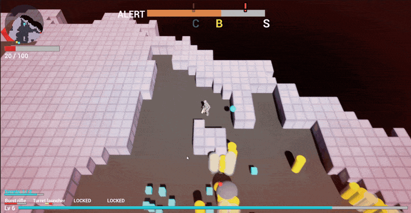

**Heal vein** (video 02:33–02:38). Right after the tunnel, the miner mines a red heal vein: the health bar goes from 20 to 47 to 80, with the green heal ring. Mining reaches the whole vein (task 034) and a vein restores 60 HP in total (task 035).

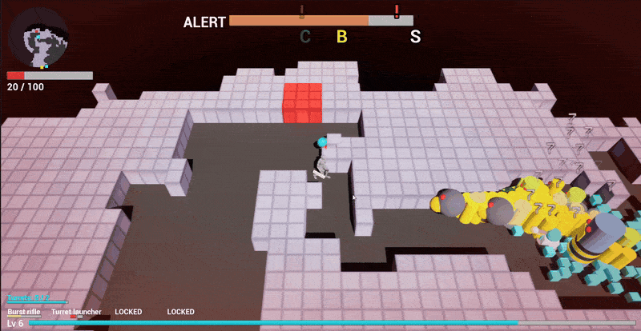

**A pack, damage numbers, XP and a level-up** (video 01:16–01:29). One damage number per hit, no merging (task 059). The very first hit taken flashes the red vignette, 100 → 90 HP (task 055). XP cubes stream to the miner with the Niagara trail (tasks 054, 058). The console locator arrow shows the distance in metres at the bottom (task 040).

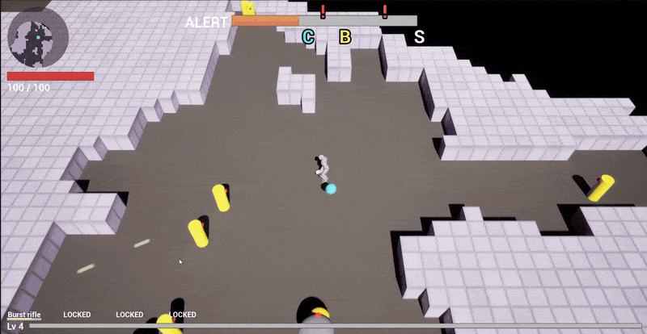

**Weapon card at level 5** (video 01:29–01:35). A new weapon is offered as a level-up card every 5 levels (task 032): here Shotgun or Turret launcher. The turret launcher slot unlocks and the turret counter appears (`Turrets: 2 / 2`). New turrets are kept at least 100 uu apart (task 051).

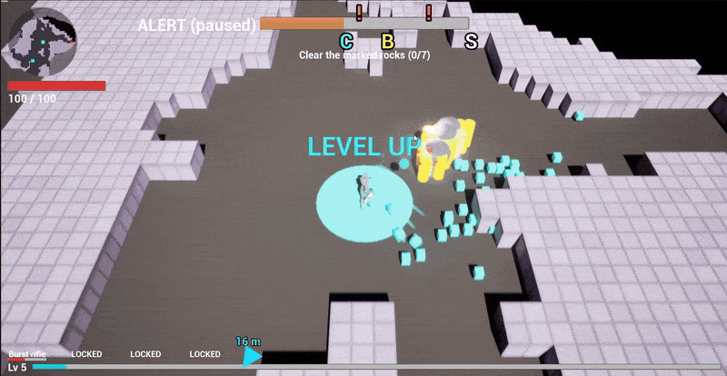

**Console hack and horde** (video 01:47–01:59). `HORDE INCOMING!` banner while the miner hacks the console ("stay close to it"); the hack takes 16 s instead of 20 (task 042).

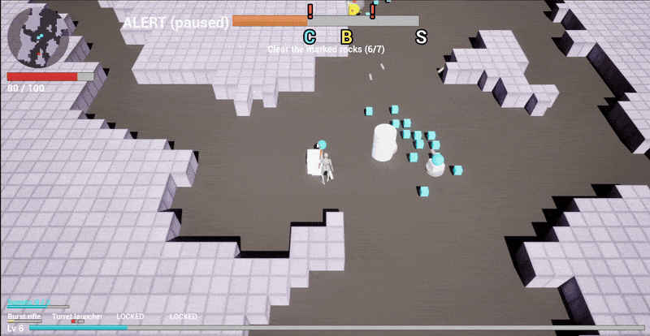

**Bonus chest** (video 03:01–03:09). One chest per level, dropped at 60 % alert. The miner hacks it for 8 s (yellow ring) for XP, ore and a lucky upgrade choice (task 056). The objective then switches to `Reach the shuttle`.

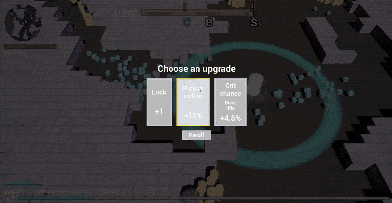

**Horde, escape, extraction** (video 03:13–03:27). A horde lands during the shuttle countdown and the health bar drops from 75 to 10. The miner digs his way out and follows the locator arrow and the chevrons to the shuttle, which now lands 37 to 50 cells away (task 049).

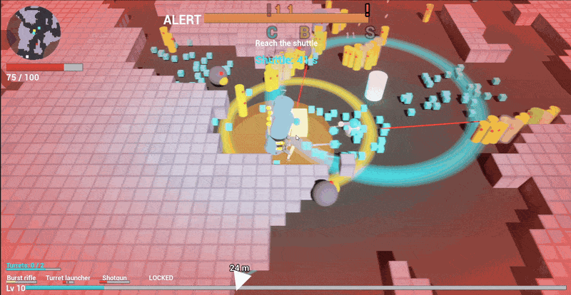

### Every task since Assignment 3

Full records in [`vault/reference/tasks/`](../../vault/reference/tasks/). "Capture" names the capture above where the change can be seen.

| Area | Task | Change | Capture |
|---|---|---|---|
| Run and pressure | 032 | Third play test: robot recycling, console locator, overtime, faster heavy, English texts, upgrade draw weights, weapon cards every 5 levels, bigger turret | Weapon card |
| | 034 | Fourth play test: bigger projectile hitbox, whole-vein mining, heal pickup fix, small terrain capsules, kamikaze trigger, softer early waves, crowd mix | Heal vein |
| | 036 | Robots left far behind are moved back ahead of the miner instead of removed | — |
| | 041 | Robots spawn beyond the rock the miner digs toward | — |
| | 042 | Console hack 20 → 16 s | Console hack |
| | 044 | Fewer kamikazes: at most 1 per pack in one pack out of two, 1–2 per horde | — |
| | 045 | Easier first level: about 15 % fewer robots, rarer heavies, at most 3 heavies | — |
| | 046 | Level 1 pressure: 80 robots alive at most, packs of one wave at least 120° apart | — |
| | 048 | Current wave director values saved as a last-level data profile (not wired) | — |
| | 049 | Shuttle lands 37 to 50 cells from the miner | Extraction |
| | 056 | Bonus chest: one per level at 60 % alert, 8 s hack, XP, ore, lucky upgrade choice | Bonus chest |
| Robots | 033 | Every robot at 180 uu/s; tests updated to the owner's data changes | — |
| | 038 | A shooter without line of sight walks around rock until it can fire, never away from the miner | — |
| | 039, 052 | Heavy slam radius 400 → 340 → 289 uu; the ground ring follows | — |
| | 047 | Heavy speed 180 → 153 uu/s | — |
| Mining | 035 | A heal vein restores 60 HP in total | Heal vein |
| | 043 | All blocks of a vein being mined shake together | — |
| | 060 | Drone arc reaches 2.5 cells and cuts up to 8 blocks at once | Dig |
| | 065 | Moving diagonally into a corner of two blocks still digs | Dig |
| Weapons | 051 | A new turret is moved at least 100 uu away from standing turrets | — |
| HUD and feedback | 037 | Ammo HUD: ammo bar or blocks, reload bar, turret recharge, padlocks | HUD |
| | 040 | Console locator arrow, pulsing, with the distance in metres | Combat, Extraction |
| | 053 | Weapon slot name, ammo and reload centred under each slot | HUD |
| | 054, 058 | XP cube trail and pickup sparkle rebuilt in Niagara, trail visible in game | Combat |
| | 055 | Red damage vignette on the very first hit, packaged build included | Combat |
| | 059 | One damage number per hit, no merging, random start on a small disc | Combat |
| | 061, 064 | Round minimap of seen cells with markers; reveal circle of 18 cells around the miner | HUD |
| | 062 | Alert bar twice as wide and tall, icons rescaled | HUD |
| Performance and tests | 050, 057 | Two intermittent tests (damage-number stacking, XP pickup) made reliable by fixing the cause | — |
| | 063 | Performance session on a quiet PC: `-game` stress at 67 uu cells, flow-field budget tests | — |
| | 066 | Flow field rebuilt on a worker thread with a double buffer; robots follow a new path within 1–2 frames | Dig |
| | 067 | Stress scenario close to a real game: 150 robots, a horde, full HUD and minimap, Niagara, miner running and digging | — |
| | 068 | Packaged build measured, Unreal Insights capture of the frame spikes | — |
| Text pipeline (this assignment) | 072 | Film pool grown to 50 parody titles, reviewed by the critic | — |
| | 073 | Text content schema: 3 content files, retrieval log, critic review file | — |
| | 074 | `validate_text.js` with selftest cases | — |
| | 075 | Baseline without lore: 6 items per content type | — |
| | 076, 077, 078 | Upgrade card lines, Rook and Vesna barks, Kessler-Voss alerts: write, validate, review, correct | — |
| | 079 | Loader: the text files are read in game and feed the upgrade cards and alert events | — |
| | 080 | Card flavor line and alert text added to the HUD | — |
| | 081 | This README filled from the logs and reviews | — |
| | 082 | Shuttle and extraction lines rewritten under the new rule T9, then reviewed | — |
| | 083 | Upgrade lines regenerated with an item-specific retrieval and compared with the first version | — |
| | 084 | Card flavor line visible in game (newline delimiter fixed in `WBP_HUD`) | — |
| | 085 | Company alert line shown once for 8 s when the shuttle countdown starts | — |

