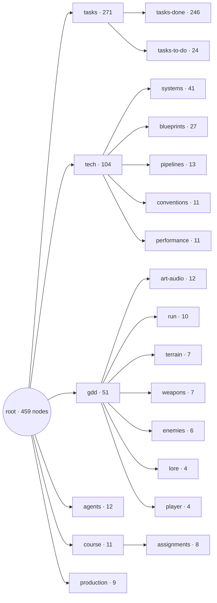
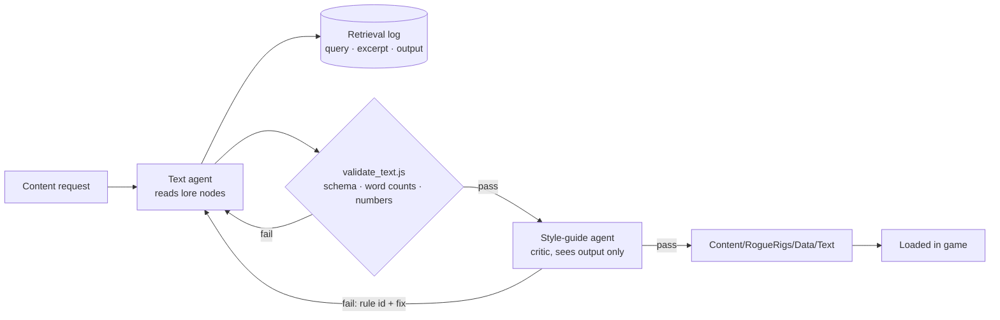

# Assignment 4 — Dynamic Content Pipeline

**ELVTR · Multi-Agent AI for Game Development** · Soumois Pierre-Emmanuel

> 🚧 **In progress.** This page is filled in as the pipeline runs. Nothing below claims a result that has not been produced yet.

⬅️ [Assignment 3](../A3-agent-crew/) · [All assignments](../)

## Goal

Generate content that *Rogue Rigs* actually needs, from the game's own lore, so it sounds like this game and not like generic sci-fi.

## Knowledge base

The project vault, the same one the dev crew reads. The lore nodes are the GDD lore, extended:

| Node | Holds |
|---|---|
| [`lore`](../../vault/reference/gdd/lore.md) | World, factions, rules L1–L4 |
| [`crew-characters`](../../vault/reference/gdd/crew-characters.md) | Rook (the miner) and Vesna (the colleague in orbit) |
| [`fictional-films`](../../vault/reference/gdd/fictional-films.md) | The in-universe films Rook quotes |
| [`company-voice`](../../vault/reference/gdd/company-voice.md) | How Kessler-Voss speaks to the public and to threats |
| [`dialogue-tone`](../../vault/reference/gdd/art-audio/dialogue-tone.md) | Text rules T1–T8 |

The whole vault, which the text agent reaches by descent from `root` (generated by `node vault/scripts/vault-map.js`):

<!-- vault-map:start -->

<!-- vault-map:end -->

| The whole vault (Parent Graph view in Obsidian) | The game design branch: `lore` and its children are the knowledge base |
|---|---|
|  |  |

## Pipeline

- Text agent: [`.claude/agents/text.md`](../../.claude/agents/text.md) · spec [`agent-text`](../../vault/reference/agents/agent-text.md)
- Critic: [`.claude/agents/style-guide.md`](../../.claude/agents/style-guide.md) · spec [`agent-style-guide`](../../vault/reference/agents/agent-style-guide.md)

## Sections to fill after the runs

- [ ] The gap: what the game is thin on, per content type.
- [ ] Three generated outputs, with links to the files.
- [ ] Query, retrieved excerpt and output, side by side.
- [ ] What the critic caught, and the correction.
- [ ] Voice judgment: does it sound like Rogue Rigs, and the prompt or retrieval tweak made.
- [ ] How to run the pipeline.
