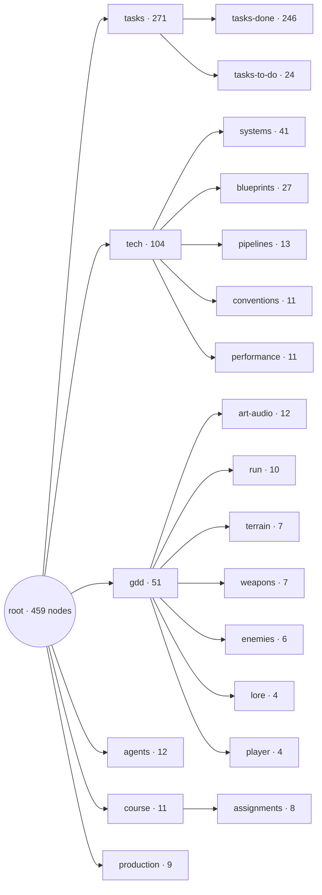
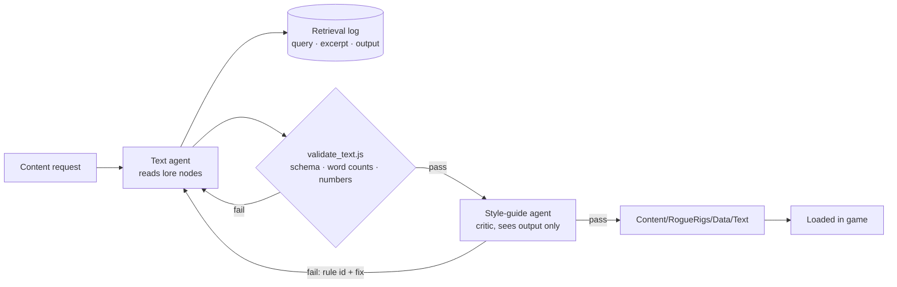

# Assignment 4 — Dynamic Content Pipeline

**ELVTR · Multi-Agent AI for Game Development** · Soumois Pierre-Emmanuel

> **Status:** the pipeline ran end to end for all three content types on 2026-10-10. Every number, quote and file below comes from the committed content files, logs and review files; the commands in [How to run it](#how-to-run-it) reproduce the validator results. Two things are **not** done and are stated in [What is not verified](#what-is-not-verified): nobody has looked at the card line and the alert text on screen yet, and barks are loaded but not displayed.

| Rubric criterion | Where it is answered |
|---|---|
| Game-anchored source | [Knowledge base](#knowledge-base-game-anchored-source) |
| Content fit | [Content fit](#content-fit-the-gap-and-the-output-that-fills-it) |
| RAG implementation | [RAG implementation](#rag-implementation-query-retrieved-excerpt-output) |
| Consistency checking | [Consistency checking](#consistency-checking-what-the-critic-caught) |
| Voice judgment | [Voice judgment](#voice-judgment-baseline-without-lore-vs-final) |

⬅️ [Assignment 3](../A3-agent-crew/) · [All assignments](../)

## Goal

Generate content that *Rogue Rigs* actually needs, from the game's own lore, so it sounds like this game and not like generic sci-fi.

## Knowledge base (game-anchored source)

**Criterion: game-anchored source.** The knowledge base is not a separate document written for this exercise. It is the lore branch of the game's own design document (`vault/reference/gdd/`), the same nodes the dev crew reads for every task. `lore` (world, factions, rules L1-L4) is part of the GDD; the owner extended it on 2026-10-09 and 2026-10-10 with the two crew voices, the company voice, the text rules T1-T8 and the film pool. All of it describes mechanics that exist in the game (alert bar, console hack, shuttle countdown, upgrades), so every generated line can be checked against a real event.

The project vault, the same one the dev crew reads. The lore nodes are the GDD lore, extended:

| Node | Holds |
|---|---|
| [`lore`](../../vault/reference/gdd/lore.md) | World, factions, rules L1–L4 |
| [`crew-characters`](../../vault/reference/gdd/crew-characters.md) | Rook (the miner) and Vesna (the colleague in orbit) |
| [`fictional-films`](../../vault/reference/gdd/fictional-films.md) | The in-universe films Rook quotes |
| [`company-voice`](../../vault/reference/gdd/company-voice.md) | How Kessler-Voss speaks to the public and to threats |
| [`dialogue-tone`](../../vault/reference/gdd/art-audio/dialogue-tone.md) | Text rules T1–T8 |

The whole vault, which the text agent reaches by descent from `root` (generated by `node vault/scripts/vault-map.js`):

<!-- vault-map:start -->

<!-- vault-map:end -->

| The whole vault (Parent Graph view in Obsidian) | The game design branch: `lore` and its children are the knowledge base |
|---|---|
| [](../../docs/images/vault-overview.png) | [](../../docs/images/vault-gdd-zoom.png) |

## Pipeline



- Text agent: [`.claude/agents/text.md`](../../.claude/agents/text.md) · spec [`agent-text`](../../vault/reference/agents/agent-text.md)
- Critic: [`.claude/agents/style-guide.md`](../../.claude/agents/style-guide.md) · spec [`agent-style-guide`](../../vault/reference/agents/agent-style-guide.md)

## Content fit: the gap and the output that fills it

**Criterion: content fit.** Three content types, each one answering something the game is missing today. The gaps are from the project's own design nodes ([`assignment-4-plan`](../../vault/reference/course/assignments/assignment-4-plan.md), [`sys-upgrades`](../../vault/reference/tech/systems/sys-upgrades.md), [`sys-hud-pressure`](../../vault/reference/tech/systems/sys-hud-pressure.md)).

| Content type | Gap in the game today | Output that fills it | File |
|---|---|---|---|
| **Upgrade card texts** | Level-up cards are purely functional: stat name, target, value (for example "Damage", "All weapons", "+12%"). Nothing says who Rook is or what the upgrade means in this world. | 13 one-line Rook flavor lines, one per stat card, 3 to 12 words, shown under the stat name. | [`upgrade_texts.json`](../../Content/RogueRigs/Data/Text/upgrade_texts.json) |
| **Barks** (Rook and Vesna) | The game has no dialogue at all. The two crew members exist only in the GDD. | 34 barks (Rook 20, Vesna 14) on all 14 existing game events (level up, upgrade offer, player damaged, horde incoming, console dropped / hack started / hacked, bonus chest dropped / opened, extraction ready, shuttle landed, run won / lost, game over), 3 to 8 words, tone from a fixed list of five (13 cocky, 11 deadpan, 10 technical). | [`barks.json`](../../Content/RogueRigs/Data/Text/barks.json) |
| **Kessler-Voss alerts** | The alert bar shows event icons and no voice: the company that hunts the player has no presence in text. | 15 alert lines, 3 for each of the 5 alert events (console, bonus chest, horde, extraction, shuttle countdown): 10 in the cold bureaucratic register toward threats, 5 in the glossy propaganda register. | [`alerts.json`](../../Content/RogueRigs/Data/Text/alerts.json) |

What the output looks like (copied from the files, not from a screenshot):

| Type | Example from the file |
|---|---|
| Upgrade card, stat `Damage` | Damage / "Harder hits, so the company's robots fold faster." |
| Rook bark, `level_up`, cocky | "Level up. Odds just got nervous." |
| Vesna bark, `player_damaged`, deadpan | "Another shortcut, Rook? Like the Pallas run." |
| Alert, `bonus_chest_dropped`, bureaucratic | "Cache contents remain company property. Tampering will be invoiced." |
| Alert, `extraction_ready`, propaganda | "Every extraction brings a better tomorrow. Please stand by." |

How the files reach the game (all in C++, no AI at runtime): the loader in [`Source/RogueRigs/Text/`](../../Source/RogueRigs/Text/) (documented in [`sys-text-content`](../../vault/reference/tech/systems/sys-text-content.md)) reads the three files. The upgrade component puts the Rook line into the card's description text, and the run-flow and HUD code pick an alert line for each of the 5 alert events. The HUD Blueprint that displays them is documented in [`wbp-hud`](../../vault/reference/tech/blueprints/wbp-hud.md). The loader has 6 automation tests (`RogueRigs.Text.*`, [`RRTextContentTests.cpp`](../../Source/RogueRigs/Tests/RRTextContentTests.cpp)), and the full headless suite passed 201/201 when the loader was committed (task-079-01). See [What is not verified](#what-is-not-verified) for what is still unchecked.

## RAG implementation: query, retrieved excerpt, output

**Criterion: RAG implementation.** There is no vector database. The text agent *retrieves by descent*: it reads the lore nodes that the vault index leads to, notes which node and which exact sentence drives a line, then writes the line. For every item it logs the query, the node ids read, the excerpt and the output ([log schema](../../vault/reference/tech/pipelines/text-run-log-schema.md)). The validator then checks that **each logged excerpt appears word for word in the node it cites** (check `excerpt-verbatim`), that the logged output equals the text in the content file, and that a number in a bark or alert also appears in a retrieved excerpt. A row below therefore cannot cite a sentence the node does not contain.

Logs: [upgrade texts](../../Tools/content/logs/20261010-103239-upgrade_texts.json), [barks](../../Tools/content/logs/20261010-103303-barks.json), [alerts](../../Tools/content/logs/20261010-103242-alerts.json). The 11 rows below (3 upgrade lines, 4 barks, 4 alerts) are copied from those entries (loop 0, first generation).

| Item | Query | Retrieved excerpt (node: text, verbatim) | Output |
|---|---|---|---|
| `upg_damage` (upgrade) | Rook voice and the mechanic of Damage | `upgrades`: "Damage, fire rate, reload speed, crit chance, crit damage, magazine size."<br>`crew-characters`: "Cocky; waves the odds away; improvises first, thinks later, and defends a shaky plan with total confidence."<br>`dialogue-tone`: "T4 Rook: a cocky, odds-dismissing smuggler crossed with a tired, sarcastic blue-collar worker" | Harder hits, so the company's robots fold faster. |
| `upg_max_health` (upgrade) | Rook voice and the mechanic of Max health | `upgrades`: "**Player stats:** max health, move speed, pickup radius, XP gain, mining speed, luck"<br>(same `crew-characters` and `dialogue-tone` excerpts as the row above) | Extra hull plating for me, welded on cheap. |
| `upg_piercing` (upgrade) | Rook voice and the mechanic of Piercing | `upgrades`: "blue +1, purple +2, yellow +3 pierced robots"<br>(same `crew-characters` and `dialogue-tone` excerpts) | Shots punch through robots, like Die Hardly but cleaner. |
| `vesna_player_damaged_01` (bark) | vesna voice for player_damaged | `crew-characters`: "The Pallas run: Rook cut through a debris field" | Another shortcut, Rook? Like the Pallas run. |
| `vesna_run_won_01` (bark) | vesna voice for run_won | `crew-characters`: "The Ceres job: Rook's plan; they lost the ship." | Clean extraction. Better than the Ceres job. |
| `vesna_console_dropped_01` (bark) | vesna voice for console_dropped | `lore`: "drops a console there as an access point" | Access point deployed. Go find it. |
| `rook_horde_incoming_01` (bark) | rook voice for horde_incoming | `fictional-films`: "The line is always original: never a real film line" | Like in Cliffhangover: everybody panic politely. |
| `kv_console_dropped_02` (alert) | bureaucratic register toward threats | `company-voice`: "Cold, impersonal, procedural: notice numbers, asset language, invoices; no emotion, no insult." | Access point flagged for immediate asset recovery. |
| `kv_bonus_chest_dropped_03` (alert) | bureaucratic register toward threats | `company-voice`: "Cold, impersonal, procedural: notice numbers, asset language, invoices; no emotion, no insult." | Cache contents remain company property. Tampering will be invoiced. |
| `kv_console_dropped_03` (alert) | propaganda register toward the public | `company-voice`: "mining sold as a gift to humanity." | Kessler-Voss keeps every connection safe for your future. |
| `kv_shuttle_countdown_01` (alert) | meaning of the extraction countdown | `lore`: "Company reinforcements arriving" | Reinforcements arriving. Compliance is mandatory. |

Reading the table honestly:

- The excerpt drives the *content* where it carries a fact. The Pallas run and the Ceres job are the past jobs Vesna may name ([`crew-characters`](../../vault/reference/gdd/crew-characters.md)). The lore row "Extraction countdown = company reinforcements arriving" is why the countdown alerts speak of reinforcements and recovery units arriving, not of a shuttle leaving.
- Where the excerpt is a *voice description* (Rook's T4 line, the company's register), it drives the register, not the words.
- The three upgrade rows show the same two voice excerpts for every item; only the mechanic excerpt changes. Card lines are retrieved per stat for the mechanic and per character for the voice, nothing finer.
- The film title in a bark (Cliffhangover) and in the piercing line (Die Hardly) comes from the catalogue in [`fictional-films`](../../vault/reference/gdd/fictional-films.md). For the bark the log cites the *rule* excerpt of that node. For `upg_piercing` the log does not list `fictional-films` among the nodes read, so that title was confirmed by the critic (it is in the pool) but is not traced by the retrieval log.

## Consistency checking: what the critic caught

**Criterion: consistency checking.** Two layers. The *validator* ([`validate_text.js`](../../Tools/content/validate_text.js)) is deterministic and checks schema, ids, enums, word counts, digits in flavor lines, reuse of vault example lines, verbatim excerpts, and the correction loop itself (a failed item must have a loop-1 correction in the log, and a loop-1 entry must follow a recorded fail). The *critic* is the `style-guide` agent, a different model from the generator (Opus reviews, Sonnet writes). By its definition it sees only the content file and the numbered rules (L1-L4 in [`lore`](../../vault/reference/gdd/lore.md), T1-T8 in [`dialogue-tone`](../../vault/reference/gdd/art-audio/dialogue-tone.md)) and returns, per item, pass or fail, one rule id, a reason and a corrected line. Maximum 2 correction loops, then the owner rules. Definition: [`.claude/agents/style-guide.md`](../../.claude/agents/style-guide.md).

Review files: [upgrade texts](../../Tools/content/logs/20261010-103239-upgrade_texts.review.json), [barks](../../Tools/content/logs/20261010-103303-barks.review.json), [alerts](../../Tools/content/logs/20261010-103242-alerts.review.json), [film pool](../../Tools/content/logs/a4-film-pool-1.review.json).

### The three catches in the content (62 lines reviewed, 3 failed round 0)

| # | Item | Before (loop 0) | Rule | Critic's reason (verbatim) | After (loop 1, in the shipped file) |
|---|---|---|---|---|---|
| 1 | `upg_magazine_size` (upgrade flavor) | Bigger mag, fewer reloads, more time making robots regret. | **L3** (robots only do their job; jokes target the company, not robot cruelty) | The joke gloats over making the robots suffer instead of aiming at the company. | Bigger mag, fewer reloads, more company hardware on the scrap pile. |
| 2 | `rook_console_hacked_02` (bark, Rook) | Like in Universal Solder: access granted, feelings optional. | **T3** (no real film line, no well-known catchphrase) | The quoted line is built on "access granted", a stock hacker-movie catchphrase, so the film quote is not an original line. | Like in Universal Solder: firewall folded first. |
| 3 | `rook_run_lost_01` (bark, Rook, tone `technical`) | Missed the shuttle. Corporate wins, again. | **T4** (Rook: Rigs jargon and punchlines under stress) | The line is labelled technical but has no Rigs jargon or shop talk, so it does not deliver the technical Rook register its tone claims. | Missed the burn window. Corporate keeps the yield. |

Round 1 (the same critic, on the corrected files): all 13 upgrade lines and all 34 barks pass. The three corrected items carry these reasons in the review files: "Corrected: robots are now company hardware being scrapped, no gloating over robot suffering (L3).", "Corrected: Universal Solder is in the catalogue and the quoted line is original.", "Corrected: burn window and yield give the technical Rook register."

How each correction was made, from the loop-1 entries of the retrieval logs: the text agent queried the vault again with a query aimed at the cited rule, then wrote the correction.

| Item | Loop-1 query | Excerpt retrieved |
|---|---|---|
| `upg_magazine_size` | Fix L3 fail: joke must target the company, not robot cruelty | `lore`: "L3 The robots are only doing their job; jokes target the company, not robot cruelty." |
| `rook_console_hacked_02` | Original film line for a console hack, Rook (critic T3) | `fictional-films`: "The line is always original: never a real film line" |
| `rook_run_lost_01` | Rook line with Rigs jargon for a lost run (critic T4) | `crew-characters`: "coolant, torque, drill bit, payload, burn window, hull patch, yield, redline" |

In all three cases the line that ships is the critic's suggestion word for word; the text agent did not write an alternative. "Burn window" and "yield" in catch 3 are two words of the jargon list retrieved in that loop. The validator confirms the loop is consistent: it fails if a loop-1 entry exists for an item the critic did not fail, or if a failed item has no correction.

What the critic did **not** catch: the 15 alerts all passed on the first round (no correction needed), and 32 of 34 barks and 12 of 13 upgrade lines passed first time. The critic is another language model, not ground truth; its pass reasons on barks are empty strings in the review file, so for those items only the verdict is on record.

### The film pool (2 fails)

Before the runs, the film catalogue in [`fictional-films`](../../vault/reference/gdd/fictional-films.md) was grown from the owner's example titles (Cry Hard, Die Hardly, Try Hard) to 50 parody titles of 80s and 90s action films, then reviewed by the same critic against T3 (parody titles only, recognisable as parodies). Result in [`a4-film-pool-1.review.json`](../../Tools/content/logs/a4-film-pool-1.review.json): 48 pass, 2 fail.

| Title (before) | Rule | Critic's reason (verbatim) | After (now in the catalogue) |
|---|---|---|---|
| Twisted Ankle | **T3** | No 80s/90s action film is recognisable behind the title, so it reads as a plain phrase rather than a parody as fictional-films requires. | Broken Arrears |
| Daylight Savings | **T3** | Daylight Savings is the unchanged title of a real 2012 film, and as a common phrase it barely points to the Stallone film Daylight. | Daylight Overtime |

Both critic suggestions were applied as written (commit `8ecf10f`). The corrected titles were not sent through a second recorded critic round, and the catalogue marks 47 of the 50 titles `provisional` until the owner reads them. The corrected title "Broken Arrears" is used in a shipped bark (`rook_run_lost_02`).

## Voice judgment: baseline without lore vs final

**Criterion: voice judgment.** This is a self-assessment by the author of the pipeline; no player has read these lines in game yet.

**The comparison.** Before the real runs, the same text agent (same definition, [`.claude/agents/text.md`](../../.claude/agents/text.md), same model, Sonnet) wrote a baseline of 6 items per content type (18 in total) **without reading any lore node**: only the file schema and the mechanic node. The baseline is kept in [`Tools/content/logs/baseline/`](../../Tools/content/logs/baseline/) (content files plus retrieval logs with `"retrieval": false`). It passes the validator, was **not** reviewed by the critic, and is never loaded in game (the loader refuses a `-noretrieval` run id, and the validator refuses one outside the logs folder). The final run is the content in `Content/RogueRigs/Data/Text/`.

Same item ids, baseline text on the left, final text on the right (the final `upg_magazine_size` is the corrected line):

| Item | Baseline (no lore) | Final (reads the vault) |
|---|---|---|
| `upg_damage` | Hit harder and let the rocks complain. | Harder hits, so the company's robots fold faster. |
| `upg_fire_rate` | More bullets, fewer second thoughts. | More shots every second. My trigger finger files no complaints. |
| `upg_reload_speed` | Fresh magazine in a heartbeat. | Mag swaps faster than corporate can say overtime. |
| `upg_crit_chance` | Lucky shots find the weak spots. | More lucky hits. I call it skill; the odds disagree. |
| `upg_crit_damage` | When it lands, it really lands. | When a crit lands, it lands like a rockslide. |
| `upg_magazine_size` | A bigger clip means longer firefights. | Bigger mag, fewer reloads, more company hardware on the scrap pile. |
| `rook_level_up_01` | Stronger already. Try keeping up. | Level up. Odds just got nervous. |
| `vesna_player_damaged_01` | That looked painful. Keep moving. | Another shortcut, Rook? Like the Pallas run. |
| `rook_horde_incoming_01` | Bring them all. I brought ammo. | Like in Cliffhangover: everybody panic politely. |
| `vesna_console_hack_started_01` | Uplink running. Hold the perimeter. | Stay near it. Rook, that includes you. |
| `rook_bonus_chest_opened_01` | Another gift from our generous employer. | Jackpot. Add it to my cut. |
| `vesna_extraction_ready_01` | Extraction approved. Form filed. Go. | Extraction is ready. Move your feet. |
| `kv_console_dropped_01` | Console deployed. Please retrieve it promptly. | Network breach logged. Unauthorized access point detected. |
| `kv_bonus_chest_dropped_01` | Wonderful news! A reward awaits your loyal service. | Unclaimed cache deployed. Retrieval by unauthorized personnel is prohibited. |
| `kv_horde_incoming_01` | Hostile activity detected. Incident report pending. | Security response escalated. Unauthorized personnel are advised to disperse. |
| `kv_extraction_ready_01` | Extraction is ready. Thank you for your dedication. | Extraction irregularity confirmed. Recovery units are being assigned. |
| `kv_shuttle_countdown_01` | Shuttle departs on schedule. Late arrivals unaccounted. | Reinforcements arriving. Compliance is mandatory. |
| `kv_horde_incoming_02` | Opportunity approaches! Defend company assets with pride. | Your safety is our priority. Protection units are deploying. |

**What the lore changed, and does it sound like Rogue Rigs?**

- *Upgrade lines.* The baseline lines have no speaker: they are interchangeable sci-fi flavor that could sit in any shooter. The final lines are Rook talking (first person: "my trigger finger", "my pockets", "the odds disagree"), and 5 of the 13 aim their joke at the company (damage, reload speed, XP gain, mining speed, magazine size), which is what rule T2 asks for. This is the clearest gain.
- *Alerts.* The baseline treats the player as a loyal employee ("your loyal service", "Thank you for your dedication", "Defend company assets with pride"). In this game the company hunts the player: [`company-voice`](../../vault/reference/gdd/company-voice.md) calls the Rigs "unauthorized personnel", never customers. The final lines use that vocabulary ("unauthorized", "asset", "invoiced", "irregularity"). The baseline countdown line "Shuttle departs on schedule" also misreads the mechanic: [`lore`](../../vault/reference/gdd/lore.md) defines the countdown as company reinforcements arriving, which the final line says. In my judgment this is where retrieval prevented a lore error rather than only adding flavor. (The baseline was not run through the critic, so this is my reading, not a recorded verdict.)
- *Barks.* The baseline barks could be anyone's. Only the final ones can name the Pallas run, the Ceres job or a film from the pool, because only the final run read them. Rook now says "hull patch", "burn window", "yield" (Rigs jargon from `crew-characters`), and Vesna's lines are aimed at Rook.
- *Where the baseline is as good or better.* "Extraction approved. Form filed. Go." (baseline Vesna) is a better joke than the final "Extraction is ready. Move your feet.", and several final lines are plain ("Shuttle is down. Board it."). The "Like in <film>: ..." pattern appears in three shipped barks and one upgrade line, which is the idea working but also a mild tic. The final lines are more consistent with the lore; they are not uniformly funnier.

**The concrete tweak: what the logs show, and what they do not.** I looked for a deliberate prompt or retrieval tweak between a first and a second version of the same run, and **none is recorded**: the text agent definition was committed once, before both runs, and each content type was generated once with retrieval. What the repo does show is the following, and I do not present anything beyond it as a tweak:

1. *Retrieval switched on versus off.* This is the one controlled change between baseline and final. Baseline: `"retrieval": false`, no node ids, no excerpts, and the same generic query for every item of a type ("write short in-game text for a top-down sci-fi mining shooter: upgrade flavor"). Final: `"retrieval": true`, a query per item, nodes and verbatim excerpts logged. The instructions differ in the same direction: the baseline subtask told the agent to read only the schema and the mechanic node ([`task-075-01-baseline-run`](../../vault/reference/tasks/task-075-baseline-run/task-075-01-baseline-run.md)); the final agent is told to read the five lore nodes and obey L1-L4 and T1-T8 ([`text.md`](../../.claude/agents/text.md)).
2. *Queries chosen per register for the alerts.* The alert log alternates two fixed queries, "bureaucratic register toward threats" and "propaganda register toward the public", which retrieve two different `company-voice` sentences; the 10 / 5 split of registers in `alerts.json` follows from it.
3. *Rule-targeted re-retrieval in the correction loop.* The three loop-1 entries above query for the cited rule and retrieve the sentence that states it (L3), the original-line rule for films (T3) and the Rigs jargon list (T4). This is the only place in the logs where the retrieval query was visibly changed in response to a failure.

If a further iteration were wanted, the evidence points to two concrete changes: retrieve an item-specific excerpt for the upgrade lines instead of the same two voice excerpts for all 13, and log `fictional-films` as a read node whenever a title is quoted. Neither was done.

## Numbers

| What | Count |
|---|---|
| Lines generated and shipped | 62: 13 upgrade lines, 34 barks, 15 alerts |
| Barks by speaker / tone | Rook 20, Vesna 14 / cocky 13, deadpan 11, technical 10 |
| Alerts by register | 10 bureaucratic, 5 propaganda (3 lines for each of 5 events) |
| Baseline lines (no lore, not shipped) | 18: 6 upgrade lines, 6 barks, 6 alerts |
| Film pool | 50 titles |
| Critic round 0 | upgrades 12 pass / 1 fail; barks 32 pass / 2 fail; alerts 15 pass / 0 fail; film pool 48 pass / 2 fail |
| Critic round 1 | upgrades 13 pass; barks 34 pass; alerts not needed. Film pool: no second recorded round |
| Correction loops used | 1 (maximum allowed: 2) |
| Validator on the 3 shipped files | exit 0 each (`valid: ...`) |
| Validator on the 3 baseline files | exit 0 each |
| Validator selftest | `selftest OK (3 cases)`: valid barks, invalid barks (4 expected error lines), invalid upgrade texts (1 expected error line) |
| Automation tests | 6 new loader tests (`RogueRigs.Text.*`); full headless suite 201/201 when the loader was committed |

## How to run it

All commands run from the repository root. Node is the only dependency of the content tools.

**Check content (deterministic, no model call).** Reproduces the validator rows of the table above:

```
node Tools/content/validate_text.js Content/RogueRigs/Data/Text/upgrade_texts.json --log Tools/content/logs/20261010-103239-upgrade_texts.json
node Tools/content/validate_text.js Content/RogueRigs/Data/Text/barks.json --log Tools/content/logs/20261010-103303-barks.json
node Tools/content/validate_text.js Content/RogueRigs/Data/Text/alerts.json --log Tools/content/logs/20261010-103242-alerts.json
node Tools/content/validate_text.js --selftest
```

The validator takes `<content file> --log <log file> [--review <review file>]`; without `--review` it uses `<run-id>.review.json` next to the log when that file exists. `--selftest` runs the cases in [`Tools/content/tests/`](../../Tools/content/tests/). Exit 0 means valid; exit 1 prints one JSON line per problem (`item_id`, `check`, `message`); exit 2 is a usage error. It has no other options. Spec: [`text-content-validator`](../../vault/reference/tech/pipelines/text-content-validator.md).

**Generate and review (calls the models).** The pipeline is run through the dev crew, in a Claude Code session opened on this repository:

1. `/task <request>` (for example "write the Rook flavor lines for the upgrade cards"). The Orchestrator checks the request against the GDD, plans one subtask per agent and asks the owner to confirm ([`.claude/commands/task.md`](../../.claude/commands/task.md)).
2. The `text` agent (Sonnet) reads the lore nodes, writes the content file into `Content/RogueRigs/Data/Text/` and its retrieval log into `Tools/content/logs/<run-id>.json`, and runs the validator until it exits 0.
3. The `style-guide` agent (Opus) reviews the content file and writes `Tools/content/logs/<run-id>.review.json`.
4. If there are fails, the `text` agent applies them, adds loop-1 entries to the log and re-runs the validator. The critic reviews again. At most 2 correction loops, then the owner decides.
5. The loader reads the files at game start; nothing else is needed to ship them.

Run ids look like `20261010-103239-upgrade_texts`; a baseline run gets the suffix `-noretrieval` and must stay in `Tools/content/logs/`. Contracts: [`text-content-schema`](../../vault/reference/tech/pipelines/text-content-schema.md), [`text-content-files`](../../vault/reference/tech/pipelines/text-content-files.md), [`text-content-events`](../../vault/reference/tech/pipelines/text-content-events.md).

## What is not verified

- **On-screen look of the card line and the alert text.** The loader is built and tested (6 tests, 201/201 headless), and the HUD Blueprint was edited to show the Rook line under the stat name and the alert text under the shuttle text ([`wbp-hud`](../../vault/reference/tech/blueprints/wbp-hud.md), commit `0bb04d7`). That Blueprint was compiled and saved but **not checked at runtime or on screen**: no human has seen the card line or the alert text in the game yet, so layout, size and readability are unknown.
- **Barks are delivered as data files and loaded, not displayed.** The loader can return a bark for each trigger, but there is no bark display system. The owner decided that barks ship as files.
- **Critic and self-assessment.** The critic is a language model and the voice judgment is the author's own; no playtest or outside reader has rated the lines.
- **Film pool.** 47 of the 50 titles are marked `provisional` until the owner reads them.
