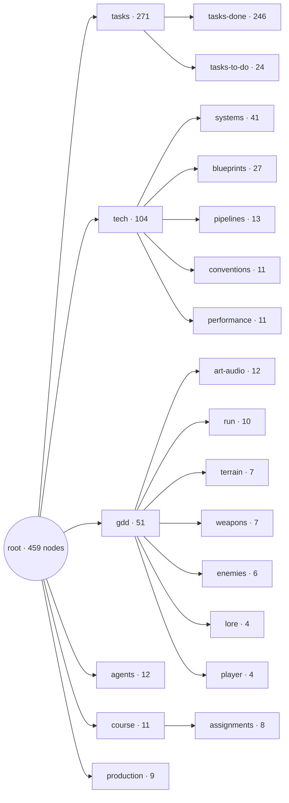
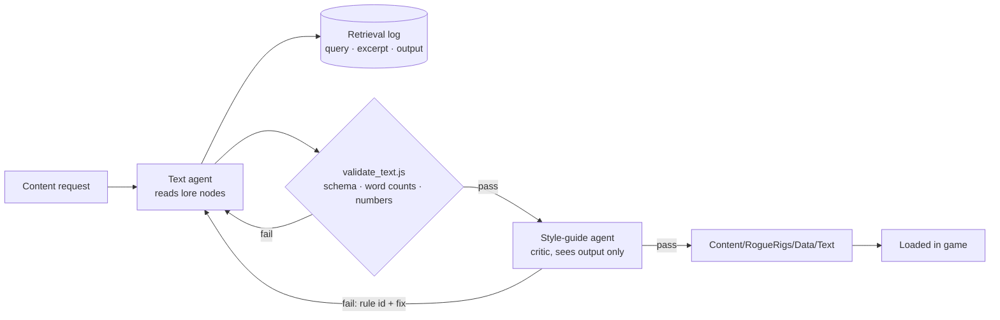

# Assignment 4 — Dynamic Content Pipeline

**ELVTR · Multi-Agent AI for Game Development** · Soumois Pierre-Emmanuel

> **Status:** the pipeline ran end to end for all three content types on 2026-10-10. Every number, quote and file below comes from the committed content files, logs and review files; the commands in [How to run it](#how-to-run-it) reproduce the validator results. The run on 2026-10-10 was followed by two real changes, both recorded below: a rule (T9) added after the owner misread an alert line in a playtest, and a second version of the upgrade lines with a per-stat retrieval.

| Rubric criterion | Where it is answered |
|---|---|
| Game-anchored source | [Knowledge base](#knowledge-base-game-anchored-source) |
| Content fit | [Content fit](#content-fit-the-gap-and-the-output-that-fills-it) |
| RAG implementation | [RAG implementation](#rag-implementation-query-retrieved-excerpt-output) |
| Consistency checking | [Consistency checking](#consistency-checking-what-the-critic-caught) |
| Voice judgment | [Voice judgment](#voice-judgment-baseline-without-lore-vs-final) |

⬅️ [Assignment 3](../A3-agent-crew/) · [All assignments](../)

## Goal

Generate content that *Rogue Rigs* actually needs, from the game's own lore, so it sounds like this game and not like generic sci-fi.

## Knowledge base (game-anchored source)

**Criterion: game-anchored source.** The knowledge base is not a separate document written for this exercise. It is the lore branch of the game's own design document (`vault/reference/gdd/`), the same nodes the dev crew reads for every task. `lore` (world, factions, rules L1-L4) is part of the GDD; the owner extended it on 2026-10-09 and 2026-10-10 with the two crew voices, the company voice, the text rules T1-T9 and the film pool. All of it describes mechanics that exist in the game (alert bar, console hack, shuttle countdown, upgrades), so every generated line can be checked against a real event.

The project vault, the same one the dev crew reads. The lore nodes are the GDD lore, extended:

| Node | Holds |
|---|---|
| [`lore`](../../vault/reference/gdd/lore.md) | World, factions, rules L1–L4 |
| [`crew-characters`](../../vault/reference/gdd/crew-characters.md) | Rook (the miner) and Vesna (the colleague in orbit) |
| [`fictional-films`](../../vault/reference/gdd/fictional-films.md) | The in-universe films Rook quotes |
| [`company-voice`](../../vault/reference/gdd/company-voice.md) | How Kessler-Voss speaks to the public and to threats |
| [`dialogue-tone`](../../vault/reference/gdd/art-audio/dialogue-tone.md) | Text rules T1–T9 |

The whole vault, which the text agent reaches by descent from `root` (generated by `node vault/scripts/vault-map.js`):

<!-- vault-map:start -->

<!-- vault-map:end -->

| The whole vault (Parent Graph view in Obsidian) | The game design branch: `lore` and its children are the knowledge base |
|---|---|
| [](../../docs/images/vault-overview.png) | [](../../docs/images/vault-gdd-zoom.png) |

## Pipeline



- Text agent: [`.claude/agents/text.md`](../../.claude/agents/text.md) · spec [`agent-text`](../../vault/reference/agents/agent-text.md)
- Critic: [`.claude/agents/style-guide.md`](../../.claude/agents/style-guide.md) · spec [`agent-style-guide`](../../vault/reference/agents/agent-style-guide.md)

## Content fit: the gap and the output that fills it

**Criterion: content fit.** Three content types, each one answering something the game is missing today. The gaps are from the project's own design nodes ([`assignment-4-plan`](../../vault/reference/course/assignments/assignment-4-plan.md), [`sys-upgrades`](../../vault/reference/tech/systems/sys-upgrades.md), [`sys-hud-pressure`](../../vault/reference/tech/systems/sys-hud-pressure.md)).

| Content type | Gap in the game today | Output that fills it | File |
|---|---|---|---|
| **Upgrade card texts** | Level-up cards are purely functional: stat name, target, value (for example "Damage", "All weapons", "+12%"). Nothing says who Rook is or what the upgrade means in this world. | 13 one-line Rook flavor lines, one per stat card, 3 to 12 words, shown under the stat name. | [`upgrade_texts.json`](../../Content/RogueRigs/Data/Text/upgrade_texts.json) |
| **Barks** (Rook and Vesna) | The game has no dialogue at all. The two crew members exist only in the GDD. | 34 barks (Rook 20, Vesna 14) on all 14 existing game events (level up, upgrade offer, player damaged, horde incoming, console dropped / hack started / hacked, bonus chest dropped / opened, extraction ready, shuttle landed, run won / lost, game over), 3 to 8 words, tone from a fixed list of five (13 cocky, 11 deadpan, 10 technical). | [`barks.json`](../../Content/RogueRigs/Data/Text/barks.json) |
| **Kessler-Voss alerts** | The alert bar shows event icons and no voice: the company that hunts the player has no presence in text. | 15 alert lines, 3 for each of the 5 alert events (console, bonus chest, horde, extraction, shuttle countdown): 10 in the cold bureaucratic register toward threats, 5 in the glossy propaganda register. | [`alerts.json`](../../Content/RogueRigs/Data/Text/alerts.json) |

What the output looks like (copied from the files, not from a screenshot):

| Type | Example from the file |
|---|---|
| Upgrade card, stat `Damage` | Damage / "Every hit lands harder, and the company's repair bill grows." |
| Rook bark, `level_up`, cocky | "Level up. Odds just got nervous." |
| Vesna bark, `player_damaged`, deadpan | "Another shortcut, Rook? Like the Pallas run." |
| Alert, `bonus_chest_dropped`, bureaucratic | "Cache contents remain company property. Tampering will be invoiced." |
| Alert, `extraction_ready`, propaganda | "Kessler-Voss proudly sends reinforcements to protect everyone's bright future." |

How the files reach the game (all in C++, no AI at runtime): the loader in [`Source/RogueRigs/Text/`](../../Source/RogueRigs/Text/) (documented in [`sys-text-content`](../../vault/reference/tech/systems/sys-text-content.md)) reads the three files. The upgrade component puts the Rook line into the card's description text, and the run-flow and HUD code pick an alert line for each of the 5 alert events. The display is in the HUD Blueprint `WBP_HUD`, documented in [`wbp-hud`](../../vault/reference/tech/blueprints/wbp-hud.md): the card flavor line is the part of the card description before its first newline (tasks 080 and 084), and the company alert line under the shuttle countdown is shown once, for 8 s, when the countdown starts (task 085). The owner saw an alert line under "Shuttle: 41 s" in a playtest screenshot on 2026-10-10; that is how the misreading described in [Consistency checking](#consistency-checking-what-the-critic-caught) was found. The card line has not been confirmed on screen yet. Barks are delivered as data files and loaded, but not displayed (owner decision). The loader has 6 automation tests (`RogueRigs.Text.*`, [`RRTextContentTests.cpp`](../../Source/RogueRigs/Tests/RRTextContentTests.cpp)), and the full headless suite passed 201/201 when the loader was committed (task-079-01).

## RAG implementation: query, retrieved excerpt, output

**Criterion: RAG implementation.** There is no vector database. The text agent *retrieves by descent*: it reads the lore nodes that the vault index leads to, notes which node and which exact sentence drives a line, then writes the line. For every item it logs the query, the node ids read, the excerpt and the output ([log schema](../../vault/reference/tech/pipelines/text-run-log-schema.md)). The validator then checks that **each logged excerpt appears word for word in the node it cites** (check `excerpt-verbatim`), that the logged output equals the text in the content file, and that a number in a bark or alert also appears in a retrieved excerpt. A row below therefore cannot cite a sentence the node does not contain.

Logs: [upgrade texts (v2)](../../Tools/content/logs/20261010-112603-upgrade_texts.json), [barks](../../Tools/content/logs/20261010-103303-barks.json), [alerts (second run)](../../Tools/content/logs/20261010-112240-alerts.json). The 11 rows below (3 upgrade lines, 4 barks, 4 alerts) are copied from those entries (loop 0, first generation, unless a row says otherwise). The first versions of the upgrade lines and of the alerts were replaced during the day, see [Consistency checking](#consistency-checking-what-the-critic-caught) and [Voice judgment](#voice-judgment-baseline-without-lore-vs-final); their logs are kept: [upgrade texts v1](../../Tools/content/logs/20261010-103239-upgrade_texts.json), [alerts, first run](../../Tools/content/logs/20261010-103242-alerts.json).

| Item | Query | Retrieved excerpt (node: text, verbatim) | Output |
|---|---|---|---|
| `upg_damage` (upgrade) | Rook trait for damage: gear and things blowing up (Damage): that stat's own line in upgrades plus one fitting Rook trait or jargon word | `upgrades`: "Stacking: percentage bonuses add together"<br>`crew-characters`: "Proud scrapper: loves his gear, loves it when things blow up, always counting his cut." | Every hit lands harder, and the company's repair bill grows. |
| `upg_max_health` (upgrade) | Rook jargon word for max health: hull patch (Max health): that stat's own line in upgrades plus one fitting Rook trait or jargon word | `upgrades`: "max health +20 / +30 / +45 / +60 / +80"<br>`crew-characters`: "coolant, torque, drill bit, payload, burn window, hull patch, yield, redline." | More max health: another hull patch, no company warranty. |
| `upg_piercing` (upgrade, loop 0 failed T3) | Rook film quote for piercing, title must be in the catalogue (Piercing): that stat's own line in upgrades plus one fitting Rook trait or jargon word | `upgrades`: "blue +1, purple +2, yellow +3 pierced robots"<br>`crew-characters`: "Cocky; waves the odds away; improvises first, thinks later, and defends a shaky plan with total confidence."<br>`fictional-films`: "Only titles in this list may be quoted; new titles go through the owner."<br>`fictional-films`: "Last Inaction Hero (provisional)" | Loop 0: Like in Last Inaction Hero: one shot, several robots, zero invoices.<br>Shipped (loop 1): Like in Last Inaction Hero: each round punches through the robot queue. |
| `vesna_player_damaged_01` (bark) | vesna voice for player_damaged | `crew-characters`: "The Pallas run: Rook cut through a debris field" | Another shortcut, Rook? Like the Pallas run. |
| `vesna_run_won_01` (bark) | vesna voice for run_won | `crew-characters`: "The Ceres job: Rook's plan; they lost the ship." | Clean extraction. Better than the Ceres job. |
| `vesna_console_dropped_01` (bark) | vesna voice for console_dropped | `lore`: "drops a console there as an access point" | Access point deployed. Go find it. |
| `rook_horde_incoming_01` (bark) | rook voice for horde_incoming | `fictional-films`: "The line is always original: never a real film line" | Like in Cliffhangover: everybody panic politely. |
| `kv_console_dropped_02` (alert) | bureaucratic register toward threats | `company-voice`: "Cold, impersonal, procedural: notice numbers, asset language, invoices; no emotion, no insult." | Access point flagged for immediate asset recovery. |
| `kv_bonus_chest_dropped_03` (alert) | bureaucratic register toward threats | `company-voice`: "Cold, impersonal, procedural: notice numbers, asset language, invoices; no emotion, no insult." | Cache contents remain company property. Tampering will be invoiced. |
| `kv_console_dropped_03` (alert) | propaganda register toward the public | `company-voice`: "mining sold as a gift to humanity." | Kessler-Voss keeps every connection safe for your future. |
| `kv_shuttle_countdown_01` (alert, second run) | T9 rule and lore meaning of the extraction countdown for a rewritten shuttle_countdown | `dialogue-tone`: "Company text never orders the player to stop or do something that contradicts the objective; it states what the company does"<br>`lore`: "Company reinforcements arriving" | Reinforcements dispatched to the site. Arrival is imminent. |

Reading the table honestly:

- The excerpt drives the *content* where it carries a fact. The Pallas run and the Ceres job are the past jobs Vesna may name ([`crew-characters`](../../vault/reference/gdd/crew-characters.md)). The lore row "Company reinforcements arriving" is why the countdown alerts speak of reinforcements and recovery units arriving, not of a shuttle leaving.
- Where the excerpt is a *voice description* (the company's register, Rook's trait line), it drives the register, not the words.
- The upgrade rows are retrieved per stat (v2): the log pairs a line from the `upgrades` node with one `crew-characters` trait or jargon word chosen for that stat. The `upgrades` excerpt is only partly stat-specific. Across the 13 items of the v2 log, 5 retrieve a line with that stat's own values (crit chance, crit damage, max health, luck, piercing), 6 retrieve a generic list sentence of stat names (fire rate, magazine size, move speed, pickup radius, XP gain, mining speed), and 2 retrieve a nearby rule (damage: the stacking rule, shown above; reload speed: "damage, fire rate and reload upgrades weigh 3").
- The film title in a bark (Cliffhangover) comes from the catalogue in [`fictional-films`](../../vault/reference/gdd/fictional-films.md); for the bark the log cites the *rule* excerpt of that node. In v1 the piercing line quoted Die Hardly without `fictional-films` in the nodes read. In v2 the log lists `fictional-films` for the title in `upg_piercing`, so that title is now traced. Last Inaction Hero is one of the 47 titles still marked `provisional`.

## Consistency checking: what the critic caught

**Criterion: consistency checking.** Two layers. The *validator* ([`validate_text.js`](../../Tools/content/validate_text.js)) is deterministic and checks schema, ids, enums, word counts, digits in flavor lines, reuse of vault example lines, verbatim excerpts, and the correction loop itself (a failed item must have a loop-1 correction in the log, and a loop-1 entry must follow a recorded fail). The *critic* is the `style-guide` agent, a different model from the generator (Opus reviews, Sonnet writes). By its definition it sees only the content file and the numbered rules (L1-L4 in [`lore`](../../vault/reference/gdd/lore.md), T1-T9 in [`dialogue-tone`](../../vault/reference/gdd/art-audio/dialogue-tone.md)) and returns, per item, pass or fail, one rule id, a reason and a corrected line. Maximum 2 correction loops, then the owner rules. Definition: [`.claude/agents/style-guide.md`](../../.claude/agents/style-guide.md).

Review files: upgrade texts [v1](../../Tools/content/logs/20261010-103239-upgrade_texts.review.json) and [v2](../../Tools/content/logs/20261010-112603-upgrade_texts.review.json), [barks](../../Tools/content/logs/20261010-103303-barks.review.json), alerts [first run](../../Tools/content/logs/20261010-103242-alerts.review.json) and [second run](../../Tools/content/logs/20261010-112240-alerts.review.json), [film pool](../../Tools/content/logs/a4-film-pool-1.review.json).

### The catches in the content (90 line reviews at round 0, 10 failed)

The critic reviewed the content in five runs: upgrade lines v1 (13), barks (34), alerts first run (15), upgrade lines v2 (13) and alerts second run (15), which makes 90 line reviews at round 0 (62 lines in the first three runs, 28 in the two re-runs). 10 failed. Catches 1 to 3 are from the first runs, 4 to 7 from the second alerts run (the T9 story below), 8 to 10 from the v2 upgrade lines (see [Voice judgment](#voice-judgment-baseline-without-lore-vs-final)).

| # | Item | Before (loop 0) | Rule | Critic's reason (verbatim) | After (loop 1) |
|---|---|---|---|---|---|
| 1 | `upg_magazine_size` (upgrade v1) | Bigger mag, fewer reloads, more time making robots regret. | **L3** (robots only do their job; jokes target the company, not robot cruelty) | The joke gloats over making the robots suffer instead of aiming at the company. | Bigger mag, fewer reloads, more company hardware on the scrap pile. (v1 file; no longer shipped, v2 replaced all 13 lines) |
| 2 | `rook_console_hacked_02` (bark, Rook) | Like in Universal Solder: access granted, feelings optional. | **T3** (no real film line, no well-known catchphrase) | The quoted line is built on "access granted", a stock hacker-movie catchphrase, so the film quote is not an original line. | Like in Universal Solder: firewall folded first. |
| 3 | `rook_run_lost_01` (bark, Rook, tone `technical`) | Missed the shuttle. Corporate wins, again. | **T4** (Rook: Rigs jargon and punchlines under stress) | The line is labelled technical but has no Rigs jargon or shop talk, so it does not deliver the technical Rook register its tone claims. | Missed the burn window. Corporate keeps the yield. |
| 4 | `kv_bonus_chest_dropped_01` (alert, bureaucratic) | Unclaimed cache deployed. Retrieval by unauthorized personnel is prohibited. | **T9** (company text never orders the player against the objective) | Declaring retrieval by unauthorized personnel prohibited forbids the player from taking the chest, which contradicts the objective instead of stating what the company does. | Unregistered cache detected. Contents logged as company property. |
| 5 | `kv_horde_incoming_01` (alert, bureaucratic) | Security response escalated. Unauthorized personnel are advised to disperse. | **T9** | Advising unauthorized personnel to disperse is an order aimed at the player rather than a statement of what the company does. | Security response escalated. Additional units assigned to the claim. |
| 6 | `kv_extraction_ready_01` (alert, bureaucratic, rewritten draft) | Unregistered shuttle detected. Extraction route is now active. | **T9** | Extraction route is now active does not state a company action and can read as the company opening the route for the player or announcing its own extraction. | Unregistered shuttle detected. Recovery units assigned to its landing zone. |
| 7 | `kv_extraction_ready_02` (alert, propaganda, rewritten draft) | Every extraction is noted. Kessler-Voss reinforcements are on the way. | **T6** | Tagged propaganda but reads as a cold surveillance warning, with none of the upbeat public register of the company voice. | Kessler-Voss proudly sends reinforcements to protect everyone's bright future. (the text agent's own wording; the critic had suggested "Kessler-Voss is proud to send more protection, for everyone's future.") |
| 8 | `upg_crit_damage` (upgrade v2) | Crits hit harder; I do love it when things blow up. | **T3** | "I do love it when things blow up" paraphrases the well-known catchphrase "I love it when a plan comes together", and crits do not make things blow up. | Crits hit harder now; corporate gets to price the extra dents. |
| 9 | `upg_xp_gain` (upgrade v2) | XP gain up: levels come sooner, thinking comes later. | **T2** | With no speaker marker, "thinking comes later" reads as a jab at the player's thinking rather than Rook's self-mockery. | XP gain up: I level up sooner, and still plan later. |
| 10 | `upg_piercing` (upgrade v2) | Like in Last Inaction Hero: one shot, several robots, zero invoices. | **T3** | The title is in the pool, but "one shot, several robots" riffs on the well-known catchphrase "one shot, one kill" (the film Sniper), so the line is not original. | Like in Last Inaction Hero: each round punches through the robot queue. |

Round 1 (the same critic, on the corrected files): all lines pass: 13 upgrade lines (v1), 34 barks, 15 alerts (second run), 13 upgrade lines (v2), which is 75 line reviews and no fail. The corrected items carry these reasons in the review files, for example: "Corrected: robots are now company hardware being scrapped, no gloating over robot suffering (L3).", "Corrected: Universal Solder is in the catalogue and the quoted line is original.", "Corrected: burn window and yield give the technical Rook register.", "Corrected: the company now only logs the cache, so it no longer forbids the player anything.", "Corrected: now upbeat propaganda with the future theme and no jokes or jargon."

How the first three corrections were made, from the loop-1 entries of the retrieval logs: the text agent queried the vault again with a query aimed at the cited rule, then wrote the correction.

| Item | Loop-1 query | Excerpt retrieved |
|---|---|---|
| `upg_magazine_size` | Fix L3 fail: joke must target the company, not robot cruelty | `lore`: "L3 The robots are only doing their job; jokes target the company, not robot cruelty." |
| `rook_console_hacked_02` | Original film line for a console hack, Rook (critic T3) | `fictional-films`: "The line is always original: never a real film line" |
| `rook_run_lost_01` | Rook line with Rigs jargon for a lost run (critic T4) | `crew-characters`: "coolant, torque, drill bit, payload, burn window, hull patch, yield, redline" |

In catches 1 to 6 and 8 to 10 the line that ships (or shipped, for catch 1) is the critic's suggestion word for word. Only catch 7 was reworded by the text agent (its loop-1 query is "correction after critic round 0 for kv_extraction_ready_02", with the `dialogue-tone` sentence "Kessler-Voss: propaganda toward the public, cold bureaucracy toward threats, never jokes" as excerpt), and the critic passed that wording in round 1. "Burn window" and "yield" in catch 3 are two words of the jargon list retrieved in that loop. The validator confirms the loop is consistent: it fails if a loop-1 entry exists for an item the critic did not fail, or if a failed item has no correction.

#### The T9 catch: a human found it first

This one did not start with the critic. In the first alerts run (`20261010-103242-alerts`), `kv_shuttle_countdown_02` read "Recovery units arrive shortly. Cease all extraction." The critic had passed it in round 0, with the reason "Bureaucratic order; recovery units are inbound, not present on site." (that run had 15 pass, 0 fail). On 2026-10-10 the owner played the game and did not understand the line shown under "Shuttle: 41 s": a player reads HUD text as guidance, and it told them to stop when the objective is to reach the shuttle. The owner's finding, not the critic's, produced a new rule, **T9** in [`dialogue-tone`](../../vault/reference/gdd/art-audio/dialogue-tone.md): company text never orders the player to stop or do something that contradicts the objective; it states what the company does.

What followed (task-082, run `20261010-112240-alerts`, [log](../../Tools/content/logs/20261010-112240-alerts.json) and [review](../../Tools/content/logs/20261010-112240-alerts.review.json)):

- The text agent rewrote the 6 shuttle and extraction lines (`kv_extraction_ready_01` to `03`, `kv_shuttle_countdown_01` to `03`). Its query for each: "T9 rule and lore meaning of the extraction countdown", with the T9 sentence of `dialogue-tone` and the lore sentence "Company reinforcements arriving" as excerpts.
- The critic, now holding T9, reviewed all 15 lines: 11 pass, 4 fail (catches 4 to 7 above). Two of the four fails were new drafts (`kv_extraction_ready_01` T9, `kv_extraction_ready_02` T6). The other two, `kv_bonus_chest_dropped_01` and `kv_horde_incoming_01`, were older lines from the first run that had passed before and that the new rule caught ("prohibited" and "advised to disperse" are orders to the player).
- After correction, round 1: 15 pass.

The line that started it, before and after:

| Item | Before (first run, seen in the playtest) | Rule | Reason | After (shipped) |
|---|---|---|---|---|
| `kv_shuttle_countdown_02` | Recovery units arrive shortly. Cease all extraction. | **T9** (written after this line) | The line orders the player to stop extracting while the objective is to reach the shuttle. The owner misread it in the playtest; the critic had passed it. | Recovery units are inbound and closing on the site. |

The shipped version passed round 0 of the second run without a correction. The lesson recorded here is T9 itself: a rule written from one human reading, then applied by the critic to all 15 lines, where it caught two older lines nobody had flagged. The critic did not find the original problem; it had no rule that could.

What the critic did **not** catch: in the first runs all 15 alerts passed on the first round, including the line above and the two older lines T9 later caught. Across the five runs 80 of the 90 line reviews passed at round 0, and 32 of 34 barks passed first time. The critic is another language model, not ground truth; its pass reasons on barks are empty strings in the review file, so for those items only the verdict is on record.

### The film pool (2 fails)

Before the runs, the film catalogue in [`fictional-films`](../../vault/reference/gdd/fictional-films.md) was grown from the owner's example titles (Cry Hard, Die Hardly, Try Hard) to 50 parody titles of 80s and 90s action films, then reviewed by the same critic against T3 (parody titles only, recognisable as parodies). Result in [`a4-film-pool-1.review.json`](../../Tools/content/logs/a4-film-pool-1.review.json): 48 pass, 2 fail.

| Title (before) | Rule | Critic's reason (verbatim) | After (now in the catalogue) |
|---|---|---|---|
| Twisted Ankle | **T3** | No 80s/90s action film is recognisable behind the title, so it reads as a plain phrase rather than a parody as fictional-films requires. | Broken Arrears |
| Daylight Savings | **T3** | Daylight Savings is the unchanged title of a real 2012 film, and as a common phrase it barely points to the Stallone film Daylight. | Daylight Overtime |

Both critic suggestions were applied as written (commit `8ecf10f`). The corrected titles were not sent through a second recorded critic round, and the catalogue marks 47 of the 50 titles `provisional` until the owner reads them. The corrected title "Broken Arrears" is used in a shipped bark (`rook_run_lost_02`).

## Voice judgment: baseline without lore vs final

**Criterion: voice judgment.** This is a self-assessment by the author of the pipeline. The only player reading on record is the owner's playtest of 2026-10-10, which found the "Cease all extraction" line (see [Consistency checking](#the-t9-catch-a-human-found-it-first)); nobody has rated the lines' voice.

**The comparison.** Before the real runs, the same text agent (same definition, [`.claude/agents/text.md`](../../.claude/agents/text.md), same model, Sonnet) wrote a baseline of 6 items per content type (18 in total) **without reading any lore node**: only the file schema and the mechanic node. The baseline is kept in [`Tools/content/logs/baseline/`](../../Tools/content/logs/baseline/) (content files plus retrieval logs with `"retrieval": false`). It passes the validator, was **not** reviewed by the critic, and is never loaded in game (the loader refuses a `-noretrieval` run id, and the validator refuses one outside the logs folder). The final run is the content in `Content/RogueRigs/Data/Text/`.

Same item ids, baseline text on the left, final text on the right (the final upgrade lines are the current v2 lines; the final alert lines are those of the second alerts run):

| Item | Baseline (no lore) | Final (reads the vault) |
|---|---|---|
| `upg_damage` | Hit harder and let the rocks complain. | Every hit lands harder, and the company's repair bill grows. |
| `upg_fire_rate` | More bullets, fewer second thoughts. | Trigger's at redline: more shots every second, no warranty. |
| `upg_reload_speed` | Fresh magazine in a heartbeat. | Mags swap faster. Fewer seconds for the robots to enjoy. |
| `upg_crit_chance` | Lucky shots find the weak spots. | More shots land as crits; I waved the odds away. |
| `upg_crit_damage` | When it lands, it really lands. | Crits hit harder now; corporate gets to price the extra dents. |
| `upg_magazine_size` | A bigger clip means longer firefights. | Bigger mag, more shots before reloading. Payload, not paperwork. |
| `rook_level_up_01` | Stronger already. Try keeping up. | Level up. Odds just got nervous. |
| `vesna_player_damaged_01` | That looked painful. Keep moving. | Another shortcut, Rook? Like the Pallas run. |
| `rook_horde_incoming_01` | Bring them all. I brought ammo. | Like in Cliffhangover: everybody panic politely. |
| `vesna_console_hack_started_01` | Uplink running. Hold the perimeter. | Stay near it. Rook, that includes you. |
| `rook_bonus_chest_opened_01` | Another gift from our generous employer. | Jackpot. Add it to my cut. |
| `vesna_extraction_ready_01` | Extraction approved. Form filed. Go. | Extraction is ready. Move your feet. |
| `kv_console_dropped_01` | Console deployed. Please retrieve it promptly. | Network breach logged. Unauthorized access point detected. |
| `kv_bonus_chest_dropped_01` | Wonderful news! A reward awaits your loyal service. | Unregistered cache detected. Contents logged as company property. |
| `kv_horde_incoming_01` | Hostile activity detected. Incident report pending. | Security response escalated. Additional units assigned to the claim. |
| `kv_extraction_ready_01` | Extraction is ready. Thank you for your dedication. | Unregistered shuttle detected. Recovery units assigned to its landing zone. |
| `kv_shuttle_countdown_01` | Shuttle departs on schedule. Late arrivals unaccounted. | Reinforcements dispatched to the site. Arrival is imminent. |
| `kv_horde_incoming_02` | Opportunity approaches! Defend company assets with pride. | Your safety is our priority. Protection units are deploying. |

**What the lore changed, and does it sound like Rogue Rigs?**

- *Upgrade lines.* The baseline lines have no speaker: they are interchangeable sci-fi flavor that could sit in any shooter. The final (v2) lines are Rook talking ("I waved the odds away", "every scrap counts toward my cut", "Shaky plan, total confidence"), and they use the Rigs jargon and traits retrieved for each stat (redline, payload, hull patch, drill bit, torque). 3 of the 13 name the company or corporate (damage, crit damage, max health). This is still the clearest gain over the baseline.
- *Alerts.* The baseline treats the player as a loyal employee ("your loyal service", "Thank you for your dedication", "Defend company assets with pride"). In this game the company hunts the player: [`company-voice`](../../vault/reference/gdd/company-voice.md) calls the Rigs "unauthorized personnel", never customers. The final lines use that vocabulary ("unauthorized", "asset", "invoiced", "unregistered", "logged"). The baseline countdown line "Shuttle departs on schedule" also misreads the mechanic: [`lore`](../../vault/reference/gdd/lore.md) defines the countdown as company reinforcements arriving, which the final line says. In my judgment this is where retrieval prevented a lore error rather than only adding flavor. (The baseline was not run through the critic, so this is my reading, not a recorded verdict.) Retrieval did not prevent every error: the first final run also contained "Cease all extraction", which was lore-consistent and passed the critic, and was still misread by a player (see [the T9 catch](#the-t9-catch-a-human-found-it-first)).
- *Barks.* The baseline barks could be anyone's. Only the final ones can name the Pallas run, the Ceres job or a film from the pool, because only the final run read them. Rook now says "hull patch", "burn window", "yield" (Rigs jargon from `crew-characters`), and Vesna's lines are aimed at Rook.
- *Where the baseline is as good or better.* "Extraction approved. Form filed. Go." (baseline Vesna) is a better joke than the final "Extraction is ready. Move your feet.", and several final lines are plain ("Shuttle is down. Board it."). The "Like in <film>: ..." pattern appears in three shipped barks and one upgrade line, which is the idea working but also a mild tic. The final lines are more consistent with the lore; they are not uniformly funnier.

**The concrete tweak: upgrade lines v1 and v2 (task-083).** v1 is the first set of upgrade lines (run `20261010-103239-upgrade_texts`, critic-approved, kept in [`Tools/content/logs/v1/upgrade_texts.json`](../../Tools/content/logs/v1/upgrade_texts.json)). The change made for v2 (run `20261010-112603-upgrade_texts`, [log](../../Tools/content/logs/20261010-112603-upgrade_texts.json), [review](../../Tools/content/logs/20261010-112603-upgrade_texts.review.json)):

1. *Retrieval per stat.* v1 retrieved the same two Rook voice excerpts (`crew-characters` and `dialogue-tone` T4) for all 13 items; only the mechanic excerpt changed. v2 retrieves a pair per stat: the stat's own line in `upgrades` plus one `crew-characters` trait or jargon word that fits it (for example `redline` for fire rate, `payload` for magazine size, `hull patch` for max health).
2. *`fictional-films` logged whenever a title is quoted.* In v1 the Die Hardly line did not list the node it came from; in v2 the piercing entry logs two `fictional-films` excerpts.
3. *Lines written to say what the stat does*, while keeping the Rook voice (the task brief asked for T4, T2, T3, T8 and T9).

The 13 stats, v1 and v2 side by side (v1 is the file in `logs/v1`, so `upg_magazine_size` is its corrected line; v2 is the current [`upgrade_texts.json`](../../Content/RogueRigs/Data/Text/upgrade_texts.json), after its own corrections):

| Stat | v1 (same two voice excerpts for all) | v2 (per-stat retrieval, shipped) |
|---|---|---|
| Damage | Harder hits, so the company's robots fold faster. | Every hit lands harder, and the company's repair bill grows. |
| Fire rate | More shots every second. My trigger finger files no complaints. | Trigger's at redline: more shots every second, no warranty. |
| Reload speed | Mag swaps faster than corporate can say overtime. | Mags swap faster. Fewer seconds for the robots to enjoy. |
| Crit chance | More lucky hits. I call it skill; the odds disagree. | More shots land as crits; I waved the odds away. |
| Crit damage | When a crit lands, it lands like a rockslide. | Crits hit harder now; corporate gets to price the extra dents. |
| Magazine size | Bigger mag, fewer reloads, more company hardware on the scrap pile. | Bigger mag, more shots before reloading. Payload, not paperwork. |
| Max health | Extra hull plating for me, welded on cheap. | More max health: another hull patch, no company warranty. |
| Move speed | Run faster. Walking away from robots is overrated. | Move speed up: still in the wrong place, just leaving faster. |
| Pickup radius | Ore jumps into my pockets from farther away. | Grabs pickups from farther away; every scrap counts toward my cut. |
| XP gain | Levels come quicker; the company trains me for free. | XP gain up: I level up sooner, and still plan later. |
| Mining speed | Drill bites faster, ore leaves before corporate shows up. | Fresh drill bit, more torque: rock falls faster. |
| Luck | Luck bends the card odds my way, as usual. | Better luck means better cards. Shaky plan, total confidence. |
| Piercing | Shots punch through robots, like Die Hardly but cleaner. | Like in Last Inaction Hero: each round punches through the robot queue. |

Critic verdicts, from the review files:

| | v1 | v2 |
|---|---|---|
| Round 0 | 12 pass, 1 fail: `upg_magazine_size` (L3) | 10 pass, 3 fail: `upg_crit_damage` (T3), `upg_xp_gain` (T2), `upg_piercing` (T3) |
| Round 1 (after correction) | 13 pass | 13 pass |

Honest reading. v2 is clearer about the stat: most lines now name it or say what it does ("Every hit lands harder", "more shots every second", "Grabs pickups from farther away", "Move speed up", "Better luck means better cards"), where several v1 lines were jokes that left the stat to the card title (for example "When a crit lands, it lands like a rockslide", "Luck bends the card odds my way, as usual"). The cost is visible too. v2 drew more critic fails at round 0 (3 of 13 against 1 of 13), two of them for T3 catchphrase paraphrases. It names the company less (3 lines name the company or corporate, against 5 in v1), and several lines read as a stat label followed by a joke ("XP gain up: ...", "Move speed up: ..."), which, in my reading, is less natural as a character's voice than the best v1 lines ("My trigger finger files no complaints", "I call it skill; the odds disagree"). The critic's verdicts say only that v2, once corrected, breaks no rule. They do not say v2 is funnier or better to read, and no player has compared the two versions. It was adopted because it explains the stat better and passes the validator and the critic, not because a test showed it to be better.

Other changes recorded in the logs, apart from the v1 to v2 tweak:

1. *Retrieval switched on versus off.* The one controlled change between baseline and final. Baseline: `"retrieval": false`, no node ids, no excerpts, and the same generic query for every item of a type ("write short in-game text for a top-down sci-fi mining shooter: upgrade flavor"). Final: `"retrieval": true`, a query per item, nodes and verbatim excerpts logged. The instructions differ in the same direction: the baseline subtask told the agent to read only the schema and the mechanic node ([`task-075-01-baseline-run`](../../vault/reference/tasks/task-075-baseline-run/task-075-01-baseline-run.md)); the final agent is told to read the five lore nodes and obey L1-L4 and T1-T9 ([`text.md`](../../.claude/agents/text.md)).
2. *Queries chosen per register for the alerts.* The alert log alternates two fixed queries, "bureaucratic register toward threats" and "propaganda register toward the public", which retrieve two different `company-voice` sentences; the 10 / 5 split of registers in `alerts.json` follows from it. The 6 rewritten shuttle and extraction lines use a different query (the T9 rule plus the lore meaning of the countdown).
3. *Rule-targeted re-retrieval in the correction loop.* The first three loop-1 entries (L3, T3, T4) query for the cited rule and retrieve the sentence that states it; the v2 upgrade corrections do the same for T3 and T2. The alert corrections of the second run retrieve the T9 sentence (or the T6 rule line for `kv_extraction_ready_02`).

## Numbers

| What | Count |
|---|---|
| Lines shipped | 62: 13 upgrade lines (v2), 34 barks, 15 alerts (second run) |
| Barks by speaker / tone | Rook 20, Vesna 14 / cocky 13, deadpan 11, technical 10 |
| Alerts by register | 10 bureaucratic, 5 propaganda (3 lines for each of 5 events) |
| Baseline lines (no lore, not shipped) | 18: 6 upgrade lines, 6 barks, 6 alerts |
| Film pool | 50 titles |
| Line reviews, round 0 (content) | 90: upgrades v1 13, barks 34, alerts run 1 15, upgrades v2 13, alerts run 2 15; 80 pass, 10 fail |
| Critic round 0, per run | upgrades v1 12 pass / 1 fail; barks 32 pass / 2 fail; alerts run 1 15 pass / 0 fail; upgrades v2 10 pass / 3 fail; alerts run 2 11 pass / 4 fail; film pool 48 pass / 2 fail |
| Critic round 1 | upgrades v1 13 pass; barks 34 pass; upgrades v2 13 pass; alerts run 2 15 pass (75 line reviews, 0 fail); alerts run 1 not needed. Film pool: no second recorded round |
| Catches in the content | 10 (3 L3/T3/T4 in the first runs, 4 T9/T6 in alerts run 2, 3 T2/T3 in upgrades v2); plus 2 in the film pool. The line that led to T9 (`kv_shuttle_countdown_02`, first alerts run) was found by the owner in a playtest, not by the critic, and is not counted in these 10 |
| Correction loops used | 1 (maximum allowed: 2) |
| Validator on the 3 shipped files | exit 0 each (`valid: ...`) |
| Validator on the 3 baseline files | exit 0 each |
| Validator selftest | `selftest OK (3 cases)`: valid barks, invalid barks (4 expected error lines), invalid upgrade texts (1 expected error line) |
| Automation tests | 6 new loader tests (`RogueRigs.Text.*`); full headless suite 201/201 when the loader was committed |

## How to run it

All commands run from the repository root. Node is the only dependency of the content tools.

**Check content (deterministic, no model call).** Reproduces the validator rows of the table above:

```
node Tools/content/validate_text.js Content/RogueRigs/Data/Text/upgrade_texts.json --log Tools/content/logs/20261010-112603-upgrade_texts.json
node Tools/content/validate_text.js Content/RogueRigs/Data/Text/barks.json --log Tools/content/logs/20261010-103303-barks.json
node Tools/content/validate_text.js Content/RogueRigs/Data/Text/alerts.json --log Tools/content/logs/20261010-112240-alerts.json
node Tools/content/validate_text.js --selftest
```

The validator takes `<content file> --log <log file> [--review <review file>]`; without `--review` it uses `<run-id>.review.json` next to the log when that file exists. `--selftest` runs the cases in [`Tools/content/tests/`](../../Tools/content/tests/). Exit 0 means valid; exit 1 prints one JSON line per problem (`item_id`, `check`, `message`); exit 2 is a usage error. It has no other options. Spec: [`text-content-validator`](../../vault/reference/tech/pipelines/text-content-validator.md).

**Generate and review (calls the models).** The pipeline is run through the dev crew, in a Claude Code session opened on this repository:

1. `/task <request>` (for example "write the Rook flavor lines for the upgrade cards"). The Orchestrator checks the request against the GDD, plans one subtask per agent and asks the owner to confirm ([`.claude/commands/task.md`](../../.claude/commands/task.md)).
2. The `text` agent (Sonnet) reads the lore nodes, writes the content file into `Content/RogueRigs/Data/Text/` and its retrieval log into `Tools/content/logs/<run-id>.json`, and runs the validator until it exits 0.
3. The `style-guide` agent (Opus) reviews the content file and writes `Tools/content/logs/<run-id>.review.json`.
4. If there are fails, the `text` agent applies them, adds loop-1 entries to the log and re-runs the validator. The critic reviews again. At most 2 correction loops, then the owner decides.
5. The loader reads the files at game start; nothing else is needed to ship them.

Run ids look like `20261010-112603-upgrade_texts`; a baseline run gets the suffix `-noretrieval` and must stay in `Tools/content/logs/`. Contracts: [`text-content-schema`](../../vault/reference/tech/pipelines/text-content-schema.md), [`text-content-files`](../../vault/reference/tech/pipelines/text-content-files.md), [`text-content-events`](../../vault/reference/tech/pipelines/text-content-events.md).

## Game features added since Assignment 3

Assignment 3 was submitted at the tag [`a3-submission`](https://github.com/soumois/RogueRigs/tree/a3-submission), at the end of task 031 (2026-10-06). Since then the crew has run tasks 032 to 085. The game work came from owner play tests, the text pipeline above from this assignment.

The captures below come from one full run recorded on 2026-10-10 at 10:48 in a standalone game window (level 1 to level 10, ending in an extraction), cropped to the game view. The recording predates the on-screen display of the generated text (tasks 080 and 084), so the cards and alerts in it do not show a generated line yet.

### Visible in the run

**HUD** (video 00:11). Round minimap of the cells already seen, with markers for the miner, console, chest and shuttle (tasks 061, 064). Alert bar twice as wide and tall, with the console (C), bonus chest (B) and shuttle (S) icons (task 062). Weapon slots with name, ammo and reload centred under each slot, `LOCKED` on slots not owned yet (tasks 037, 053).


**Digging a tunnel through small rock cells** (video 02:21–02:33). The grid is 240 × 240 cells of 67 uu instead of 80 × 80 cells of 200 uu at M1. The drone's laser fan cuts several blocks at once, up to 8 and about two rows deep (task 060), and moving into the corner of two blocks still digs (task 065). The robots follow the new corridor as soon as it opens: the flow field is rebuilt on a worker thread with a double buffer (task 066).


**Heal vein** (video 02:33–02:38). Right after the tunnel, the miner mines a red heal vein: the health bar goes from 20 to 47 to 80, with the green heal ring. Mining reaches the whole vein (task 034) and a vein restores 60 HP in total (task 035).


**A pack, damage numbers, XP and a level-up** (video 01:16–01:29). One damage number per hit, no merging (task 059). The very first hit taken flashes the red vignette, 100 → 90 HP (task 055). XP cubes stream to the miner with the Niagara trail (tasks 054, 058). The console locator arrow shows the distance in metres at the bottom (task 040).


**Weapon card at level 5** (video 01:29–01:35). A new weapon is offered as a level-up card every 5 levels (task 032): here Shotgun or Turret launcher. The turret launcher slot unlocks and the turret counter appears (`Turrets: 2 / 2`). New turrets are kept at least 100 uu apart (task 051).


**Console hack and horde** (video 01:47–01:59). `HORDE INCOMING!` banner while the miner hacks the console ("stay close to it"); the hack takes 16 s instead of 20 (task 042).


**Bonus chest** (video 03:01–03:09). One chest per level, dropped at 60 % alert. The miner hacks it for 8 s (yellow ring) for XP, ore and a lucky upgrade choice (task 056). The objective then switches to `Reach the shuttle`.


**Horde, escape, extraction** (video 03:13–03:27). A horde lands during the shuttle countdown and the health bar drops from 75 to 10. The miner digs his way out and follows the locator arrow and the chevrons to the shuttle, which now lands 37 to 50 cells away (task 049).


### Every task since Assignment 3

Full records in [`vault/reference/tasks/`](../../vault/reference/tasks/). "Capture" names the capture above where the change can be seen.

| Area | Task | Change | Capture |
|---|---|---|---|
| Run and pressure | 032 | Third play test: robot recycling, console locator, overtime, faster heavy, English texts, upgrade draw weights, weapon cards every 5 levels, bigger turret | Weapon card |
| | 034 | Fourth play test: bigger projectile hitbox, whole-vein mining, heal pickup fix, small terrain capsules, kamikaze trigger, softer early waves, crowd mix | Heal vein |
| | 036 | Robots left far behind are moved back ahead of the miner instead of removed | — |
| | 041 | Robots spawn beyond the rock the miner digs toward | — |
| | 042 | Console hack 20 → 16 s | Console hack |
| | 044 | Fewer kamikazes: at most 1 per pack in one pack out of two, 1–2 per horde | — |
| | 045 | Easier first level: about 15 % fewer robots, rarer heavies, at most 3 heavies | — |
| | 046 | Level 1 pressure: 80 robots alive at most, packs of one wave at least 120° apart | — |
| | 048 | Current wave director values saved as a last-level data profile (not wired) | — |
| | 049 | Shuttle lands 37 to 50 cells from the miner | Extraction |
| | 056 | Bonus chest: one per level at 60 % alert, 8 s hack, XP, ore, lucky upgrade choice | Bonus chest |
| Robots | 033 | Every robot at 180 uu/s; tests updated to the owner's data changes | — |
| | 038 | A shooter without line of sight walks around rock until it can fire, never away from the miner | — |
| | 039, 052 | Heavy slam radius 400 → 340 → 289 uu; the ground ring follows | — |
| | 047 | Heavy speed 180 → 153 uu/s | — |
| Mining | 035 | A heal vein restores 60 HP in total | Heal vein |
| | 043 | All blocks of a vein being mined shake together | — |
| | 060 | Drone arc reaches 2.5 cells and cuts up to 8 blocks at once | Dig |
| | 065 | Moving diagonally into a corner of two blocks still digs | Dig |
| Weapons | 051 | A new turret is moved at least 100 uu away from standing turrets | — |
| HUD and feedback | 037 | Ammo HUD: ammo bar or blocks, reload bar, turret recharge, padlocks | HUD |
| | 040 | Console locator arrow, pulsing, with the distance in metres | Combat, Extraction |
| | 053 | Weapon slot name, ammo and reload centred under each slot | HUD |
| | 054, 058 | XP cube trail and pickup sparkle rebuilt in Niagara, trail visible in game | Combat |
| | 055 | Red damage vignette on the very first hit, packaged build included | Combat |
| | 059 | One damage number per hit, no merging, random start on a small disc | Combat |
| | 061, 064 | Round minimap of seen cells with markers; reveal circle of 18 cells around the miner | HUD |
| | 062 | Alert bar twice as wide and tall, icons rescaled | HUD |
| Performance and tests | 050, 057 | Two intermittent tests (damage-number stacking, XP pickup) made reliable by fixing the cause | — |
| | 063 | Performance session on a quiet PC: `-game` stress at 67 uu cells, flow-field budget tests | — |
| | 066 | Flow field rebuilt on a worker thread with a double buffer; robots follow a new path within 1–2 frames | Dig |
| | 067 | Stress scenario close to a real game: 150 robots, a horde, full HUD and minimap, Niagara, miner running and digging | — |
| | 068 | Packaged build measured, Unreal Insights capture of the frame spikes | — |
| Text pipeline (this assignment) | 072 | Film pool grown to 50 parody titles, reviewed by the critic | — |
| | 073 | Text content schema: 3 content files, retrieval log, critic review file | — |
| | 074 | `validate_text.js` with selftest cases | — |
| | 075 | Baseline without lore: 6 items per content type | — |
| | 076, 077, 078 | Upgrade card lines, Rook and Vesna barks, Kessler-Voss alerts: write, validate, review, correct | — |
| | 079 | Loader: the text files are read in game and feed the upgrade cards and alert events | — |
| | 080 | Card flavor line and alert text added to the HUD (in progress) | — |
| | 081 | This README filled from the logs and reviews | — |
| | 082 | Shuttle and extraction lines rewritten under the new rule T9, then reviewed | — |
| | 083 | Upgrade lines regenerated with an item-specific retrieval and compared with the first version | — |
| | 084 | Card flavor line visible in game (newline delimiter fixed in `WBP_HUD`) | — |
| | 085 | Company alert line shown once for 8 s when the shuttle countdown starts (in progress) | — |

Queued, not started: 069 (minimum PC specification), 070 (ore nuggets inside rock), 071 (light custom robot movement, on hold), 086 (update of this README with rule T9, the voice tweak and the display status).
