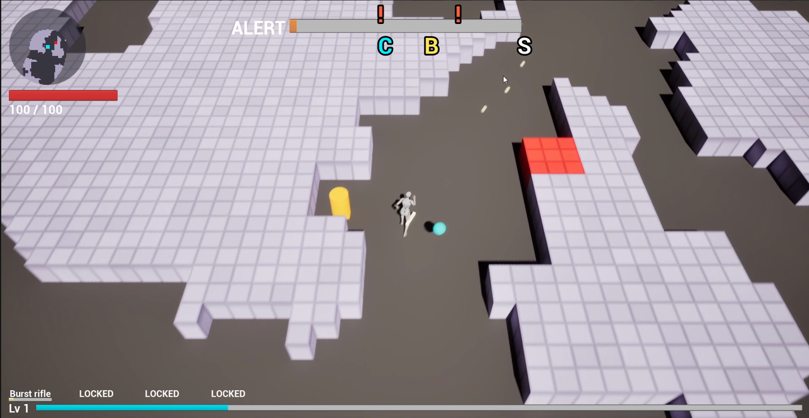
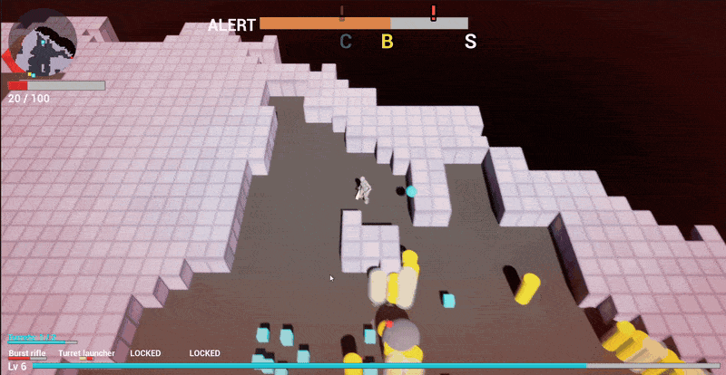
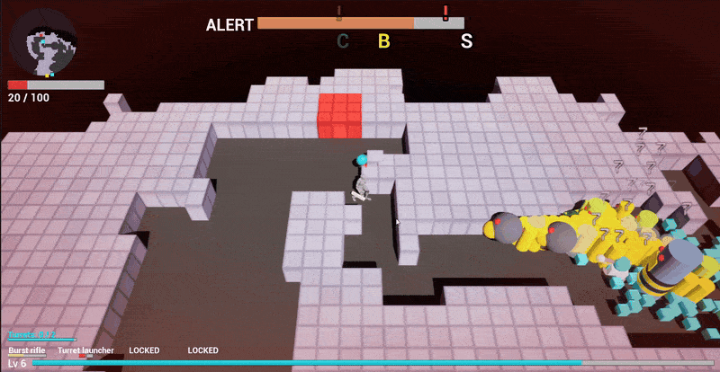
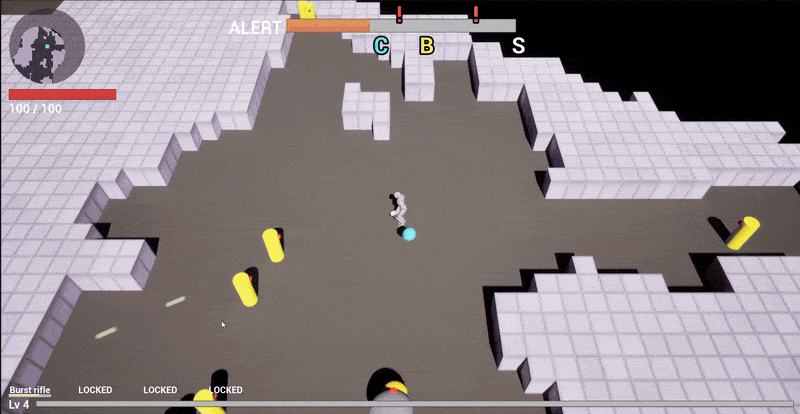
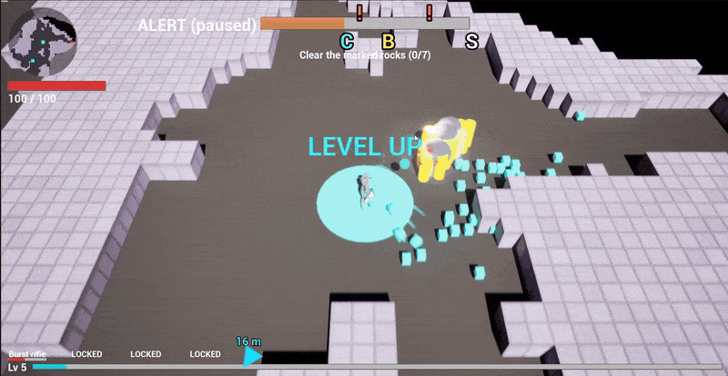
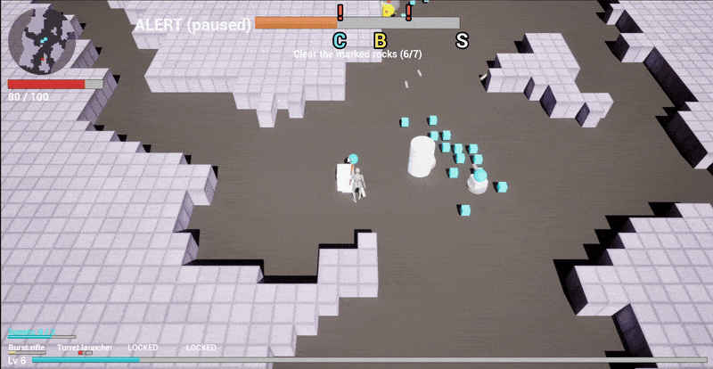
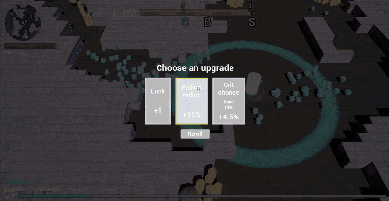
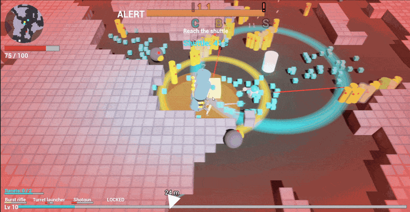

# Game progress since Assignment 3

⬅️ [Assignment 4 README](README.md) · [All assignments](../)

Assignment 3 was submitted at the tag [`a3-submission`](https://github.com/soumois/RogueRigs/tree/a3-submission), at the end of task 031 (2026-10-06). Since then the crew has run tasks 032 to 085, the last task of Assignment 4. The game work came from owner play tests; the text pipeline is described in the [Assignment 4 README](README.md).

The captures below come from one full run recorded on 2026-10-10 at 10:48 in a standalone game window (level 1 to level 10, ending in an extraction), cropped to the game view. The recording predates the on-screen display of the generated text (tasks 080 and 084), so the cards and alerts in it do not show a generated line yet.

## Visible in the run

**HUD** (video 00:11). Round minimap of the cells already seen, with markers for the miner, console, chest and shuttle (tasks 061, 064). Alert bar twice as wide and tall, with the console (C), bonus chest (B) and shuttle (S) icons (task 062). Weapon slots with name, ammo and reload centred under each slot, `LOCKED` on slots not owned yet (tasks 037, 053).

**Digging a tunnel through small rock cells** (video 02:21–02:33). The grid is 240 × 240 cells of 67 uu instead of 80 × 80 cells of 200 uu at M1. The drone's laser fan cuts several blocks at once, up to 8 and about two rows deep (task 060), and moving into the corner of two blocks still digs (task 065). The robots follow the new corridor as soon as it opens: the flow field is rebuilt on a worker thread with a double buffer (task 066).

**Heal vein** (video 02:33–02:38). Right after the tunnel, the miner mines a red heal vein: the health bar goes from 20 to 47 to 80, with the green heal ring. Mining reaches the whole vein (task 034) and a vein restores 60 HP in total (task 035).

**A pack, damage numbers, XP and a level-up** (video 01:16–01:29). One damage number per hit, no merging (task 059). The very first hit taken flashes the red vignette, 100 → 90 HP (task 055). XP cubes stream to the miner with the Niagara trail (tasks 054, 058). The console locator arrow shows the distance in metres at the bottom (task 040).

**Weapon card at level 5** (video 01:29–01:35). A new weapon is offered as a level-up card every 5 levels (task 032): here Shotgun or Turret launcher. The turret launcher slot unlocks and the turret counter appears (`Turrets: 2 / 2`). New turrets are kept at least 100 uu apart (task 051).

**Console hack and horde** (video 01:47–01:59). `HORDE INCOMING!` banner while the miner hacks the console ("stay close to it"); the hack takes 16 s instead of 20 (task 042).

**Bonus chest** (video 03:01–03:09). One chest per level, dropped at 60 % alert. The miner hacks it for 8 s (yellow ring) for XP, ore and a lucky upgrade choice (task 056). The objective then switches to `Reach the shuttle`.

**Horde, escape, extraction** (video 03:13–03:27). A horde lands during the shuttle countdown and the health bar drops from 75 to 10. The miner digs his way out and follows the locator arrow and the chevrons to the shuttle, which now lands 37 to 50 cells away (task 049).

## Every task since Assignment 3

Full records in [`vault/reference/tasks/`](../../vault/reference/tasks/). "Capture" names the capture above where the change can be seen.

| Area | Task | Change | Capture |
|---|---|---|---|
| Run and pressure | 032 | Third play test: robot recycling, console locator, overtime, faster heavy, English texts, upgrade draw weights, weapon cards every 5 levels, bigger turret | Weapon card |
| | 034 | Fourth play test: bigger projectile hitbox, whole-vein mining, heal pickup fix, small terrain capsules, kamikaze trigger, softer early waves, crowd mix | Heal vein |
| | 036 | Robots left far behind are moved back ahead of the miner instead of removed | — |
| | 041 | Robots spawn beyond the rock the miner digs toward | — |
| | 042 | Console hack 20 → 16 s | Console hack |
| | 044 | Fewer kamikazes: at most 1 per pack in one pack out of two, 1–2 per horde | — |
| | 045 | Easier first level: about 15 % fewer robots, rarer heavies, at most 3 heavies | — |
| | 046 | Level 1 pressure: 80 robots alive at most, packs of one wave at least 120° apart | — |
| | 048 | Current wave director values saved as a last-level data profile (not wired) | — |
| | 049 | Shuttle lands 37 to 50 cells from the miner | Extraction |
| | 056 | Bonus chest: one per level at 60 % alert, 8 s hack, XP, ore, lucky upgrade choice | Bonus chest |
| Robots | 033 | Every robot at 180 uu/s; tests updated to the owner's data changes | — |
| | 038 | A shooter without line of sight walks around rock until it can fire, never away from the miner | — |
| | 039, 052 | Heavy slam radius 400 → 340 → 289 uu; the ground ring follows | — |
| | 047 | Heavy speed 180 → 153 uu/s | — |
| Mining | 035 | A heal vein restores 60 HP in total | Heal vein |
| | 043 | All blocks of a vein being mined shake together | — |
| | 060 | Drone arc reaches 2.5 cells and cuts up to 8 blocks at once | Dig |
| | 065 | Moving diagonally into a corner of two blocks still digs | Dig |
| Weapons | 051 | A new turret is moved at least 100 uu away from standing turrets | — |
| HUD and feedback | 037 | Ammo HUD: ammo bar or blocks, reload bar, turret recharge, padlocks | HUD |
| | 040 | Console locator arrow, pulsing, with the distance in metres | Combat, Extraction |
| | 053 | Weapon slot name, ammo and reload centred under each slot | HUD |
| | 054, 058 | XP cube trail and pickup sparkle rebuilt in Niagara, trail visible in game | Combat |
| | 055 | Red damage vignette on the very first hit, packaged build included | Combat |
| | 059 | One damage number per hit, no merging, random start on a small disc | Combat |
| | 061, 064 | Round minimap of seen cells with markers; reveal circle of 18 cells around the miner | HUD |
| | 062 | Alert bar twice as wide and tall, icons rescaled | HUD |
| Performance and tests | 050, 057 | Two intermittent tests (damage-number stacking, XP pickup) made reliable by fixing the cause | — |
| | 063 | Performance session on a quiet PC: `-game` stress at 67 uu cells, flow-field budget tests | — |
| | 066 | Flow field rebuilt on a worker thread with a double buffer; robots follow a new path within 1–2 frames | Dig |
| | 067 | Stress scenario close to a real game: 150 robots, a horde, full HUD and minimap, Niagara, miner running and digging | — |
| | 068 | Packaged build measured, Unreal Insights capture of the frame spikes | — |
| Text pipeline (this assignment) | 072 | Film pool grown to 50 parody titles, reviewed by the critic | — |
| | 073 | Text content schema: 3 content files, retrieval log, critic review file | — |
| | 074 | `validate_text.js` with selftest cases | — |
| | 075 | Baseline without lore: 6 items per content type | — |
| | 076, 077, 078 | Upgrade card lines, Rook and Vesna barks, Kessler-Voss alerts: write, validate, review, correct | — |
| | 079 | Loader: the text files are read in game and feed the upgrade cards and alert events | — |
| | 080 | Card flavor line and alert text added to the HUD | — |
| | 081 | This README filled from the logs and reviews | — |
| | 082 | Shuttle and extraction lines rewritten under the new rule T9, then reviewed | — |
| | 083 | Upgrade lines regenerated with an item-specific retrieval and compared with the first version | — |
| | 084 | Card flavor line visible in game (newline delimiter fixed in `WBP_HUD`) | — |
| | 085 | Company alert line shown once for 8 s when the shuttle countdown starts | — |
