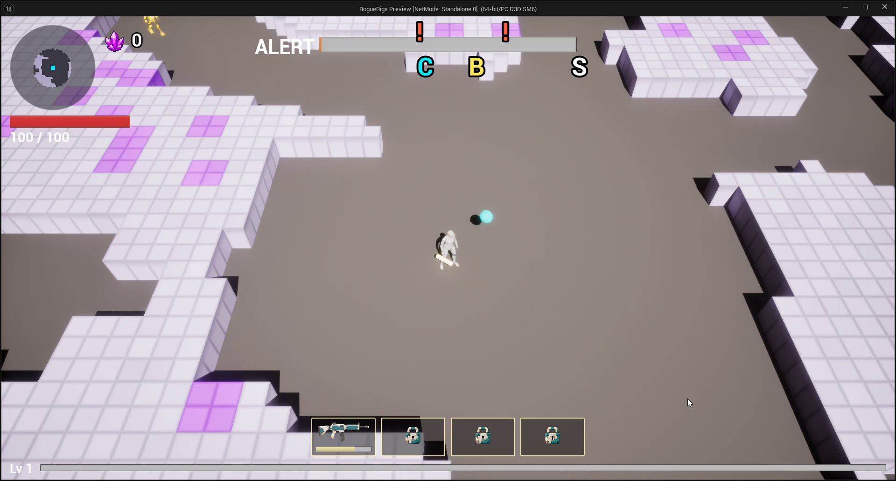

# Assignment 5 — Goal-Oriented Coding Agent

**ELVTR · Multi-Agent AI for Game Development** · Soumois Pierre-Emmanuel

⬅️ [Assignment 4](../A4-dynamic-content-pipeline/) · [All assignments](../)

> **Final state of Assignment 5:** *to fill — commit and tag `a5-submission`.*

## In short

- **The agent:** the **Code Architect**, the [`/architect`](../../.claude/commands/architect.md) command. It drives the Rogue Rigs crew (the Orchestrator and its `cpp`, `art` and `bp` sub-agents) as a goal-oriented agent: I do not name the feature, it finds it.
- **What it does:** reads the GDD in the project vault, scans the C++ code, the Blueprints and the data tables, classifies every GDD feature `built` / `partial` / `missing` with evidence, scores the gaps, recommends one, **stops for my approval**, then plans, delegates and verifies the build.
- **What it built (run 1, 2026-10-14):** the **ore counter**. Ore picked up during a level is counted, secured by a successful extraction, and lost if the shuttle is missed or the miner dies. A HUD counter with its own icon sits right of the minimap, and the success screen shows the secured ore.
- **Every decision is on the [blackboard](blackboard.md)**, written and committed *before* the agent acts on it: the scan, the scores, the recommendation, my answers quoted verbatim, the plan, and the exact prompt sent to each sub-agent. Its memory between runs is [state.md](state.md).

| # | Deliverable | Where |
|---|---|---|
| 1 | The agent's source code | [`/architect` command](../../.claude/commands/architect.md), run by the crew's Orchestrator and its sub-agents ([`.claude/agents/`](../../.claude/agents/), definitions in [`vault/reference/agents/`](../../vault/reference/agents/)) |
| 2 | A working feature in the game, generated by the agent | the ore counter: [what it does](#the-feature-the-ore-counter), [how to test it in one click](#how-to-run-it) |
| 3 | Which feature, why, what the owner changed | [Why the agent chose it](#why-the-agent-chose-it), [Owner direction](#owner-direction-during-the-run), [What the owner changed](#what-the-owner-changed-before-accepting-it) |

## How the agent works

The agent is a prompt-driven loop, not a separate program: the same crew built in [Assignment 3](../A3-agent-crew/), given a goal instead of a request. The command fixes the steps and the blackboard rule.

| Step | What the agent does | Blackboard section |
|---|---|---|
| 0. Resume | reads its rules, [state.md](state.md) and the last run; records the base commit | [Base](blackboard.md#1-base) |
| 1. Scan | descends to the 38 GDD `spec` nodes (approved or provisional; deferred and wishlist skipped); four read-only scan agents, one per GDD branch, each checking every evidence path; the Architect re-checks the deciding gaps itself | [Scan](blackboard.md#2-scan) |
| 2. Score | milestone + pillar fit + gaps it closes or unblocks + cost; a missing dependency scores 0; a value marked `open` makes a feature not buildable | [Scoring](blackboard.md#3-scoring) |
| 3. Recommend, then stop | top buildable feature, why, the `open` values it needs, the one-click test; waits for me | [Recommendation](blackboard.md#4-recommendation) |
| 4. Plan | GDD check, one global task, one subtask per agent and output; waits for my confirmation | [Plan](blackboard.md#5-plan) |
| 5. Build | before each delegation, pastes the exact prompt and reading list; after it, files, build, tests, commits | [Build](blackboard.md#6-build) |
| 6. Rescan | the feature is now `built`, with evidence; records the final agent commit | [Rescan](blackboard.md#7-rescan) |
| 7. State | updates built, failed, left and decisions in [state.md](state.md) | [Close](blackboard.md#8-close) |

The agent never writes feature code itself: only the sub-agents do, each with a written subtask node in the vault.

## Why the agent chose it

The scan found the M1 core loop built and listed the gaps. Scores from the [blackboard](blackboard.md#3-scoring) (Total = milestone + pillar + unblocks + cost):

| Feature | Total | Reason given by the agent |
|---|---|---|
| **Ore counter** (ore-economy, extraction) | **6** | Approved M1 rule in two specs; without it the extraction risk window has no stake and the bonus chest's 5 ore chunks count for nothing. All dependencies exist (ore pickups, shuttle events, HUD event pattern). Small. |
| Locator distance in metres | 5 | Small. *Later found already built in Blueprint; the agent corrected its scan.* |
| Barrel particle burst | 5 | Pillar fit, but mostly a Niagara asset, not a code gap. |
| C++ arena generator | 5 | Unblocks the 4-level run, but far too large for one run. |
| Drone dialogue channel | 4 | Barks are scheduled for M3. |
| Stat sheet, damage-number toggle, block log, shooter tolerance | 3 | No pillar fit, missing host (options menu, logging design) or pure tuning. |

**Excluded, with the reason:** threat counter and scaling, alert tier pool, special ore, 4-direction fire, magazine upgrade, ore loss on a failed run (each needs a value marked `open` or not given in the GDD); the 4-level run (blocked by the arena generator); EMP and audio (blocked by missing systems or assets); art-only items; wishlist items. The agent also reported, without acting on them, five places where the docs and the code disagree.

## Owner direction during the run

All quoted verbatim on the blackboard, followed by a translation. I answered in French.

| Moment | My decision | Effect |
|---|---|---|
| [Recommendation](blackboard.md#owner-answer-verbatim) | approved the ore counter and the three defaults the agent proposed (secured ore kept for the session, death also loses carried ore, one dedicated widget) | moved the counter **next to the radar** instead of the XP bar; **added** an in-game render by the Art agent and an HUD icon drawn from it |
| [Plan](blackboard.md#owner-confirmation-verbatim) | confirmed the four subtasks (C++, render, icon, widget) | only the two image choices still came back to me |
| [Render](blackboard.md#owner-answer-on-the-render-verbatim) | picked render 2 against the agent's preference and the critic's fail | **changed the placement**: an inline counter, icon then number, no plate, like a gold counter in other top-down games but larger |
| [Icon](blackboard.md#owner-answer-on-the-icon-verbatim) | picked icon 2 against the critic's recommendation | kept the glossy, magenta-leaning crystal on purpose |
| Blackboard | added a rule mid-run | every owner quote stays verbatim and is followed by an English translation |

Left `open` on purpose and not built: the share of secured ore lost on a failed run.

## The feature: the ore counter

Base commit `468e91a2` → final agent commit `17083710` ([diff](https://github.com/soumois/RogueRigs/compare/468e91a2...17083710)).

| Subtask | Agent | Output |
|---|---|---|
| [`task-183-01-ore-counter-logic`](../../vault/reference/tasks/task-183-ore-counter/task-183-01-ore-counter-logic.md) | cpp | carried ore in `URRRunFlowSubsystem` (`AddCarriedOre`, `GetCarriedOre`, `OnOreChanged`); secured ore in the new game-instance subsystem `URROreBankSubsystem`; secured on extraction, lost on a missed shuttle or death; cheat `rr.Cheat.GrantOre <N>`; 38/38 related tests pass |
| [`task-183-02-ore-hud-render`](../../vault/reference/tasks/task-183-ore-counter/task-183-02-ore-hud-render.md) | art | 2 in-game renders of the counter next to the radar; [render 2 chosen](../../vault/assets/ore-hud-render.png) |
| [`task-183-03-ore-hud-icon`](../../vault/reference/tasks/task-183-ore-counter/task-183-03-ore-hud-icon.md) | art | 2 HUD icons drawn from the render; [icon 2 chosen](../../vault/assets/ore-hud-icon.png) |
| [`task-183-04-ore-counter-widget`](../../vault/reference/tasks/task-183-ore-counter/task-183-04-ore-counter-widget.md) | bp | `WBP_OreCounter` right of the minimap, bound to `OnOreChanged` (no tick); "Ore secured: N" on the success screen; Blueprint docs |

Docs written by the agents: [`sys-objectives-ore-counter`](../../vault/reference/tech/systems/world/sys-objectives/sys-objectives-ore-counter.md), [`wbp-ore-counter`](../../vault/reference/tech/blueprints/ui/wbp-ore-counter.md).

**The counter in the game:** top-left, right of the minimap, in the place and at the larger size I asked for after the agent's render.



**Extraction:** *GIF to come: ore picked up, then the success screen with the secured ore.*

## What the owner changed before accepting it

My main correction was **where the counter sits on screen**. I wanted it exactly where my reference game puts its gold counter. I made the change while the agent was working, at its two stops, not after the fact. The agent's final commit `17083710` is therefore accepted as it is: no code was rewritten by hand after it.

**1. Position on the HUD.**
- **Agent's proposal:** a widget next to the XP bar.
- **My first correction**, at the recommendation: next to the radar (minimap), top-left.
- **My second correction**, at the render: the render showed the count inside a dark plate, half over the radar rim. I sent a screenshot of my reference game: a round minimap top-left, and to its right a row of resource counters, each just an icon then a number, with no plate. I asked for the same layout, but larger.
- **Why:** *to fill.*
- **Result:** the `bp` agent placed a 56 × 56 icon at x 236, y 30, with a 32 pt bold white number and a dark outline. It checks that the counter overlaps neither the minimap, nor the health bar, nor the alert bar. In the game, the counter sits where I asked, at the larger size I asked for after seeing the agent's render ([capture](#the-feature-the-ore-counter)).

**2. Scope I added.** The agent planned only code and a widget. I asked for an in-game render by the Art agent first, so that the icon would be drawn from how the counter actually looks in the game. That added two art subtasks.

**3. Image choices against the critic.** For the render and for the icon, I picked candidate 2. The agent and the `style-guide` critic both preferred candidate 1 (the critic flagged glossy shards and a magenta lean). I kept candidate 2 on purpose. The critic's fails stay on record on the blackboard.

**4. Defaults accepted.** I accepted as they were the three answers the agent proposed for questions the GDD leaves open:
- secured ore is kept for the session;
- death also loses the carried ore;
- the counter is one dedicated widget.

**What the agent got right without help:**
- It picked a gap that blocks the game's own risk loop, with evidence for every claim.
- It corrected its own scan when the plan revealed that the locator distance was already built.
- It left the `open` ore-loss share unbuilt instead of inventing a value.
- It reported five doc and code mismatches without silently "fixing" them.
- It bound the widget to an event rather than polling every frame.
- It ran the 38 related automation tests (all pass).

**How it was checked:**
- **In the editor (PIE), read back by the agent:** the counter shows 10 after `rr.Cheat.GrantOre 10`; extraction shows "Ore secured: 10"; a death empties the carried ore.
- **Code review:** securing resets the carried count to 0 and fires `OnOreChanged`, so the HUD returns to 0. A missed shuttle goes through `EndRun(false)` and runs the same lose path as a death, `LoseCarriedOre`.
- **Not checked:** the counter rebinding after a level restart.

## How to run it

1. Clone the repository, open `RogueRigs.uproject` in Unreal Engine 5.8 and let it build the C++ module.
2. Press **Play**. Ore chunks dropped by destroyed ore blocks and by the bonus chest raise the counter right of the minimap.
3. **One-click test:** open the console (`` ` ``) and type
   ```
   rr.Cheat.GrantOre 10
   rr.Cheat.SkipToExtraction 1
   ```
   The counter shows 10; board the shuttle: the success screen shows **Ore secured: 10**. Let the shuttle leave without you, or die, and the carried ore drops to 0.

**Run the agent again:** in a Claude Code session on this repository, type `/architect` (optionally followed by a constraint, e.g. `/architect only M2 features`). It reads [state.md](state.md), appends a new run to the [blackboard](blackboard.md) and stops at its recommendation.
