# Week 1 — 2026-09-29 to 2026-10-08

⬅️ [Devlog](../) · [Week 2](../week-02/) ➡️

The project went from the empty Unreal Engine 5.8 C++ template to a complete run: an asteroid arena, a miner who digs with a drone, three weapons, five robot types, a wave director, and a level that ends with a console hack and a shuttle extraction. Everything was built through the agent crew, from requests typed by the owner.

| | |
|---|---|
| Commits | 434 |
| Tasks | 001 to 056 (task 059 started on Oct 8, finished in week 2) |
| Automation tests | about 195 at the end of the week |
| Crew | Orchestrator, `level-design`, `cpp`, `bp`, all defined on Oct 1 |
| Course | Assignment 3 submitted on Oct 6 (task 031, tag [`a3-submission`](https://github.com/soumois/RogueRigs/tree/a3-submission)) |

## Start of the week: milestone M1

Captures from [Assignment 3](../../assignments/A3-agent-crew/): an 80 × 80 arena of 200 uu cells.

**The arena.** Generated by the `level-design` agent as JSON, checked by `Tools/validate_layout.js`, built by the C++ grid actor (tasks 001, 003).

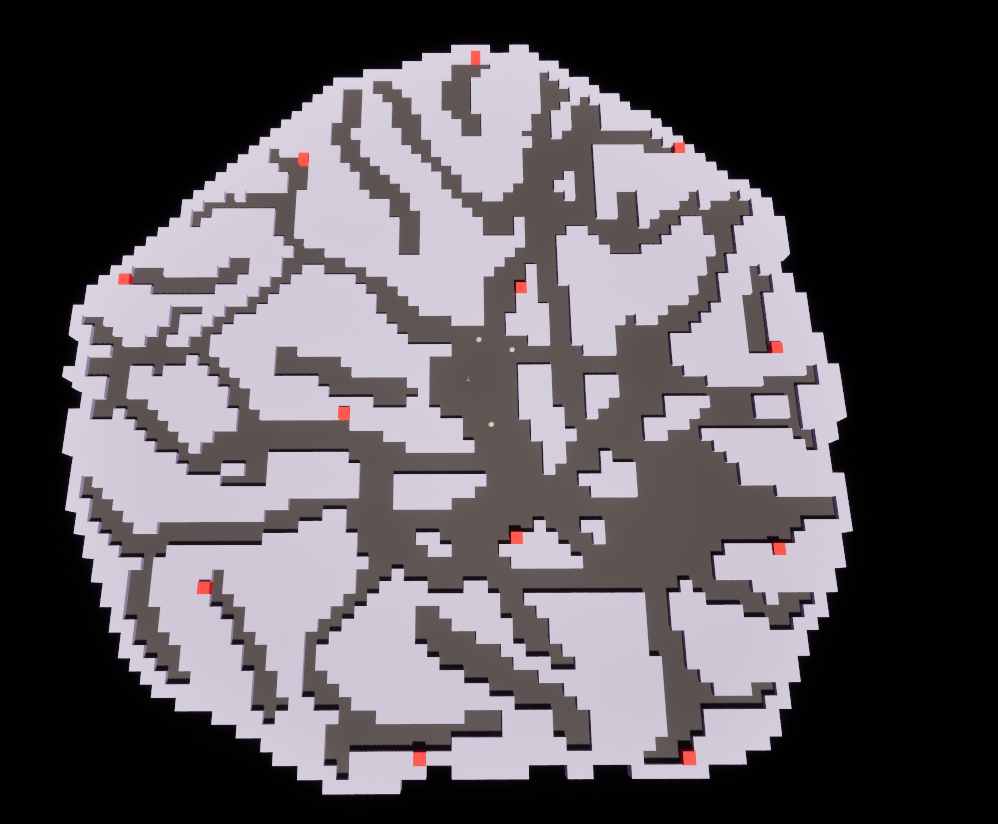

**Digging opens a path, and the robots use it.** The chasers take the new opening as soon as the block is gone: the grid flow field recomputes (tasks 006, 009).

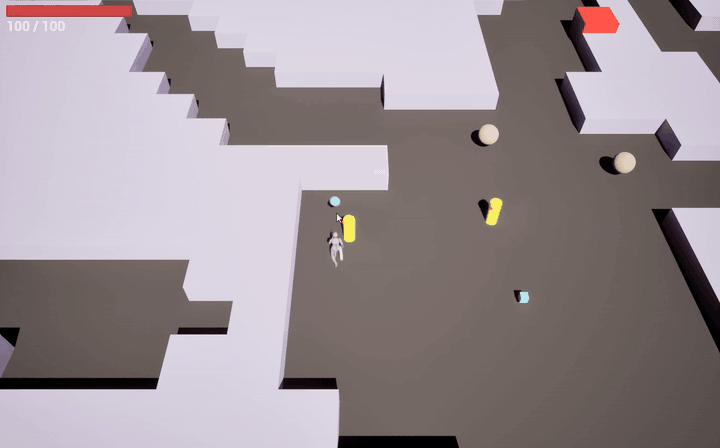

**Shooting and pickups.** Burst rifle with floating damage numbers, XP cubes dropped by the chasers (tasks 007, 008, 009).

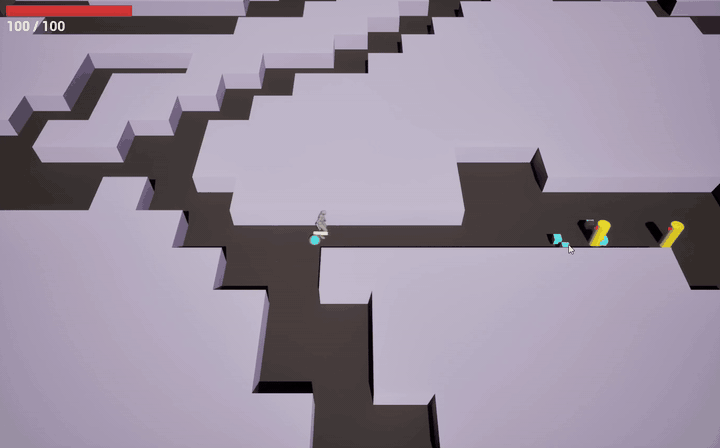

**Game over.** At that point a run could only end in death (task 009).

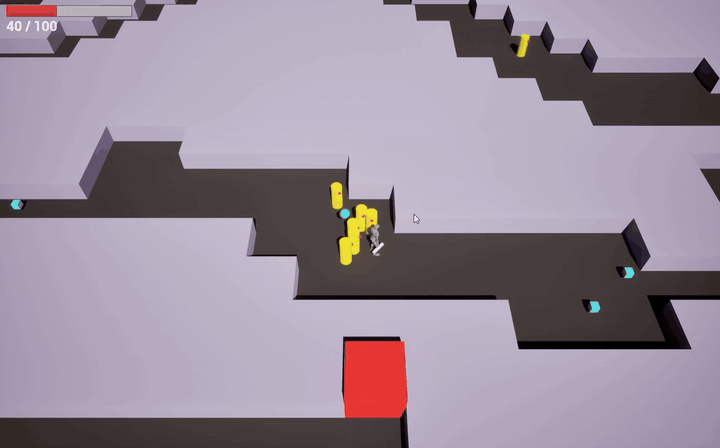

## End of the week

Captures from a full run recorded on the morning of 2026-10-10. The run has a 240 × 240 grid of 67 uu cells, levels 1 to 10, and ends in an extraction. The recording was made on Saturday, so it also shows four changes from Oct 9, which belong to week 2: the round minimap (tasks 061, 064), the larger alert bar (062), the deeper drone cut (060) and the flow field on a worker thread (066).

**HUD.** Health, alert bar with the console (C), chest (B) and shuttle (S) icons, weapon slots with ammo, reload and `LOCKED` (tasks 037, 053).

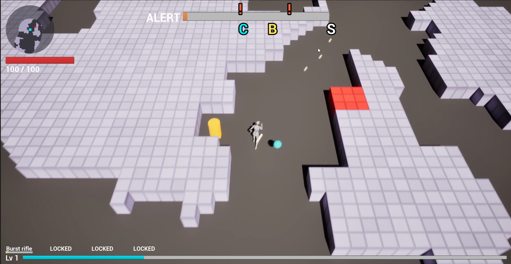

**Digging through small cells.** The drone cuts several blocks at once in an arc when the miner touches a wall (task 029), and the robots follow the corridor.

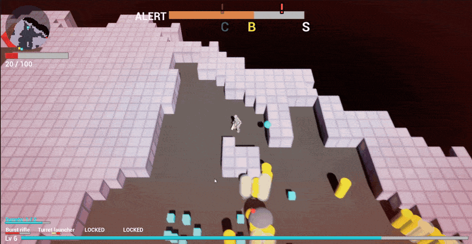

**A pack, XP and a level-up.** One damage number per hit, red vignette from the first hit (task 055), XP cubes that pop out and stream to the miner (tasks 027, 054), console locator arrow in metres (task 040).

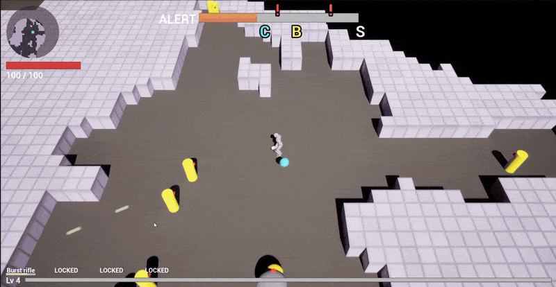

**Heal vein.** The whole vein is mined at once (task 034) and restores 60 HP (task 035).

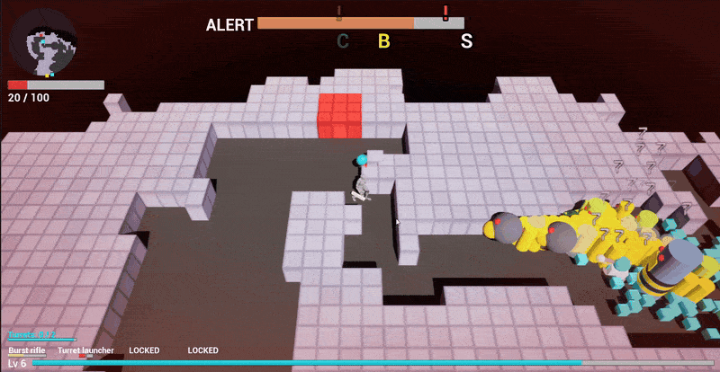

**Weapon card.** A new weapon is offered every 5 levels (task 032), here the turret launcher.

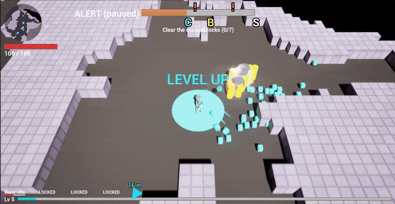

**Console hack and horde.** The miner stays close to the console while a horde is announced (tasks 016, 026, 042).

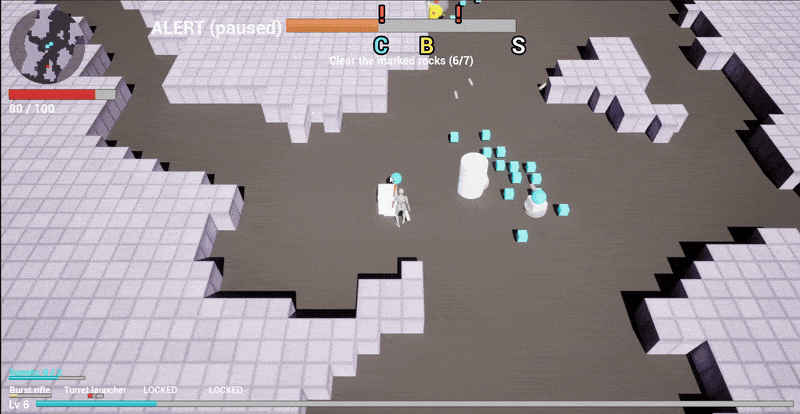

**Bonus chest.** One per level at 60 % alert, 8 s hack, XP, ore and a lucky upgrade choice (task 056).

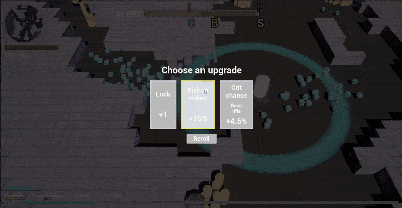

**Extraction.** A run can now be won: reach the shuttle before the countdown ends (tasks 016, 049).

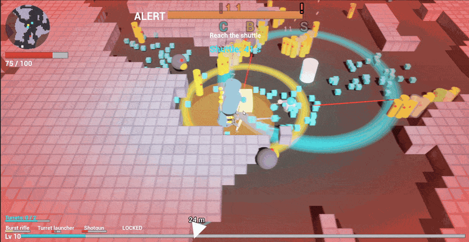

## What changed, by area

| Area | Tasks | Change |
|---|---|---|
| Crew and vault | — | Orchestrator with the `level-design`, `cpp` and `bp` agents and the `/task` command; the GDD split into one node per concept in the vault; vault lint, task scripts and, from task 013, a cost log of every subtask |
| Arena | 001, 003, 023, 029 | 60 × 60 then 80 × 80 asteroid from JSON; stress test of finer cells, then 240 × 240 cells of 67 uu with chunked rendering and a flow field updated in place |
| Miner and mining | 004, 005, 006, 029, 034, 035, 043 | Miner on the Gameplay Ability System; orbiting drone; digging by contact in an arc; whole-vein mining; heal veins worth 60 HP; blocks of a vein shake together |
| Weapons | 007, 015, 024, 032, 051 | Burst rifle, then shotgun; rework with rifle pierce, shotgun pellets, turret launcher on a button and weapons as level-up cards; a weapon card every 5 levels; turrets kept apart |
| Robots | 009, 011, 021, 022, 028, 036, 038 | Chaser on the grid flow field; kamikaze and chain explosions; shooter; heavy with a ground slam; shield chaser; robots left behind moved back ahead; shooter walks around rock |
| Run loop | 012, 014, 016, 026, 056 | XP and levels; upgrades with rarities, 3 cards and a reroll; console hack and shuttle extraction; wave director with announced hordes; bonus chest |
| Balance from play tests | 017, 030–034, 039, 041–049, 052 | Four owner play tests (030, 031, 032, 034) and smaller owner requests: spawn timing and position, robot speeds, heavy slam radius, kamikaze share, level 1 pressure, hack time, shuttle distance |
| HUD and feedback | 010, 025, 027, 037, 040, 053, 054, 055 | Damage numbers in Niagara; XP cubes that pop and stream; ammo HUD; locator arrow; slot info centred; XP trail and sparkle in Niagara; first-hit vignette |
| Performance and tests | 013, 018, 019, 020, 050 | Stress baseline from 50 to 400 robots; robot count optimisation; packaged build fixed; code review refactor; one intermittent test fixed at its cause |

On Oct 8 an analysis of a *Deep Rock Galactic: Survivor* reference video (damage numbers, HUD, minimap, mining, ore dripping from rock) was added to the vault. Several week 2 tasks start from it, such as ore inside the rock (task 070, "as in DRGS").
