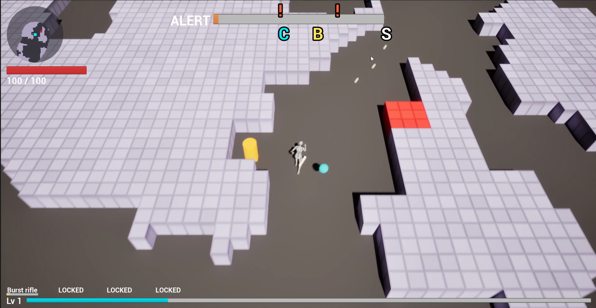
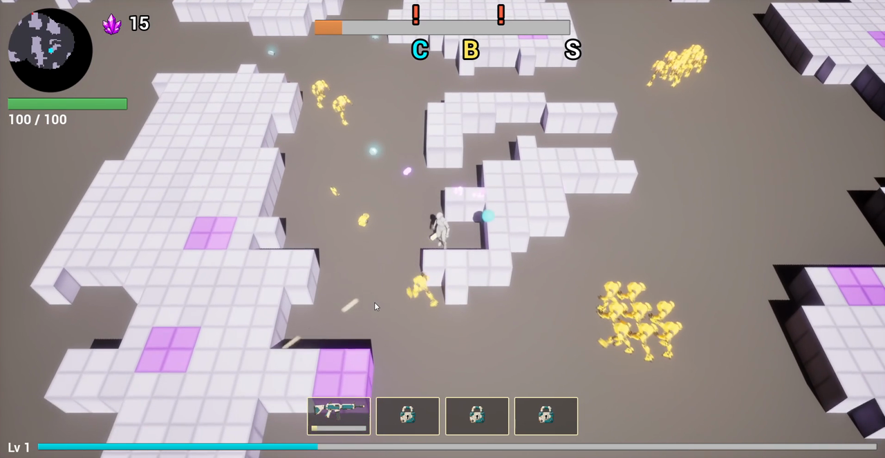
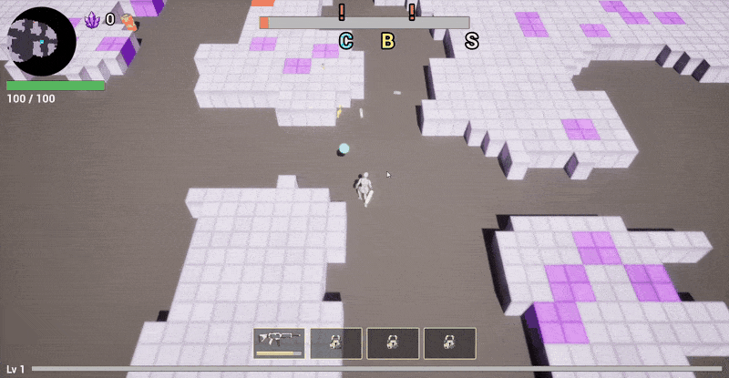
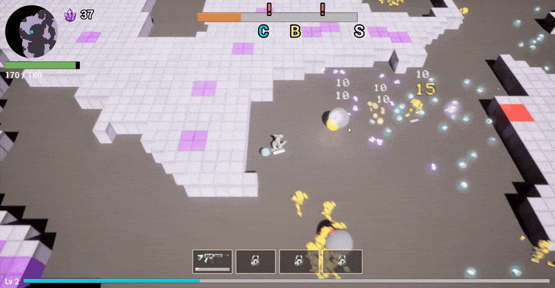
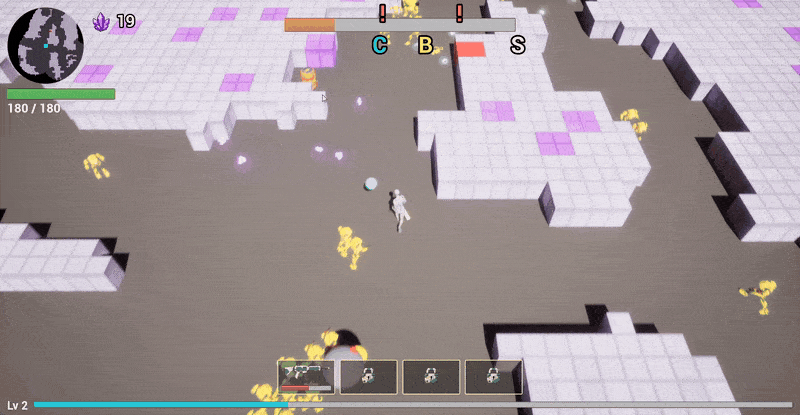
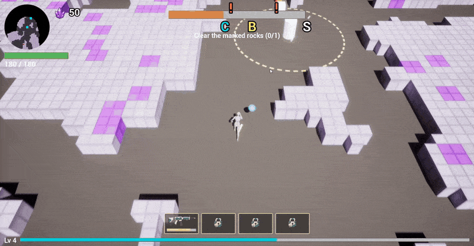
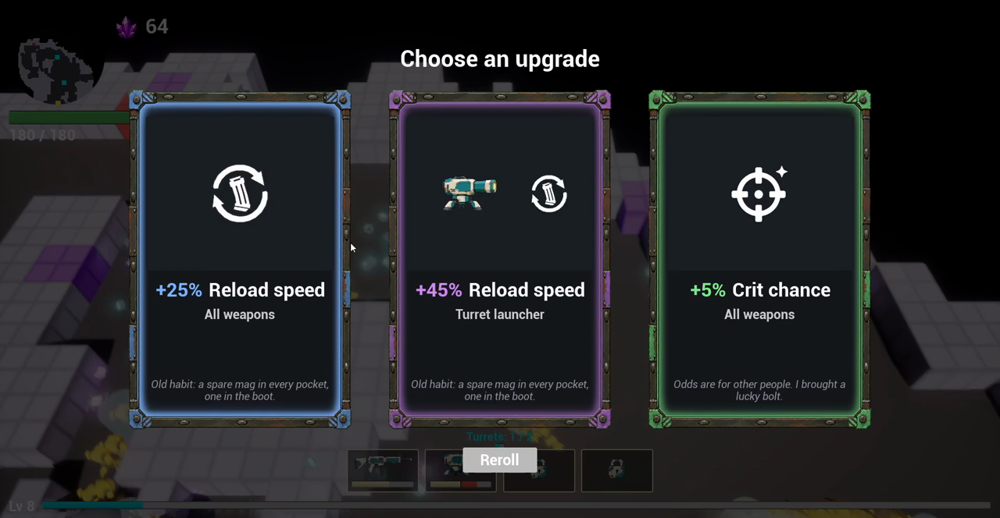
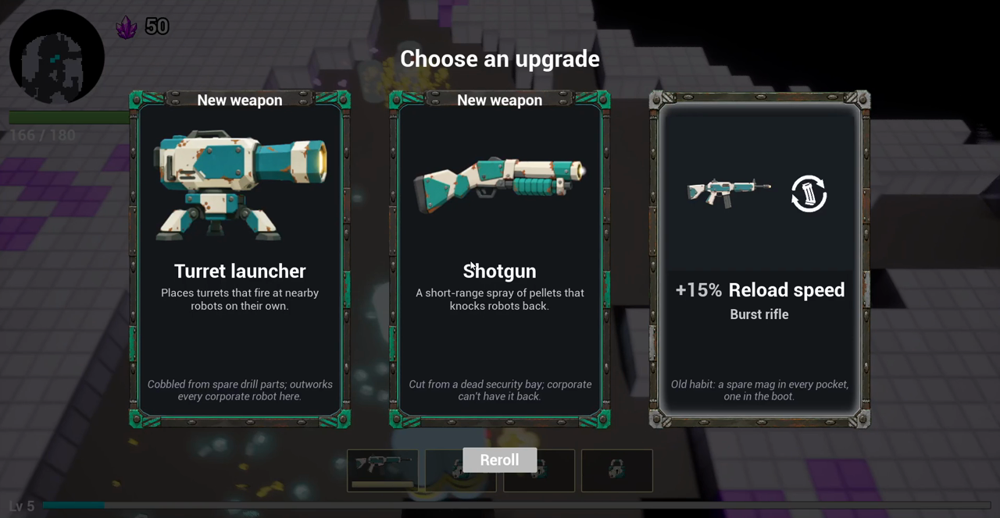
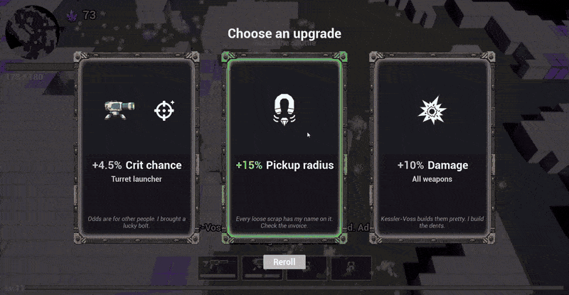

# Week 2 — 2026-10-09 to 2026-10-16

⬅️ [Week 1](../week-01/) · [Devlog](../)

The run from week 1 stays the same; what changed is how it looks, feels and performs. The chaser is now a modelled, animated robot. XP and ore drop as glowing meshes. Duskite ore sits inside the rock. Barrels burn a fuse before exploding. The HUD and the level-up cards were redrawn. Behind that, the crew grew from four agents to eight, plus a goal-oriented Code Architect, and the game thread was cut down with actor pools and an event-driven HUD.

| | |
|---|---|
| Commits | 959 |
| Tasks | 057 to 204; 188 (shared editor lock) not started, 069 (minimum PC spec) cancelled until the end of the project, 071 (light robot movement) on hold |
| Automation tests | about 195 → 262 |
| Crew | + `text` and `style-guide` (Oct 9), + `art` and `3d` (Oct 11), + the Code Architect, `/architect` (Oct 14) |
| Course | Assignment 4 submitted on Oct 11 (tag [`a4-submission`](https://github.com/soumois/RogueRigs/tree/a4-submission)), Assignment 5 on Oct 15 (tag [`a5-submission`](https://github.com/soumois/RogueRigs/tree/a5-submission)) |

## Before and after

| End of week 1 (run of 2026-10-10) | End of week 2 (run of 2026-10-16) |
|---|---|
|  |  |

On the right: the ore counter next to the minimap (task 183), the minimap fully opaque (184), no `ALERT` label on the alert bar (185), a green health bar (203, 204), weapon icons and padlocks instead of text in the slots (108, 109), and violet Duskite deposits in the rock (070, 100).

## Captures from the run of 2026-10-16

One full run, level 1 to level 11, ending in an extraction with 78 ore secured. Timecodes refer to the recording.

**Mining Duskite** (00:07–00:13). The deposits are 2 × 2 blocks scattered through the rock (task 070), and the ore is named Duskite (task 100). The drone's laser fan cuts into a deposit and the ore chunks pop out as small violet crystals (task 189), with a long floaty arc and a mid-air magnet toward the miner (task 195).

**Chasers, XP and debris** (00:52–00:58). The chaser is a model built from generated reference views through Meshy, with a baked run and attack animation, its parts moving separately, and no two chasers in step (tasks 151–165). A dying robot hides its shrink behind a puff of sparks (task 167) and throws 2 to 4 robot pieces that bounce off the walls (tasks 166–174, 186, 190, 191). The XP pickups are now glowing hex nuts with a light disc under them (tasks 125–150).

**Barrel fuse and explosion** (00:44–00:49). The barrel is a modelled mesh (tasks 101, 107). Shot to 0 health, it burns a 1.5 s fuse: it shakes and blinks while an orange danger zone and a growing disc show where it will hit (tasks 114, 118, 197). The explosion radius is doubled, with a burst of particles and a ground shockwave ring (tasks 114, 197–199). The crater renders correctly from its first frame (task 202), and the block destruction is spread over frames, about 2 ms of game thread per frame (task 121).

**Console hack** (01:24–01:36). Every rock within 7 cells of the console is cleared before the hack, and the hack takes 12 s (task 120). The hack zone is a sharp circle with a growing progress disc on the ground (tasks 112, 113, 118). A horde is announced, and the company speaks in a one-line subtitle at the bottom (task 099) with a line generated by the text pipeline of Assignment 4. The health bar drains as the miner is hit (task 203).

**Level-up cards** (02:28 and 01:48). Large cards with an icon, the effect, a one-line lore quote and a frame tinted by rarity, with a stronger glow on hover (tasks 168, 176–178). New weapons have their own card layout (task 169).

| Stat cards | New weapon cards |
|---|---|
|  |  |

**Extraction** (03:11–03:21). The shuttle countdown, the locator arrow and the chevrons lead to the shuttle while a company line runs as a subtitle. Carried ore is secured by the extraction and lost on a missed shuttle or a death; the end screen shows the secured ore (task 183, built by the Code Architect).

## What changed, by area

| Area | Tasks | Change |
|---|---|---|
| Crew and process | — | `text` and `style-guide` agents for the Assignment 4 text pipeline; `art` (image generation) and `3d` (image to mesh through Meshy or Blender) agents; the Code Architect, `/architect`, which scans the GDD against the code, picks the next feature and drives the crew (run 1: ore counter, task 183; run 2: barrel explosion, tasks 197–202); `/architect-score` for a scan without writing |
| Text in the game | 072–087, 099 | Film pool, text schema and validator, baseline without lore, upgrade lines, Rook and Vesna barks, company alerts, loader and display, rule T9; company lines as bottom subtitles |
| Performance | 063, 066–068, 090–093, 094, 103, 105, 111, 121 | Flow field on a worker thread; real-game stress scenario (limit 250 robots) and packaged-build measurement; actor pools for robots and pickups (wave-spawn spikes from 46–61 to 4 per run); robot components trimmed; HUD split into 7 event-driven panels (HUD Blueprint 0.40 → 0.11 ms per frame); pools prewarmed; barrel block destruction spread over frames |
| Mining and terrain | 060, 065, 070, 088, 089, 100, 117, 120, 187 | Drone cuts up to 8 blocks; diagonal dig; Duskite deposits inside the rock; heal veins 2 × 2, heal pickup left on the floor at full health; barrels keep their floor slab; console zone cleared of rock; an explosion breaks a whole deposit |
| Robots | 096, 119, 123, 124, 151–165, 180 | Kamikaze goes through its preparation when killed; heavy slam shown only by the ground telegraph; modelled and animated chaser; burst rifle hits no longer push robots |
| Pickups | 057, 058, 095, 110, 122, 125–150, 189, 192, 195, 196 | XP trail visible; many XP cubes merge into one big block; XP as a hex nut and the big block as a data chip, both meshes with a glow disc; Duskite crystal for ore; random orientation and mesh variant per drop; floaty pop and mid-air magnet |
| Feedback and effects | 059, 097, 112–119, 166–174, 186, 190–194, 197–202 | One damage number per hit; explosion size matches its radius; ground telegraphs for console, chest, barrel and heavy; robot debris and death puff; barrel fuse and explosion effects; no green decal frame or black crater on the first frame |
| HUD and cards | 061, 062, 064, 098, 104, 108, 109, 168, 169, 176–178, 183–185, 203, 204 | Round minimap with an 18-cell reveal circle, then fully opaque; alert bar doubled, then without its label; weapon icons and padlocks; new stat and weapon cards; ore counter; health bar with smooth drain, damage chunk, flash, shake and colour by health |
| Art assets | 101, 102, 106, 107, 137 | Barrel mesh; Kessler-Voss logo candidates; shared wear mask texture; headless tool to reimport a mesh from its FBX |
