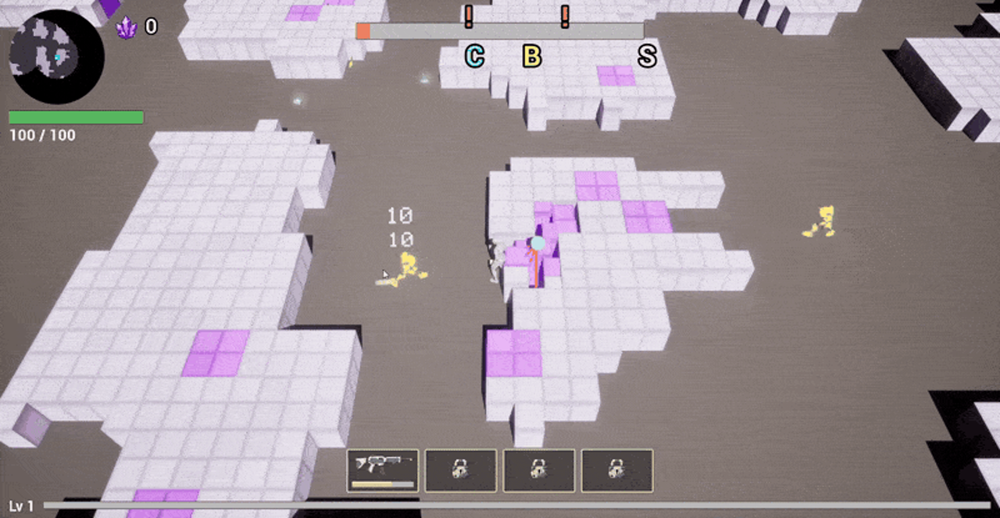
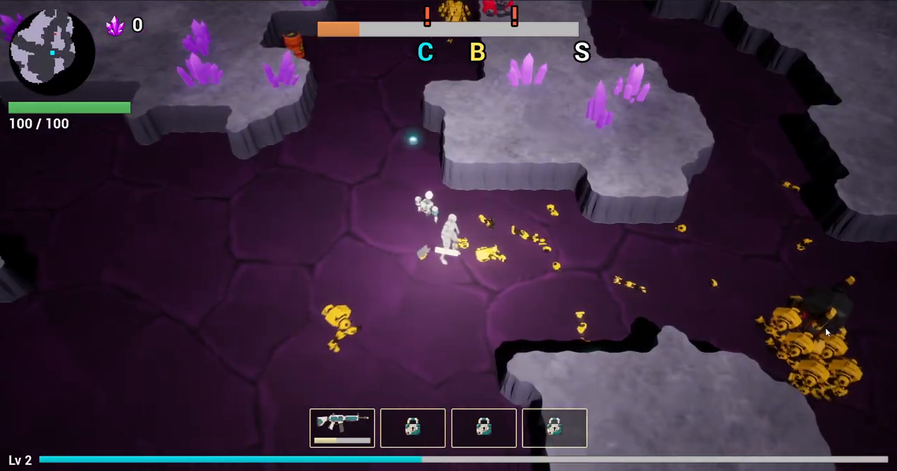
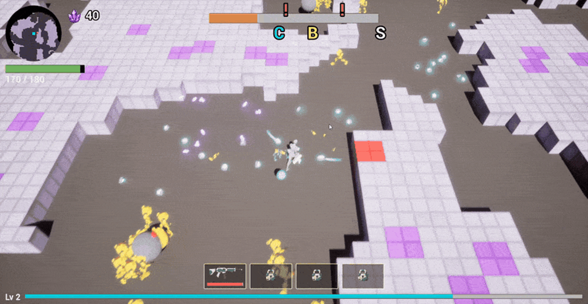
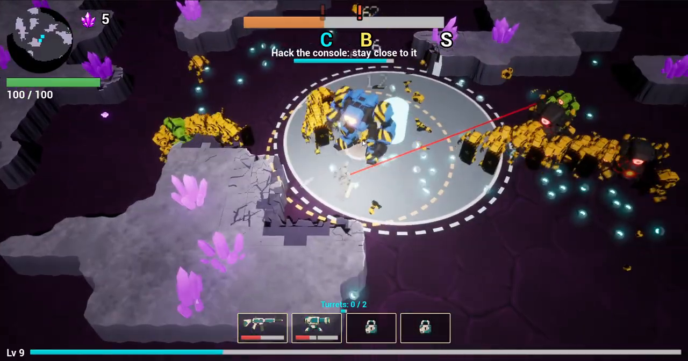
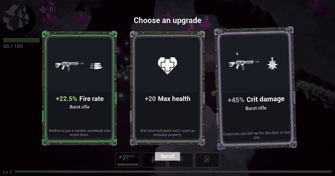
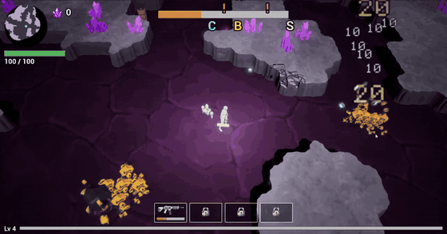
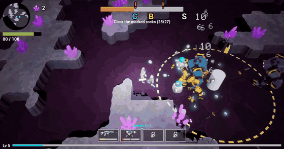
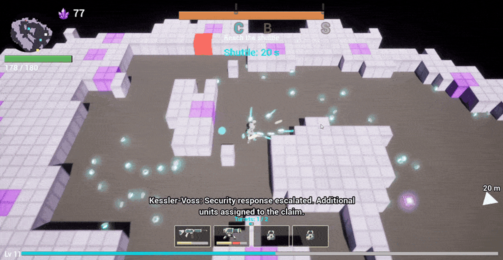
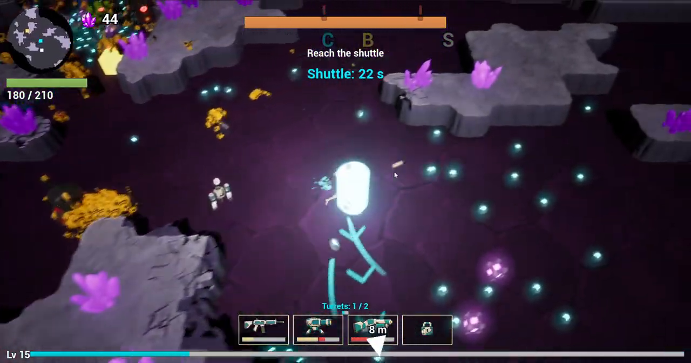
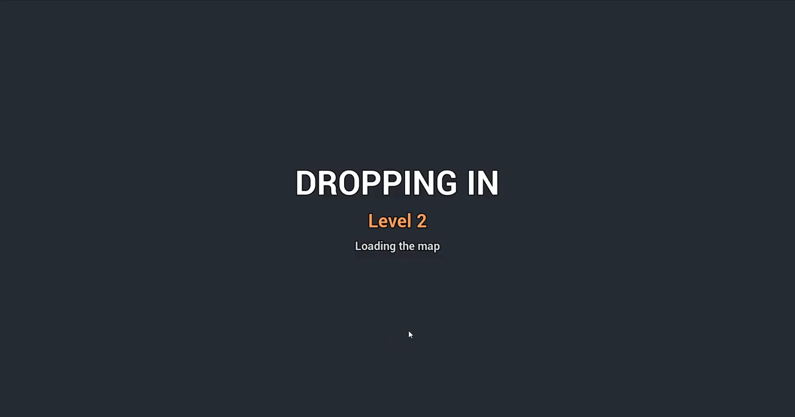

# Week 3 — 2026-10-17 to 2026-10-23

⬅️ [Week 2](../week-02/) · [Devlog](../)

Week 2 ended with a game made of white cubes on a grey floor and primitive robots. Week 3 gave the arena its look: rock slabs, painted floor, dark violet ambience with a pool of light on the miner, crystal deposits, meshed and animated robots, a living drone, and level-up cards that are dealt, flipped and picked. A run now chains four levels with an intermission and a loading screen.

| | |
|---|---|
| Commits | 832 |
| Tasks | 205 to 313 (297 to 313 landed on Oct 23); no task cancelled in the period |
| Course recording | `Rogue Rigs Prototype - Multi-Agent AI for Game Development course week 3.mp4`, 4 min 16 s, showing the build of about Oct 23, level 1 to level 15. Timecodes below refer to it |

The Oct 23 console and chest tasks (301 to 313) are not yet in that recording; their captures are on the [week 4 page](../week-04/).

## Before and after

Left: end of week 2 (run of Oct 16, [week 2 captures](../week-02/media/)). Right: the recording of Oct 23.

| End of week 2 | Recording of Oct 23 |
|---|---|
|  |  |
|  |  |

**Look of the arena** (00:30 and after). Rock is made of dual-grid slabs with a world-UV top texture, cracks and plates (task 230) instead of cubes; ore and heal deposits are single crystal formations, three variants per type, cast no shadow and read as volumes (234, 237, 262); the floor has its first painted cracked texture (273). The lighting went through many iterations: shadows off (261), then a warm player light that is the only caster of rock shadows (263), a dark violet ambient (265), a tight light pool with a fixed exposure (268, 270, 272), a darkening post-process instead of a tint (274), and finally a revert to the Monday Oct 19 look with the owner's own light edits recorded (275, 276). Robot yellow no longer burns and robots separate from the floor (266); XP pickups are small bright cyan dots (269, 271, 277), robot and drone eyes glow (278, 279).

## Level-up cards

**Cards are dealt and flipped** (00:49–00:58). They arrive face down in a fan, then flip one by one, with one card back per rarity (task 243). From purple up the best card flips last: its back glows, the others darken, then a punch, flash and rays in the tier colour (244). Hovering tilts a card toward the pointer, scales it and sweeps a sheen across the higher tiers (245). The chosen icon flies to the HUD slot of its weapon, or to the XP bar for a player stat (246).

## Damage numbers

**Numbers are thrown in an arc** (00:57–01:03). A number grows with the damage of the hit from ×0.8 to ×1.4 (task 239), rises with its own random speed and angle (240), pops for 0.25 s (241) and follows a gravity arc with a peak of about 60 uu (242). Crits are a lighter orange (238).

## Robots

**Horde** (01:36–01:45). The grey-box primitives were replaced by Meshy robots for the heavy, kamikaze, shooter and chaser v2, flattened and cleaned in headless Blender (281 to 283), with walk, knee, run, attack, slam and aim/fire animations (284, 285, 287, 289 to 291). The shield chaser has a textured riot shield with the company emblem, a shield-held run, a bash, and fragments thrown as debris when it breaks (216, 218, 220, 222, 224, 226), plus a v2 on the chaser v2 mesh (286, 296). Packs carry at most one heavy (292), the slam is bigger and slower (293), the kamikaze splits its damage 40 to robots and 30 to the miner (294).

**Drone.** It no longer circles the miner: it holds an escort slot behind and beside him with a damped spring, never hovers over a block, looks alive (height, turn toward interest points, tilt), then patrols a point in the miner zone (247 to 251). The Meshy drone is split into base, laser and a modelled dish with three animated parts and two thruster particles (252 to 254, 280). One laser beam aims at the middle of the dug blocks, with sparks and chips at the impact (232, 233).

## Pickups

XP and ore land into Chaos physics so they roll and tumble (229, 256); the big XP is now the owner's data cube with the same floaty pop (217, 221, 228); crystals and pickups pulse out of sync (257); deposits release their loot one by one over the dig time (235); ore blocks take 2 s to dig and rock 0.65 s (259, 260); the camera arm is 1400 uu (255).

## Level chain and end screens

**Before.** A run was one level, ending on a single extraction screen.

| End of week 2, extraction | Recording, end of level 1 (04:08) | Recording, loading level 2 (04:13) |
|---|---|---|
|  |  |  |

**After.** A run chains four levels with an intermission recap, the next layout loads in the background and a loading screen is drawn before the map travel (206, 208); the HUD and subtitles are hidden during intermission and loading, and the end screens show alone (207, 211); level 2 to 4 layouts are written at 240 × 240 (205); the run-won text appears at level 4 (209); the intermission and loading screens are in English (210) and company subtitles carry no speaker prefix (215). The shuttle at extraction is still a disc here (recording, 03:52: [after-extraction](media/after-extraction.png)).

## Crew and tests

| Area | Tasks | Change |
|---|---|---|
| Run logs and tests | 212 to 214, 250 | Run logs; failing and flaky automation tests fixed; barks log excerpt matches T2; `RogueRigs.Ore.HealVein` passes again |
| Debug | 223 | Console command that empties the shield of living shield chasers, to capture the break |
| Rock | 230, 231, 233 | Dual-grid slab integration; smaller dug-block shake (8 uu horizontal, 3 uu vertical) |

## What changed, by area

| Area | Tasks |
|---|---|
| Level chain and screens | 205 to 211 |
| Company text | 214, 215 |
| Shield chaser | 216, 218, 220, 222 to 227, 286, 296 |
| XP cube and pickups | 217, 221, 228, 229, 256, 257, 235 |
| Rock, deposits and digging | 219, 230 to 237, 259, 260, 262 |
| Damage numbers | 238 to 242 |
| Level-up cards | 243 to 246 |
| Drone | 232, 233, 247 to 254, 279, 280 |
| Light and floor | 255, 261, 263 to 278 |
| Robot meshes and animation | 281 to 291, 292 to 295, 297 to 300 |
| Console and chest (Oct 23) | 301 to 313, see [week 4](../week-04/) |

Task records: [`vault/reference/tasks/`](../../vault/reference/tasks/).
