# Week 3 — 2026-10-23 to 2026-10-29

⬅️ [Week 2](../week-02/) · [Devlog](../)

The run recorded for the course (see below) is the game as it stood on the morning of 2026-10-23: a white cylinder for the console, a yellow cube for the chest, a flat purple void around the arena, a free reroll, a placeholder end screen and a white disc for the extraction shuttle. This week replaced those placeholders with real meshes, effects and screens, and added the missing loop around a level: a main menu, a paid shop between levels, and an extractor that carries the miner out.

| | |
|---|---|
| Commits | 783 |
| Tasks | 299 to 385 (297 and 298 were finished on Oct 23); 314 (chest lid logo) still `todo`; 333, 354, 384 cancelled; 188 (shared editor lock) cancelled on Oct 26; 386 (miner Mixamo animation) started on Oct 29 and cancelled on Oct 30 |
| Crew | + `doc` agent (task 325), + `capture` agent (task 360) |

Oct 17 to Oct 22 (tasks 205 to 298) is not covered by a devlog page: this one starts on Oct 23 as asked.

## How the comparison was made

- **Before** = the course recording `Rogue Rigs Prototype - Multi-Agent AI for Game Development course week 3.mp4` (4 min 16 s, level 1 to level 15, ending on the stats screen and the loading of level 2). Timecodes below refer to it.
- **After** = `-game` captures taken by the crew while doing each task (the `capture` agent and the capture subtasks of the task nodes). They are single frames or short sequences, not one continuous run, so the camera and the situation differ from the recording.

## Console and hack

**Before** (01:18–01:25). The console is a white cylinder, the zone a dashed circle, the hack a white disc (tasks 301 and later did not exist yet).

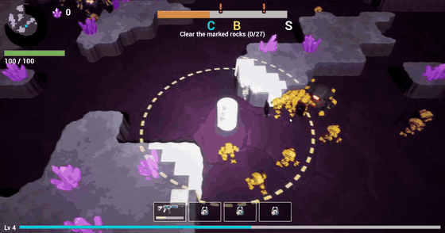

**After.** The cylinder is the owner's C2 uplink mast with a mobile dish head and three material slots (task 301). Its lamp colour and blink, dish rotation and screen colour follow the console state (302). The drone hovers in front of the data socket and the hack link aims at it (313). The zone colour stays on the ground and no longer washes out the console, miner and drone (312). The console is 50 % bigger and lands on a free 3 × 3 footprint (311), only where its zone holds between 10 and 40 markable blocks (304), and the hack takes 10 s instead of 12 s (305). A finished hack throws three big XP chips in every direction with a green ring flash (303).

| Before (01:25) | After, console state and zone (302) | After, drone at the socket (313) |
|---|---|---|
| [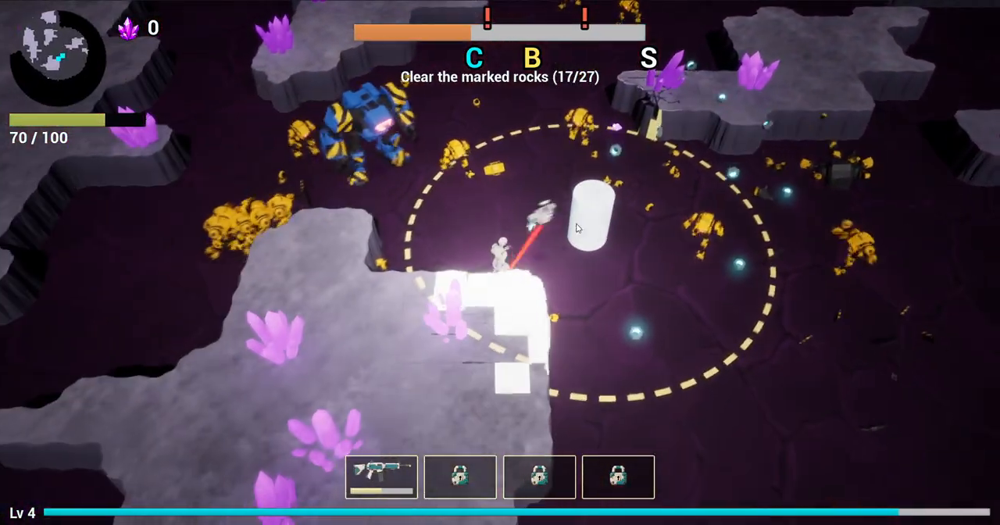](media/before-console.png) | [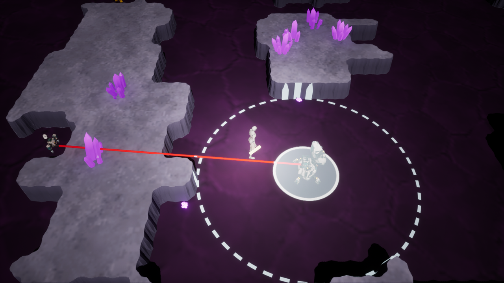](media/after-console.png) | [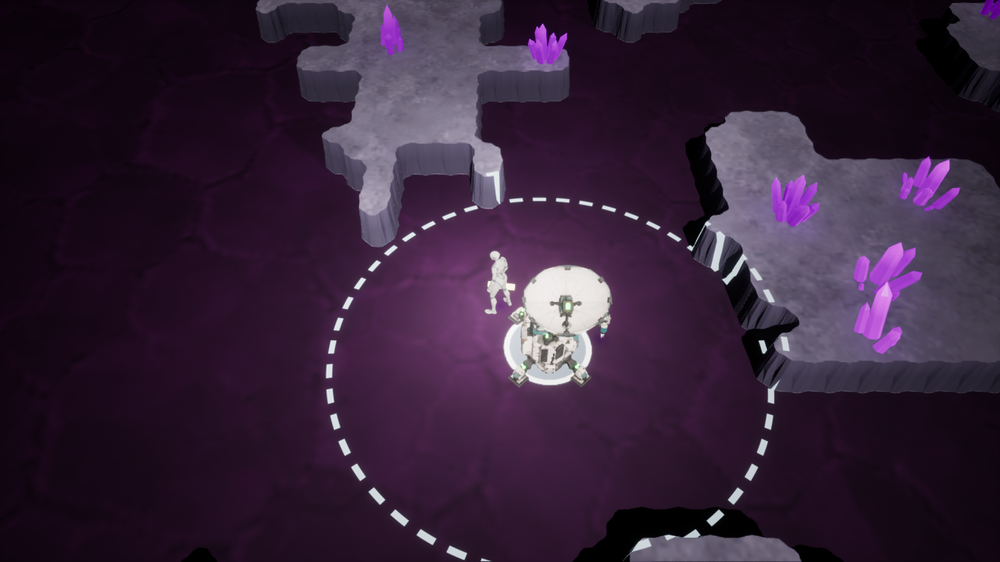](media/after-drone-socket.png) |

| After, hack in progress (302) | After, hack reward (303) |
|---|---|
| [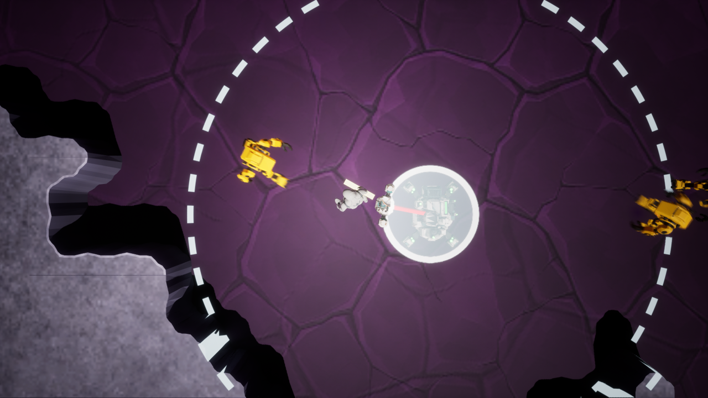](media/after-console-hacking.png) | [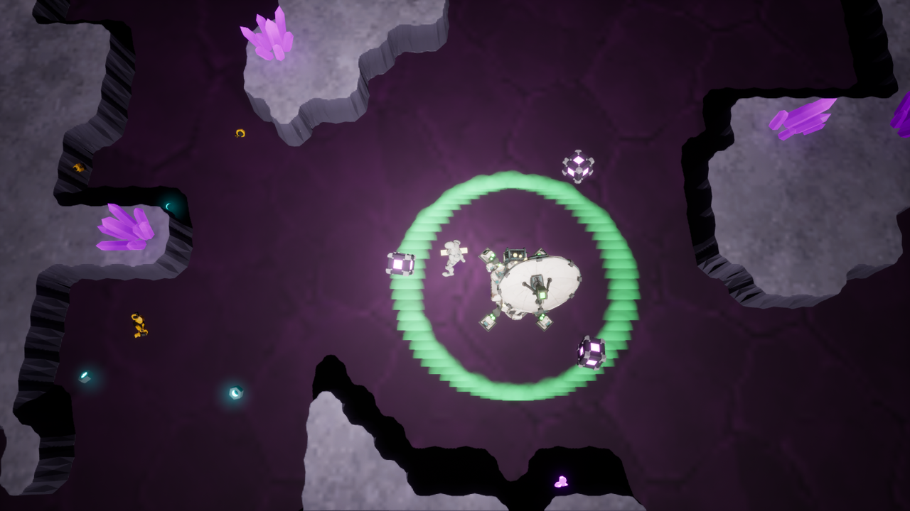](media/after-console-reward.png) |

## Bonus chest

**Before** (03:28). The chest is a yellow cube beside a dashed circle.

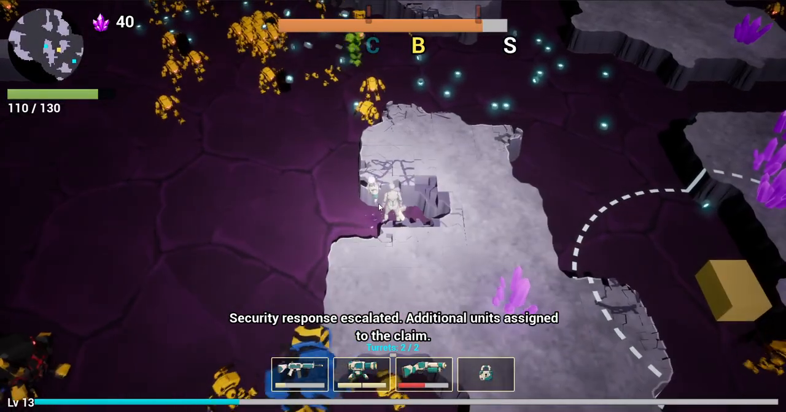

**After.** The Meshy chest has its puffed faces flattened and is cut into body, lid and latch (306). Its lock light blinks red while waiting, orange and faster with the hack progress, and stays green once open (308). Opening plays a sequence: the latch swings, the lid slams open with an overshoot, a freeze and a shake, an inner light, a ground ring, three popping XP chips and sparks (309). The shake is a shared C++ camera shake that any actor can play (310). The chest gives exactly one upgrade choice (307).

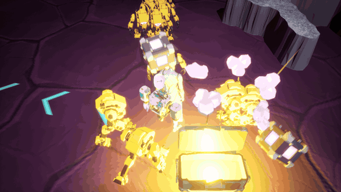

| Chest in game (306) |
|---|
| [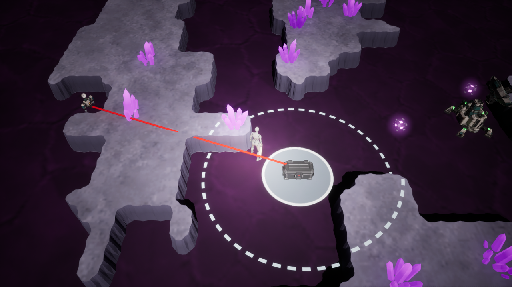](media/after-chest.png) |

Not done: the yellow Kessler-Voss mark on the lid (task 314).

## Space background and main menu

**Before** (00:04). The arena floats on an empty dark void.

**After.** A layered void with real parallax and procedural stars (332), then bold tileable AI-generated textures at several depths (335), and low-poly asteroids floating nearer the camera (334). A first attempt to retune the procedural nebula was cancelled (333). A main menu with a key-art background, New Run, Options and Exit opens the game (337, 338).

| Before | After, layered space (335) | After, main menu (337, 338) |
|---|---|---|
| [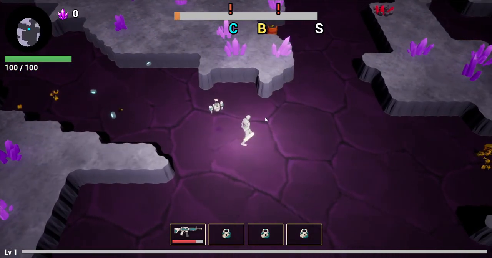](media/before-void.png) | [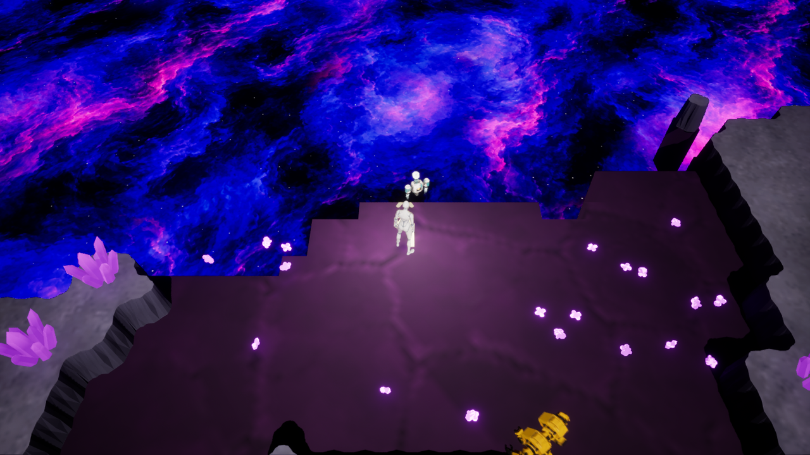](media/after-space.png) | [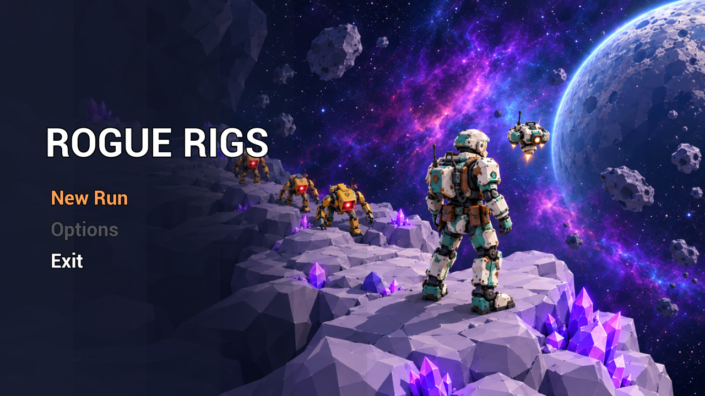](media/after-main-menu.png) |

## Aim chevrons and heal numbers

Neither is in the recording: the miner's aim was invisible and a heal pickup showed nothing.

**After.** White-gold chevrons projected on the ground show the aim direction, stop at rock, fade with distance (measured on the final image, task 331) and have sharp outlines (330) (tasks 328 to 331). A heal pickup shows a green floating `+N` on the miner, rendered like the damage numbers (324); the heal pickup is now three modelled red chunk variants chosen at random (336, 339).

| Aim chevrons (328, 331) | Heal numbers (324) |
|---|---|
| [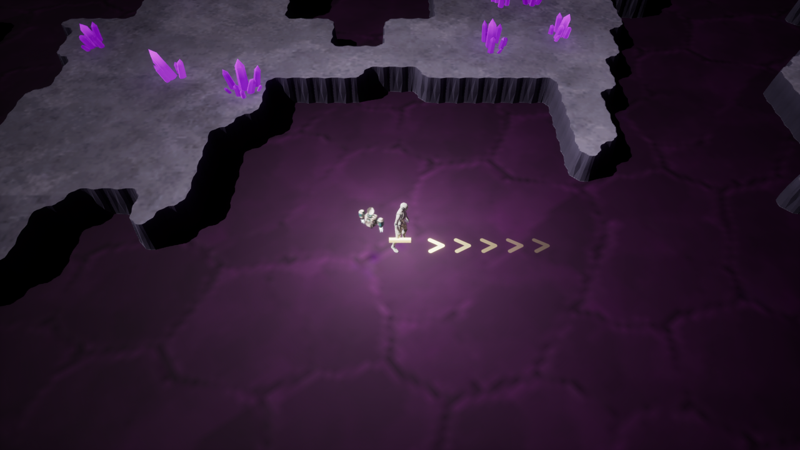](media/after-aim-chevrons.png) | [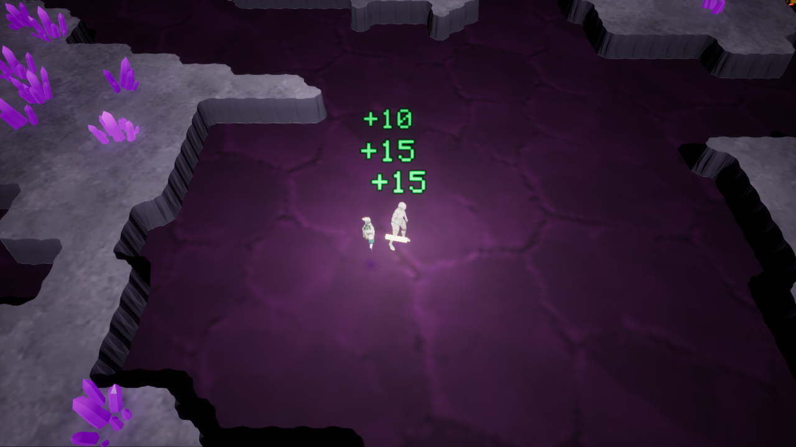](media/after-heal-number.png) |

## Level up, reroll, shop and stats screens

**Before** (00:54 and 04:08). A level-up shows three cards and a free `Reroll`; the end of a level is a grey placeholder screen with two ore lines and a disabled `Shop opens later` button.

| Before, free reroll | Before, end of level (04:08) |
|---|---|
| [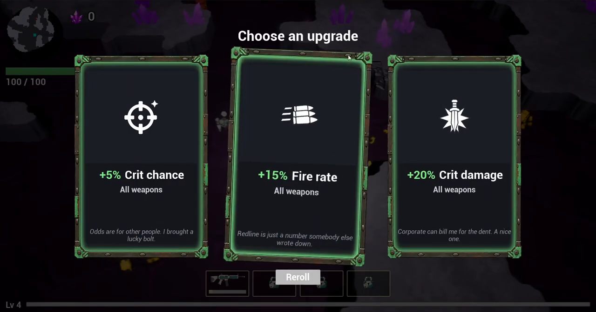](media/before-reroll.png) | [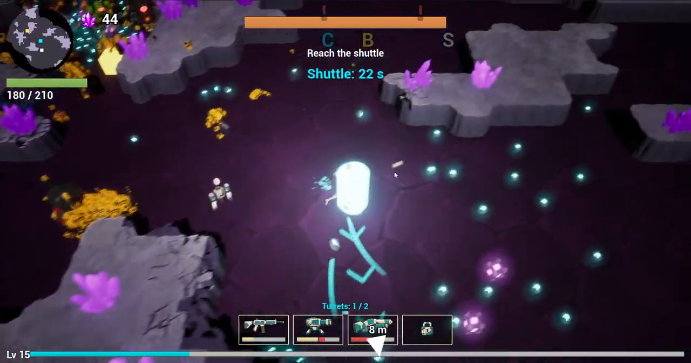](media/before-endscreen.png) |

**After.** Reroll costs Duskite ore: 15, plus 5 for each further reroll without a level-up (315). The end of a level is split into two screens, a stats screen and a shop (317). The shop sells 5 upgrade cards priced by rarity with an escalating reroll (316). The ore is never reset between levels, so the miner spends his whole run total (340). A bought card plays the level-up burn and shows a sold look (344), the Buy button has its own press reaction (343) and ore flies from the counter to the button (342). The next level loads during the shop (318), and after the first intermission level-ups no longer offer cards (319, a bug found by a test). The shop was then rebuilt to the owner's ChatGPT mockup (348, 351 to 357), on a Root Canvas with anchors so it adapts to the screen ratio (356, 357); the stats screen was rebuilt the same way, with frame and divider sprites generated through Kie.ai as 9-slice (378, 380, 381, 383, 385).

| After, paid reroll (315) | After, stats screen (381, 383) | After, shop screen (348, 356) |
|---|---|---|
| [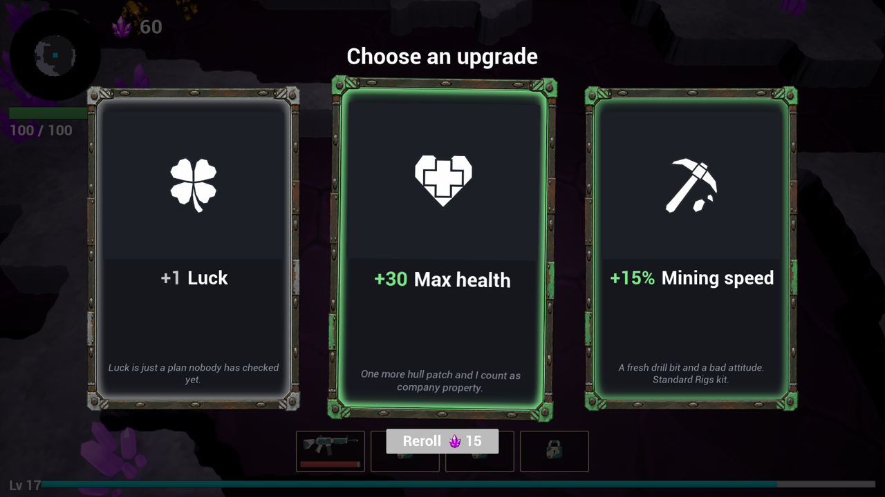](media/after-reroll.png) |  | [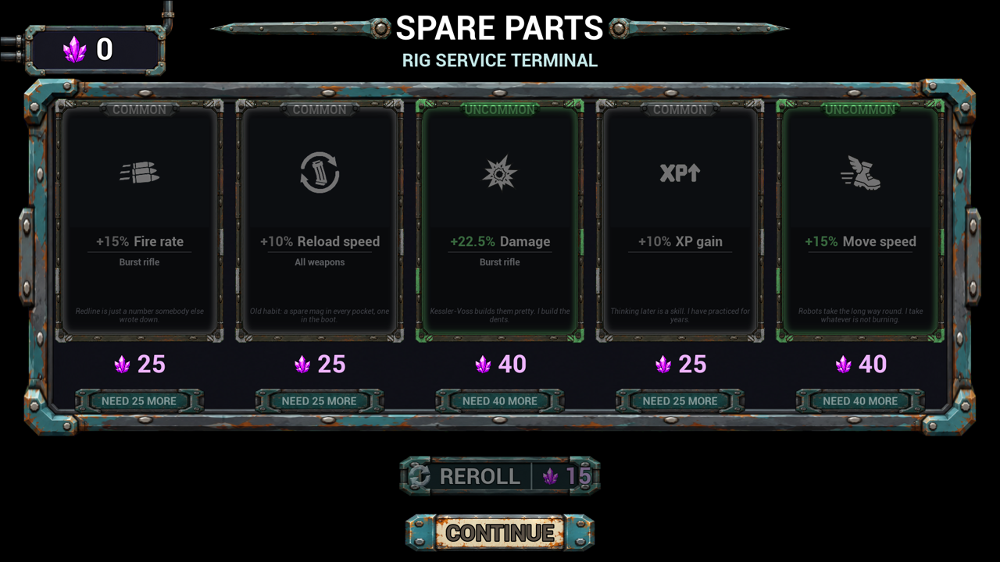](media/after-shop.png) |

## Extractor and level transitions

**Before** (03:52–04:00). The shuttle is a white disc on the ground; walking into it opens the end screen at once.

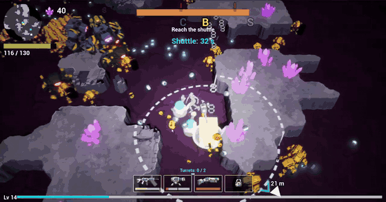

**After.** The owner's Meshy quadrotor ("Rustwing") is decimated and its flat faces flattened (366), split into body and four rotors (367) and re-baked with a new unwrap (368). In game it shows as the extraction shuttle (369), takes off like a helicopter when the miner touches it (370), and at level start waits beside the miner and leaves after the fade-in (371). Its rotors spin on opposite diagonals, slower on the ground (373), with a rotor-wash effect under each (374). It is scaled ×4 (375), clears the rock under its footprint plus a margin (372, 376), and the level ends when the miner enters a resizable box component instead of a 12-cell radius (377). New Run now shows a loading screen with an animated image until level 1 is ready (365, 379).

| After, re-baked extractor mesh (368) |
|---|
| [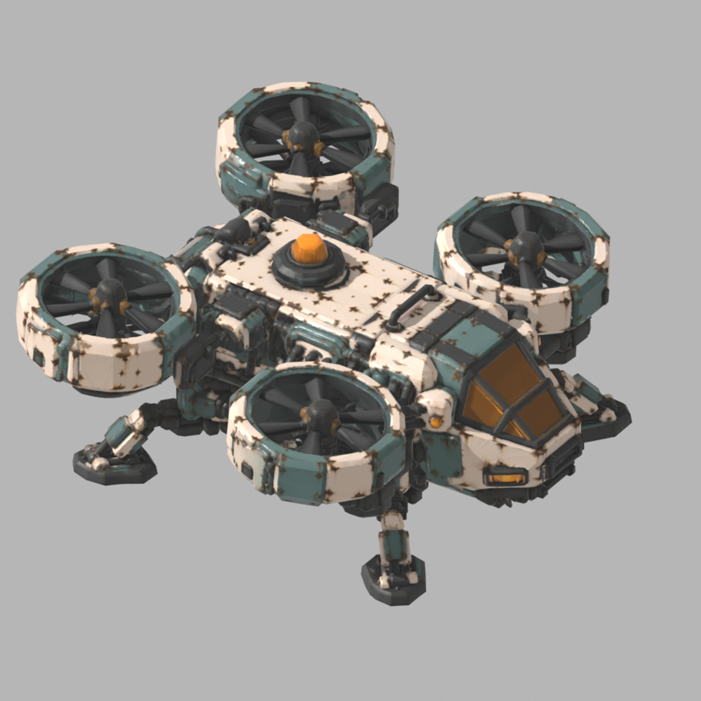](media/after-extractor-mesh.png) |

## What changed, by area

| Area | Tasks | Change |
|---|---|---|
| Robots | 297 to 300 | Heavy death puff; shooter charge-up glow at the cannon tip during the 0.6 s targeting laser; kamikaze body shakes during its fuse; dust ring and rock chips when the heavy slam lands (the owner kept the light beige-tan dust as is) |
| Console | 301 to 305, 311 to 313 | C2 mesh, state visuals, hack reward, marked-rock range, 10 s hack, 50 % bigger, zone colour, drone at the socket |
| Chest | 306 to 310 | Flat Meshy mesh in three parts, one upgrade choice, lock light, opening sequence, shared camera shake; 314 (lid logo) not done |
| Shop and economy | 315 to 319, 340 to 344, 348, 351 to 357 | Paid reroll, intermission shop, stats then cards, preload of the next level, ore carried through the run, buy and burn effects, redesign and anchors |
| Level end screens | 378 to 385 | Prompt and mockup archive, frame and divider sprites, rebuilt `WBP_Intermission`, one `Total Ore` line, caption lines allowed in `screen_texts.json` (384, subtitle lines, cancelled when the owner validated the screen) |
| Extractor | 366 to 377 | Mesh, rotors, takeoff, arrival, rock clearing, rotor spin and wash, ×4 scale, board box |
| Turret | 345 to 347, 349, 350 | Meshy turret canon, flat surfaces, cut into fixed base and yaw head, placed turret turns toward its target and shots leave the canon |
| World and menus | 332 to 339, 365, 379 | Space background, asteroids, main menu, loading screen, packaged-build fix for New Run |
| HUD and feedback | 324, 328 to 331 | Heal numbers, aim chevrons |
| Crew and process | 320 to 323, 325 to 327, 358 to 363 | `task-start.js` and a `started` timestamp to flag stale tasks; `cancelled` and `wait-answers` statuses; `doc` agent; units ceiling for the cost alert; short subtask paths; planner cost cut by a script for all-defaults answers; capture tooling and `capture` agent; `bp` cost cut; agents resolve wikilinks with `path-of.js`; shared Blender module `rr_blender.py` |
| Miner animation | 382, 386 | Rigged Meshy miner saved and measured; the Mixamo animation task went through an idle, run and directions blendspace but showed a T-pose in motion and was cancelled on Oct 30 to be redone |

Task records: [`vault/reference/tasks/`](../../vault/reference/tasks/).
