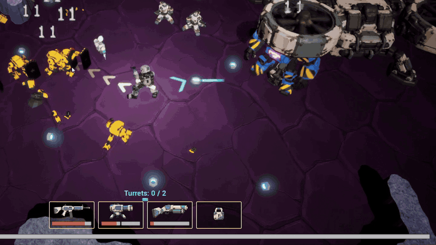
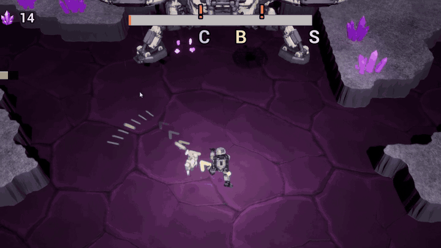
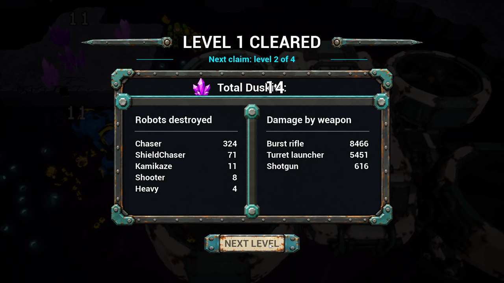
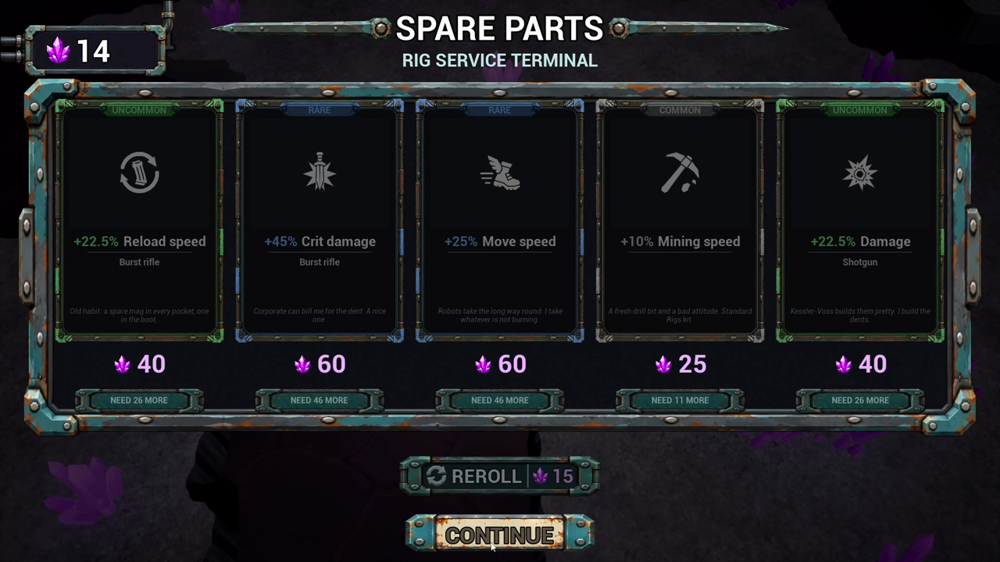
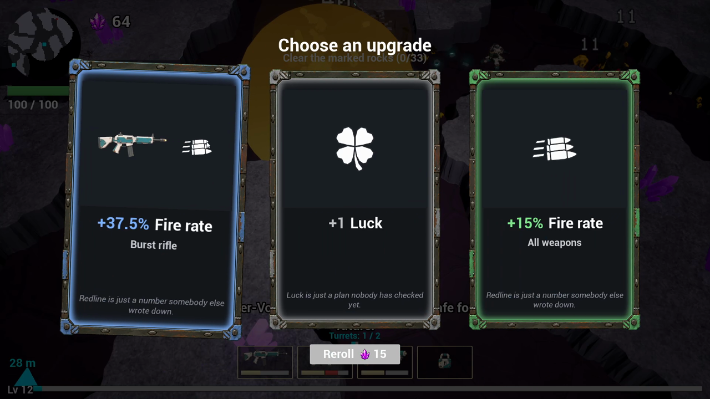
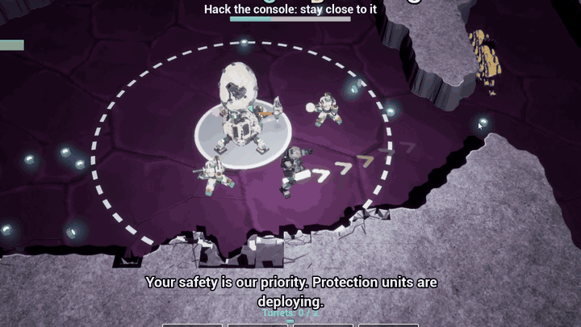
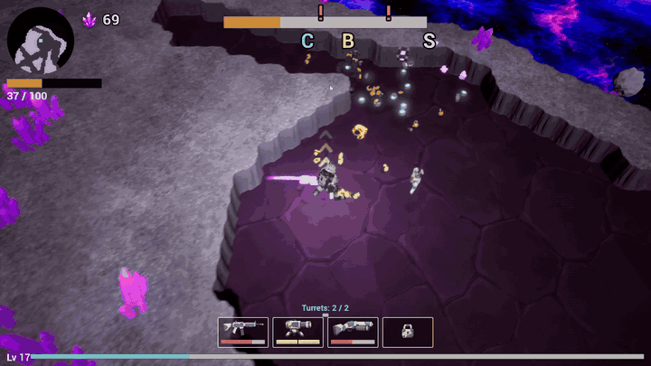
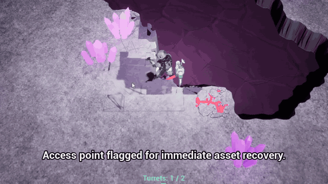
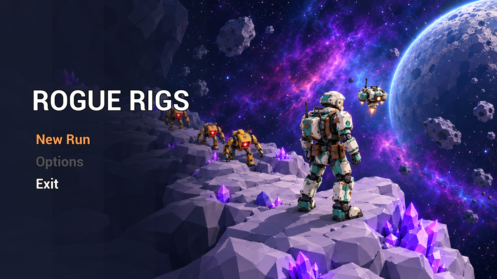

# Week 4 — 2026-10-23 to 2026-10-30

⬅️ [Week 3](../week-03/) · [Devlog](../)

The objective console became a modelled C2 uplink mast and the bonus chest a real chest that slams open. The run now has a shape around it. Between two levels the miner sells and buys upgrades on a **Spare Parts** shop screen, paying in Duskite. The game opens on a main menu. The extraction shuttle became a real Meshy model, four times bigger, with four spinning rotors, that lands to drop the miner and takes off again. The void around the arena is a layered nebula with floating asteroids. The turret, the miner and the burst rifle were rebuilt from Meshy meshes. Behind that, the crew learned to cost less per task: statuses are set by scripts, a `doc` agent and a `capture` agent were added, and the planner and the `bp` agent were slimmed down.

| | |
|---|---|
| Commits | 961 |
| Tasks | 297 to 405: 108 global tasks (102 done, 6 cancelled: 333, 354, 384, 386, 395, 405) and about 324 subtasks. 314 (yellow mark on the chest lid) is still to do |
| Not in this log | 406 to 408 (miner upper body layer and right arm), started in the night of Oct 30 to 31: they belong to week 5 |
| Crew | + `doc` (task 325, Oct 27), + `capture` (task 360, Oct 29) |
| Course | No submission this week (Assignment 6 went in on Oct 20, tag [`a6-submission`](https://github.com/soumois/RogueRigs/tree/a6-submission)) |

## Captures from the run of 2026-10-30

One run recorded on Friday at 16:01, from level 1 to the end of level 4 (player level 25). The game is in the state of that afternoon: the miner is the Meshy model without a rifle in the hand yet (that came at 19:42, task 400). Timecodes refer to the recording.

**Reaching the extractor** (03:49–03:57). The shuttle countdown, the locator arrow and the aim chevrons lead through the horde to the new extractor, a Meshy quadrotor with its four rotors cut out of the body so they can spin (tasks 366–369, 373). It is four times bigger than the first version, and the end-of-level zone is now a box the owner resizes in `BP_ExtractionShuttle` (tasks 375, 377). Touching it ends the level: the stats screen opens, the miner disappears and the extractor takes off behind it (task 370).

**Arrival on the next level** (04:08–04:14). The black clears, the miner stands beside the extractor, and as soon as the fade-in ends it takes off and leaves the screen (task 371). The ground under its footprint and a margin around it is cleared of rock, and the ore or heal pickups of the destroyed blocks stay on the floor (tasks 372, 376). The extractor no longer shows at its start spot behind the stats, shop and upgrade screens (task 397).

**End-of-level stats screen** (03:59). Rebuilt to the ChatGPT mockup with 9-slice frame sprites made with Kie.ai (tasks 378–381): robots destroyed on the left, damage by weapon on the right, one *Total Duskite* line (task 383). On the level 4 extraction the button leads to the run-won screen and then back to the main menu (tasks 317, 390). The number is drawn over the end of its label in this capture; it was fixed that same afternoon (task 399).

**Spare Parts shop** (04:04). A second screen after the stats: five upgrade cards priced by rarity (common 25, uncommon 40, rare 60), an escalating *Reroll* and *Continue* (task 316). The balance is the Duskite the miner holds, carried from level to level and spent here (tasks 340, 391). A card he cannot afford says *NEED n MORE* on its plate (task 353). The screen follows the owner's ChatGPT mockup and sits on a canvas with anchors so it adapts to other resolutions (tasks 348, 351–357). While this screen is up, the next level loads in the background, and *Continue* fades into it, or shows a loading screen if it is not ready (task 318).

**Paid reroll** (05:22). The level-up cards cost Duskite to reroll: 15, plus 5 for each further reroll without a level-up (task 315). Since the first intermission the level-up cards come back as before (task 319, a regression found by a test).

**Console hack** (05:46–05:54). The console is the owner's C2 uplink mast with a mobile dish head (task 301), 50 % bigger and set only on a free 3 × 3 footprint (task 311). Its lamp, dish rotation and screen colour show its state (task 302). The hack takes 10 s (task 305). The zone colour stays on the ground, so the console, miner and drone are no longer washed out (task 312), and the drone hovers in front of the console's data socket while it hacks (task 313). When the hack ends, three big XP chips fly out with a green ring flash (task 303). The console lands only where its zone holds 10 to 40 markable rocks (task 304).

**Void, nebula and drifting asteroids** (08:44–08:50). When the miner digs to the edge of the arena slab, the void behind it is no longer flat: layered tileable space textures at several depths with real parallax, procedural stars on top (tasks 332, 335), and low-poly asteroids floating nearer the camera than the nebula (task 334). The white-gold chevrons in front of the miner show where he aims and fade with distance, with sharp outlines (tasks 328–331).

**Heal number** (09:04–09:09). A green `+15` rises above the miner when he picks up a heal pickup, drawn like the damage numbers; the health bar goes from 82 to 97 (task 324). The heal drops are red crystal chunks, three Blender-made variants chosen at random (tasks 336, 339).

**Main menu**. The game opens on a key-art screen generated through Kie.ai and picked by the owner: *New Run*, *Options* (placeholder) and *Exit* (tasks 337, 338). *New Run* shows a loading screen until level 1 is ready (task 379). This is a capture from the crew's capture agent, not from the recording.

## What changed, by area

| Area | Tasks | Change |
|---|---|---|
| Console and chest | 301–313 | C2 mast mesh with state visuals; bigger, free 3 × 3 footprint; 10 s hack; zone colour off the console; drone at the data socket; hack reward chips; marked-rock range 10 to 40. Chest: Meshy mesh flattened and cut into body, lid and latch; exactly one upgrade choice on opening; lock light red, orange, green; latch, lid slam with overshoot, shake, inner light, ring and chips; shared camera shake class |
| Robot effects | 297–300 | Own death puff for the heavy; red charge-up at the shooter cannon; shaking kamikaze fuse; dust ring and rock chips on the heavy slam |
| Economy and shop | 315–319, 340–344, 348, 351–357, 391, 392, 396 | Paid reroll; intermission shop with five priced cards, escalating reroll and *Continue*; stats screen and shop as two screens; next level preloaded behind the shop; Duskite carried over the whole run (every run starts at 0) and every on-screen ore number is the balance held; every player-facing "Ore" reads "Duskite"; ore crystals fly from the counter to a bought card, the Buy button reacts, and the card burns as in the level-up pick; shop screen rebuilt to the mockup on anchors |
| Extractor | 366–377, 397 | Meshy mesh decimated, its flat faces flattened and its texture re-baked; four rotors cut out and spinning (slower on the ground, faster in flight) with a rotor wash; shown at the exit, takes off behind the stats; arrival at level start; rock cleared under and around it; scaled ×4 with a box zone; never shows again behind the screens |
| Turret | 345–350 | The owner's two Meshy zips sorted by triangle count; canon rebuilt with real holes; flat surfaces restored; mesh cut into a fixed base and a head that yaws toward its target, shots leaving the canon |
| Miner and rifle | 364, 382, 387, 393, 394, 400–404 | Turnaround prompts for the miner and the burst rifle; rigged Meshy miner saved and measured; blown highlights cut with the material scale; rifle flattened, imported and held in a right-hand socket with the left hand on the handguard by IK; cream-white material fixed by clearing an override; rifle position set by the owner. The Mixamo animation task (386) and the rifle re-bake (395) were cancelled |
| Background and feedback | 324, 328–336, 339 | Layered void background and drifting asteroids; aim chevrons with distance fade; green heal number; red heal chunk meshes |
| Menus and screens | 337, 338, 365, 378–381, 383, 385, 388–390, 398, 399 | Main menu and its key art; fix for *New Run* doing nothing in the packaged build (the map was missing from the cook); loading screen; stats screen rebuilt; Main Menu button after a won run; nothing of the chest or of dead robots left in the next level; black backdrop behind the shop; stats number moved beside its label |
| Crew and process | 320–327, 358–363, 402 | `task-start.js`, a `started` field, a `cancelled` status and a `wait-answers` status, so the crew board shows what is live; task and subtask paths printed by the scripts; `doc` agent writing the vault pages from the executor brief; `capture` agent running `-game` captures from a checklist; planner answered with one script on "ok"; `bp` agent batches its MCP calls; agents resolve links with `path-of.js`; shared Blender module for the `3d` agent; capture tooling with crops and comparison sheets; capture fix for the Git Bash path rewrite |

Not shown in the recording: the chest opening (tasks 306–310), the buy animation of the shop (tasks 342–344), the turret close up, and the miner with the rifle in hand, which came after it. Task 314 (chest lid mark) is still open.
