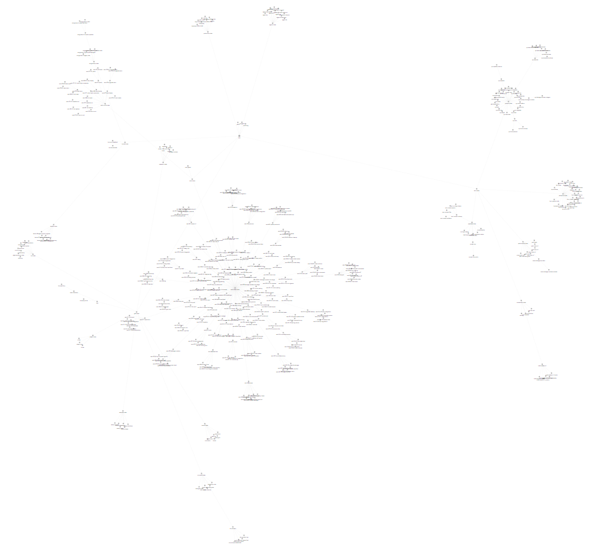
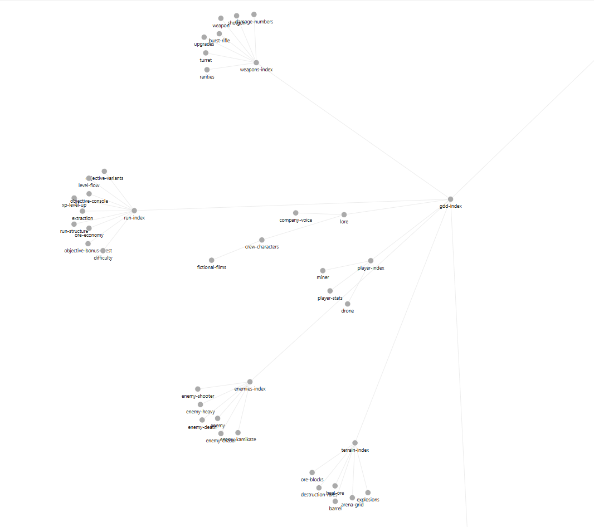

# Rogue Rigs vault

The vault is the single source of truth of *Rogue Rigs*, a top-down roguelite auto-shooter built with Unreal Engine 5.8 (C++ first): game design, technical docs, agent specs, every task the AI crew has run, and the course material. It is plain Markdown with YAML frontmatter, so any Claude account or other AI tool can read and write it. The game itself runs no AI: the vault and its agents are development tools only.

State on 2026-11-03: 436 nodes (per `lint.js`) plus about 1,100 task and subtask files. 426 global tasks have been run (422 archived as done, 1 still open).

## Where to start

| You are | Read |
|---|---|
| An AI agent | [`root.md`](root.md), then [`_navigation.md`](_navigation.md). Follow them strictly. |
| About to write or edit a node | [`_authoring.md`](_authoring.md) first. |
| A human browsing | This file, then [`root.md`](root.md) or the Obsidian view below. |

The main project README (repository root) presents the game, the crew and the course assignments; this file explains the vault itself.

## How it is organised

The vault is a tree. Each node has one `parent`; indexes (`*-index`) are pure routers that list their children with a gloss saying what the child holds and when to open it.

| Branch | Entry node | Holds |
|---|---|---|
| Game design | [`gdd-index`](reference/gdd/gdd-index.md) | pillars, glossary, lore, run structure, player, weapons, enemies, terrain, art and audio. Says WHAT the game does. |
| Dev crew | [`agents-index`](reference/agents/agents-index.md) | one spec per agent, the orchestration protocol, runbook and lessons. |
| Technical | [`tech-index`](reference/tech/tech-index.md) | conventions, C++ systems, one doc per Blueprint, pipelines, performance. Says HOW it is built. |
| Production | [`production-index`](reference/production/production-index.md) | milestones, scope, wishlist of cut ideas, cost log, handovers between sessions. |
| Tasks | [`tasks-index`](reference/tasks/tasks-index.md) | open tasks ([`tasks-to-do-index`](reference/tasks/tasks-to-do-index.md)) and the archive of finished ones ([`tasks-done-index`](reference/tasks/tasks-done-index.md)). |
| Course | [`course-index`](reference/course/course-index.md) | ELVTR course frame, assignments with briefs and plans, instructor feedback, lesson summaries. |
| External tools | [`external-tools-index`](reference/external-tools/external-tools-index.md) | tools built around the project, outside the game and the crew workflow: the crew board mod. |

A code task reads the `gdd` node first (what), then the `tech` node (how). The map with live node counts is generated in the main README (`node vault/scripts/vault-map.js`).

Other folders: [`assets/`](assets/) holds the validated reference images (turnarounds, key art, in-game checks), [`templates/`](templates/) the node templates, [`scripts/`](scripts/) the tooling.

## Reading rules (descent, never search)

1. Start at `root.md`, pick the branch from its routing table by the OBJECT of the task.
2. Descend through each index's `## Children`; say in one clause what you expect from a node before opening it.
3. Never locate a node by grep, glob or full-text search, and never build a path by analogy. Resolve a `[[wikilink]]` from a directory listing, from [`_paths.md`](_paths.md) (generated id to path map) or with `node vault/scripts/path-of.js <id>`.
4. If descent does not reach the node, stop and report the trajectory: a failed descent is a defect in the tree.
5. A value marked `open` is undecided: report it, never invent it.

Exception: during a confirmed task, the Executor opens task and subtask nodes directly from the paths printed by the task scripts.

## Writing rules

- One concept per node, about 400 words at most, in English. `id` equals the file name.
- Frontmatter: `id`, `description` (one sentence, 25 words max), `parent`, `kind` (`note`, `rule`, `spec`, `doc`, `task`), plus `status` for specs and tasks.
- End with `## Relations` and link both ends (`parent` and the parent's `## Children`).
- A fact lives in one place and is linked elsewhere. Game values held in a CSV under `Content/RogueRigs/Data/Tables/` live only there; a gdd node cites the file and row, never the number.
- Every Blueprint has a doc node in `tech/blueprints/`; a task that changes a Blueprint is not done until the doc is updated.
- No secrets, no orphans.
- After any edit: `node vault/scripts/lint.js --write` (checks links, parents, statuses, sizes and regenerates `_paths.md`), fix what it reports, then commit. A pre-commit hook runs the lint once `git config core.hooksPath vault/scripts/hooks` is set.

## The crew and the tasks

An owner request typed as `/task <request>` flows through files in the vault:

1. The **Planner** checks the request against the GDD, asks the owner its questions, and writes a global task node with its subtasks.
2. The owner confirms. One fresh **Executor** per global task then delegates each subtask to a specialised agent: `cpp`, `bp`, `capture`, `doc`, `level-design`, `text`, `style-guide`, `art`, `3d`.
3. Each subtask has `done_when` checks; its tokens go to the cost log, and the result is committed. Status and `next_step` live in the nodes, so another session or account can resume after a usage limit (see the handovers in `production`).

Agents never talk to each other: every hand-off is a file. Specs are in `reference/agents/`; the step-by-step procedure is [`orchestration-protocol`](reference/agents/orchestration-protocol.md).

## Scripts

All in [`scripts/`](scripts/), run from the repository root with Node.

| Script | Use |
|---|---|
| `lint.js` | check every invariant, regenerate `_paths.md` (`--write`) |
| `path-of.js` | exact id to path |
| `vault-map.js` | regenerate the map and node counts in the READMEs |
| `task-create.js` | write the nodes of a planning pass from a spec |
| `task-confirm.js` | apply an all-defaults owner answer without resuming the planner |
| `task-start.js`, `task-next.js` | start a confirmed task; close a subtask, record its cost, start the next, commit |
| `task-status.js` | set a task's status, `next_step` or `result`; keeps the task indexes in sync |
| `task-quiet.js` | shared helper that keeps only actionable output |
| `agent-usage.js`, `record-cost.js`, `cost-rates.json` | read Claude Code transcripts and add each subtask's cost to `cost-log` |
| `crew-board.js` | render the crew dashboard (agents, queue, costs) |

## Browse it in Obsidian

Open the `vault/` folder as a vault. The Parent Graph plugin ships in `.obsidian/plugins/parent-graph`: enable community plugins, then click the fork icon in the ribbon to see the tree drawn from each node's `parent` field.

| The whole vault (Parent Graph view) | Zoom on the game design branch |
|---|---|
|  |  |
